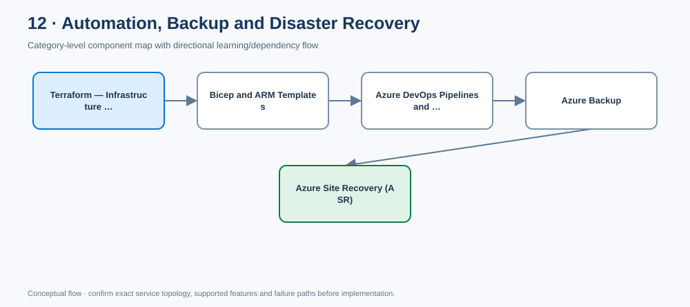

# Category 12 — Automation, Backup and Disaster Recovery

- [Edit diagram in draw.io](architecture.drawio) · [Mermaid source](architecture.mmd)

## Component completion tracker

Use this checklist to review every component page. Mark an item complete only when content is present and verified; if an item is not applicable, record why.

- [ ] Component-specific purpose, architecture placement, use cases and alternatives
- [ ] Real Azure design details, not generic placeholder paragraphs
- [ ] Identity, access, security, governance and data protection
- [ ] Network design and private connectivity where applicable
- [ ] Availability, scaling, backup/DR, limits and failure modes where applicable
- [ ] Cost drivers, monitoring, operations and common mistakes
- [ ] Enterprise scenario and decision trade-offs
- [ ] Rendered Azure architecture diagram (SVG) and editable draw.io source
- [ ] Validated Terraform/Bicep or policy/configuration samples where appropriate
- [ ] Validation, deployment, output and cleanup steps where applicable
- [ ] Interview questions/model answers and LinkedIn-ready summary
- [ ] Current official Microsoft Learn references

**[Component architecture map](architecture.mmd)** — arrows show a typical dependency/learning flow, not a mandatory deployment order.

[← Master catalogue](../README.md) · [Machine-readable catalogue](../catalog.json)

This is the **complete category page** for infrastructure delivery and business continuity. The key learning content is on this page; links to component files are optional deep dives and examples.

## Learning tracker — topics 72–76

- [ ] **72. Terraform** — declarative Infrastructure as Code, modules, state, plan/apply, drift and reusable provisioning.
- [ ] **73. Bicep and ARM Templates** — Azure-native deployment language, scopes, modules, parameters and what-if.
- [ ] **74. Azure DevOps Pipelines and GitHub Actions** — CI/CD, federated identity, approval gates, validation and deployment evidence.
- [ ] **75. Azure Backup** — policies, retention, protected vaults, restore operations and recovery validation.
- [ ] **76. Azure Site Recovery (ASR)** — replication, recovery plans, test failover, failover, reprotect and failback.

---

# 1. Reference enterprise architecture

~~~mermaid
flowchart TB
    Tenant[Microsoft Entra tenant] --> Root[Root management group]
    Root --> Platform[Platform management group]
    Root --> Landing[Landing zones management group]
    Platform --> Identity[Identity subscription]
    Platform --> Connectivity[Connectivity subscription]
    Platform --> Management[Management subscription]
    Landing --> Prod[Production subscription]
    Landing --> NonProd[Non-production subscription]
    Pipeline[CI/CD with federated workload identity] --> Validate[Validate / scan / plan or what-if]
    Validate --> Approve[Review and environment approval]
    Approve --> Deploy[Deploy approved infrastructure]
    Deploy --> Workload[Workload resources]
    Workload --> Backup[Azure Backup]
    Workload --> ASR[Azure Site Recovery]
    Backup --> Restore[Test restore and business validation]
    ASR --> Failover[Test / planned / unplanned failover]
~~~

This is illustrative, not a mandatory subscription layout. A management group is a governance scope above subscriptions; it does not replace a subscription. Actual hierarchy, deployment scope and recovery architecture depend on ownership, compliance, blast radius and RTO/RPO.

---

# 72. Terraform — Infrastructure as Code

## What it is and where it fits

Terraform declares desired infrastructure in configuration. The provider maps resources to Azure APIs; Terraform compares configuration, state and observed infrastructure to propose changes. It is well suited to repeatable provisioning, reusable modules and consistent environments.

## Core workflow

~~~mermaid
flowchart LR
    Git[Version-controlled configuration] --> Fmt[Format and validate]
    Fmt --> Scan[Security and policy scans]
    Scan --> Plan[Plan with protected state]
    Plan --> Review[Review replacement/destruction]
    Review --> Apply[Approved apply]
    Apply --> Verify[Smoke tests and drift checks]
~~~

## Production checklist

- [ ] Pin Terraform/provider versions and commit the provider lock file.
- [ ] Use a supported remote backend; protect state, access and locking.
- [ ] Remember state may contain sensitive values even if outputs are marked sensitive.
- [ ] Separate state and deployment permissions by environment/workload based on blast radius.
- [ ] Prefer OIDC/workload identity federation from CI where supported.
- [ ] Review replacements, data loss, RBAC scope, address changes and network exposure in every plan.
- [ ] Handle drift deliberately; do not blindly apply over unexplained production changes.
- [ ] Never commit `.tfstate`, secrets, secret-bearing variable files or sensitive generated plans.

## Actual starter example

A minimal, deployable pattern is included in [Terraform main.tf](./72-terraform/infra/main.tf), [variables.tf](./72-terraform/infra/variables.tf) and [example values](./72-terraform/infra/terraform.tfvars.example). It creates a resource group only; it is a learning baseline, not a full landing zone.

Validation sequence:

~~~bash
terraform fmt -check -recursive
terraform init -backend=false
terraform validate
terraform plan -var-file=terraform.tfvars
~~~

For production, configure the intended remote backend before planning. Do not apply until the plan is reviewed and the target subscription, permissions, cost and destructive actions are confirmed.

**When to choose Terraform:** cross-cloud or multi-provider estate, existing Terraform module ecosystem, or standardized Terraform workflows. For Azure-only workloads, compare it fairly with Bicep based on skills, governance and lifecycle requirements.

**Interview question:** How do you prevent unsafe Terraform changes?  
**Model answer:** Isolate and protect state, scope identities, pin versions, run validation/security checks, review plans, require environment approvals, monitor drift, protect branches and test recovery. Focus review on stateful resource replacement and identity/network changes.

---

# 73. Bicep and ARM Templates

## What they are and where they fit

Azure Resource Manager (ARM) is Azure's deployment and management control plane. ARM templates are JSON declarations. Bicep is a higher-level authoring language that compiles to ARM templates. Bicep is a strong Azure-native choice; ARM JSON is useful when generated or required by a tool or existing workflow.

## Scope matters

- **Resource group scope:** resources inside a resource group.
- **Subscription scope:** subscription-level resources and resource-group operations.
- **Management group scope:** governance deployment such as selected policy assignments.
- **Tenant scope:** selected tenant-level deployments.

A template's declared scope must match the operation being performed.

## Production checklist

- [ ] Use modules and parameters to separate reusable infrastructure from environment-specific values.
- [ ] Keep secrets out of source files, outputs and parameter files.
- [ ] Run build/lint/validation and ARM what-if before deployment.
- [ ] Understand incremental deployment behavior; omitted resources are not generally deleted merely because they are omitted. Complete mode and deployment-stack behaviors have distinct semantics.
- [ ] Validate policy, permissions, quotas, provider registration and runtime health after deployment.
- [ ] Use the narrowest deployment identity and scope that can perform the intended operation.

## Actual Bicep example

[main.bicep](./73-bicep-arm-templates/infra/main.bicep) and [parameter example](./73-bicep-arm-templates/infra/main.parameters.example.json) show a resource-group-scoped StorageV2 account baseline with HTTPS-only, TLS 1.2, no blob public access, shared-key access disabled and public network access disabled.

**Important:** Because public network access is disabled, clients need an approved private endpoint/network and DNS path before they can use the account. The sample does not create that private connectivity. Confirm SKU availability, redundancy support and feature requirements in the target region before deployment.

~~~bash
az bicep build --file infra/main.bicep
az bicep lint --file infra/main.bicep
az deployment group validate --resource-group <resource-group> --template-file infra/main.bicep --parameters @infra/main.parameters.example.json
az deployment group what-if --resource-group <resource-group> --template-file infra/main.bicep --parameters @infra/main.parameters.example.json
~~~

**When to choose Bicep:** Azure-focused teams seeking native ARM integration and Azure resource typing. Terraform may fit better when a common multi-provider workflow or established module estate matters more.

**Interview question:** Why isn't a successful ARM deployment enough?  
**Model answer:** ARM confirms deployment operations, not business health. Add policy/compliance checks, endpoint and identity tests, smoke tests, monitoring and rollback/forward-fix procedures.

---

# 74. Azure DevOps Pipelines and GitHub Actions

## What they do

Both systems orchestrate CI/CD. Use them to validate code, scan dependencies/configuration, plan infrastructure changes, gate production, deploy and preserve evidence. Select based on repository, enterprise governance, audit requirements, existing tools and team capability.

## Reference pipeline

~~~mermaid
flowchart TD
    PR[Pull request] --> Validate[Format / lint / validate]
    Validate --> Scan[Security and policy scans]
    Scan --> Plan[Terraform plan / ARM what-if]
    Plan --> Review[Review and required checks]
    Review --> Merge[Protected main branch]
    Merge --> Test[Deploy to test]
    Test --> Smoke[Smoke and integration tests]
    Smoke --> Gate[Production approval]
    Gate --> Prod[Deploy production]
    Prod --> Evidence[Health checks and deployment evidence]
    Identity[Federated workload identity] --> Test
    Identity --> Prod
~~~

## Production checklist

- [ ] Separate pull-request validation from deployment jobs.
- [ ] Prefer OIDC/workload identity federation over long-lived client secrets where supported.
- [ ] Scope federated trust to the intended organization/project/repository/branch/environment and validate claims.
- [ ] Give validation jobs no production deployment rights.
- [ ] Pin third-party GitHub Actions to full commit SHAs where practical; review external tasks/extensions.
- [ ] Protect branches and production environments; require independent approval for high-risk changes.
- [ ] Restrict Azure roles to the needed scope and actions.
- [ ] Prevent concurrent conflicting deployments; preserve artifacts and approval evidence.
- [ ] Never echo tokens, credentials, sensitive plans or state into logs.
- [ ] Run smoke tests and define rollback or forward-fix criteria.

**Interview question:** How do you build a secure infrastructure pipeline?  
**Model answer:** Protected PR checks, security scans, reviewed plan/what-if, federated identity, least-privilege roles, environment isolation and approvals, pinned dependencies, deployment evidence and post-deployment verification. Treat the pipeline identity as a privileged production principal.

---

# 75. Azure Backup

## What it is and what it is not

Azure Backup provides managed backup and restore for supported workloads. It addresses point-in-time recovery and retention; it does not replace high availability, application replication or a disaster recovery plan.

## Reference flow

~~~mermaid
flowchart TB
    Workload[Protected workload] --> Policy[Schedule and retention policy]
    Policy --> Vault[Supported Azure Backup vault]
    Vault --> Points[Recovery points]
    Points --> Alerts[Job status and compliance monitoring]
    Points --> Restore[Test restore / alternate target]
    Restore --> Validate[Data and application validation]
    Validate --> Evidence[Record achieved RTO/RPO and gaps]
~~~

## Design checklist

- [ ] Choose Recovery Services vault or Backup vault based on the exact workload and supported protection pattern; do not assume vault capabilities are interchangeable.
- [ ] Define frequency and retention from business RPO, legal retention and recovery needs.
- [ ] Evaluate supported soft delete, immutability, multi-user authorization and cross-region/cross-subscription restore features.
- [ ] Separate backup administration from production workload administration where possible.
- [ ] Monitor protection coverage, job failures, stale recovery points, retention and storage cost.
- [ ] Test restores to an isolated or alternate target; verify dependencies, DNS, access, data integrity and business function.
- [ ] Define who can delete recovery points, disable protection or change retention.

## Restore runbook

1. Declare incident and identify the affected workload and acceptable recovery point.
2. Confirm vault access, approvals, clean target and dependency availability.
3. Restore using the supported recovery procedure.
4. Validate data consistency, identity, DNS, application health and business transactions.
5. Reconnect production traffic only after security and integrity checks.
6. Measure actual restore duration and data loss; record gaps and owners.

**Metrics:** protected-asset coverage, policy compliance, age of last usable recovery point, restore-test pass rate, measured restore time and storage cost.

**Interview question:** Why isn't backup-job success enough?  
**Model answer:** A successful job does not prove the recovery point is usable or the application can be restored. Recovery requires accessible backups, dependencies, a clean target, application validation and a rehearsed runbook. Measure restore success and achieved RTO/RPO.

---

# 76. Azure Site Recovery (ASR)

## What it is and what it is not

Azure Site Recovery orchestrates replication and recovery for supported workloads and source/target combinations. It is a disaster-recovery capability. Backup provides point-in-time recovery and retention; ASR focuses on recovering a workload in a recovery location. A workload may need both.

## Reference DR flow

~~~mermaid
flowchart LR
    Primary[Primary workload] --> Replication[ASR replication]
    Replication --> Target[Recovery location]
    Target --> Test[Test failover in isolated network]
    Test --> Validate[Validate application, DNS, identity and data]
    Primary --> Decision{Disaster declared?}
    Decision -->|No| Primary
    Decision -->|Yes| Failover[Execute recovery plan]
    Failover --> Service[Restore business service]
    Service --> Reprotect[Reprotect / failback]
~~~

## Design checklist

- [ ] Define RTO and RPO with business owners for each workload tier.
- [ ] Confirm supported source/target, region, operating system, storage, networking and licensing prerequisites.
- [ ] Plan target capacity, IP mapping, subnets, NSGs, routes, private endpoints, DNS, identity, certificates, secrets and external dependencies.
- [ ] Use recovery plans to order multi-tier applications; orchestration does not automatically guarantee application consistency.
- [ ] Run test failover in an isolated network without disrupting production.
- [ ] Distinguish planned failover, unplanned failover, reprotect and failback; assign decision authority and communications.
- [ ] Monitor replication health/lag and alert on unhealthy replication or configuration drift.
- [ ] Rehearse recovery and failback after meaningful architecture changes.

## DR exercise runbook

1. Confirm incident commander, workload owner, scope and success criteria.
2. Verify replication health and latest recovery point.
3. Confirm recovery-region quota, capacity, network, identity and required dependencies.
4. Execute test failover in isolation or follow approved failover procedure during a real incident.
5. Validate authentication, DNS, application transactions, data consistency and user access.
6. Measure time from declaration to business service restored (RTO) and data loss (RPO).
7. Test reprotect/failback assumptions when safe and supported.
8. Record evidence, gaps, accountable owners and remediation dates.

**Interview question:** How do you prove the DR design meets RTO/RPO?  
**Model answer:** Run scoped exercises and measure time to validated business service plus data loss from the recovery point. Test DNS, identity, dependencies and data/application consistency; compare results with objectives and track remediation. A diagram or configured replication alone is not proof.

---

## Cross-cutting architecture decisions

| Decision | Architect's action |
|---|---|
| Governance | Keep management group, subscription, resource group and resource roles distinct; policy and RBAC are complementary controls. |
| Identity | Prefer federated workload identity for CI/CD where supported; minimize privileges and secret lifetime. |
| Change safety | Validate, scan, plan/what-if, review and approve before production changes. |
| Recovery | Choose backup, replication or both from business RPO/RTO, retention and workload support. |
| Resilience | Protect backups, IaC state and recovery controls from the same administrative blast radius where possible. |
| Evidence | Preserve deployment, approval, backup, restore and DR exercise evidence. |
| Cost | Include pipeline agents, logs, state storage, protected data, retention, replicated capacity and recovery-region resources. |

## Definition of done

- [ ] Code/configuration validated and peer-reviewed.
- [ ] Identity, permissions, state/vault security and environment boundaries documented.
- [ ] Plan/what-if reviewed; deployment and cleanup steps tested in a sandbox.
- [ ] Backup coverage and restore test proven for applicable workloads.
- [ ] DR test failover and RTO/RPO measurement completed where applicable.
- [ ] Runbooks, monitoring, owners and follow-up actions recorded.

## Official references

- [Terraform on Azure](https://learn.microsoft.com/azure/developer/terraform/)
- [Bicep documentation](https://learn.microsoft.com/azure/azure-resource-manager/bicep/)
- [ARM templates](https://learn.microsoft.com/azure/azure-resource-manager/templates/)
- [GitHub Actions for Azure](https://learn.microsoft.com/azure/developer/github/github-actions)
- [Azure Pipelines](https://learn.microsoft.com/azure/devops/pipelines/)
- [Azure Backup](https://learn.microsoft.com/azure/backup/)
- [Azure Site Recovery](https://learn.microsoft.com/azure/site-recovery/)

## Component dependency flow

The diagram includes every component in this catalog and shows a typical progression plus cross-cutting controls.

~~~mermaid
flowchart LR
  subgraph CAT12["12 · Automation Backup and Disaster Recovery"]
    n1["Terraform  Infrastructure as Code"]
    n2["Bicep and ARM Templates"]
    n1 --> n2
    n3["Azure DevOps Pipelines and GitHub Actions"]
    n2 --> n3
    n4["Azure Backup"]
    n3 --> n4
    n5["Azure Site Recovery ASR"]
    n4 --> n5
  end
  Identity[Entra ID / RBAC] -. cross-cutting .-> n1
  Network[Network / DNS / private access] -. cross-cutting .-> n3
  Operations[Monitor / logs / cost] -. cross-cutting .-> n5
~~~
