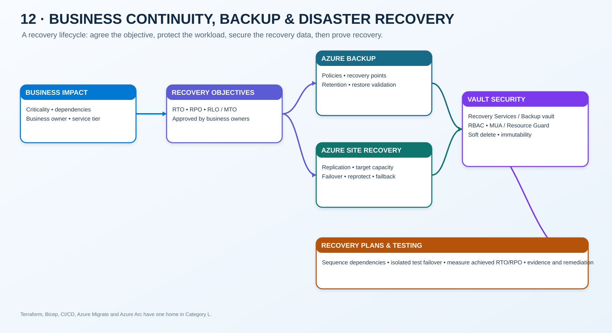

# 12. Business Continuity, Backup & Disaster Recovery

> This category is about keeping business services running through disruption and proving recovery. It is **not** the Infrastructure as Code or CI/CD category; those topics live in [L — DevOps, IaC, Migration & Hybrid Management](../L-devops-resilience-migration-ai/README.md).

  

- [Edit the category architecture in draw.io](architecture.drawio) · [Mermaid source](architecture.mmd)

[← Master catalogue](../README.md) · [Machine-readable catalogue](../catalog.json) · [Enterprise reference architecture](../AZURE-ENTERPRISE-REFERENCE-ARCHITECTURE.md)

## Category boundary

This category owns the **business recovery lifecycle**: strategy, business impact, recovery objectives, backup protection, restore proof, replication, failover and failback.

| Topic | What it owns | It does not duplicate |
|---|---|---|
| Business continuity strategy | Business service continuity, disruption scenarios, ownership and crisis governance | IaC pipelines or Azure product configuration |
| Workload criticality, BIA, RTO & RPO | Business impact, service tiers, tolerable outage and data-loss objectives | Backup schedules or ASR replication settings |
| Azure Backup & workload protection | Azure Backup service, supported workload protection and recovery points | Business continuity strategy or restore-exercise governance |
| Backup policy, retention & vault security | Policy design, retention, vault protection and separation of duties | General Key Vault or identity service fundamentals |
| Restore operations & recovery testing | Clean recovery targets, restore runbooks, application validation and test evidence | Replication-based regional failover |
| Azure Site Recovery & replication | ASR service, replication health and supported recovery targets | Backup retention and point-in-time restore |
| Recovery plans, failover & failback | Multi-tier recovery sequence, decision gates, network/DNS mapping and return to primary | Underlying ASR service configuration guide |

## Learning sequence

1. **Understand the business obligation:** identify critical services, impact and continuity requirements.
2. **Set measurable objectives:** agree service tier, RTO, RPO and dependency order.
3. **Choose protection:** select supported backup, replication or combined patterns per workload.
4. **Prove recovery:** restore to a clean target and validate data and application behavior.
5. **Exercise disaster recovery:** test failover, business acceptance, reprotect and failback.
6. **Improve continuously:** measure gaps, cost, test outcomes and changes in workload dependencies.

## Component catalogue

- [ ] **1. [Business Continuity & Disaster Recovery Strategy](77-business-continuity-disaster-recovery-strategy/README.md)**
- [ ] **2. [Workload Criticality, BIA, RTO & RPO](78-workload-criticality-bia-rto-rpo/README.md)**
- [ ] **3. [Azure Backup & Workload Protection](75-azure-backup/README.md)**
- [ ] **4. [Backup Policy, Retention & Vault Security](79-backup-policy-retention-vault-security/README.md)**
- [ ] **5. [Restore Operations & Recovery Testing](80-restore-operations-recovery-testing/README.md)**
- [ ] **6. [Azure Site Recovery & Replication](76-azure-site-recovery-asr/README.md)**
- [ ] **7. [Recovery Plans, Failover & Failback](81-recovery-plans-failover-failback/README.md)**

## Reference architecture principles

- Business service recovery is the success criterion; a green backup job or healthy replication status is not sufficient.
- RTO and RPO are business-approved targets and must be measured in exercises.
- Backup and replication solve different problems. Use each according to workload support and recovery objectives.
- Keep recovery credentials, vault administration and production administration separated where practical.
- Test in an isolated environment before connecting recovered workloads to production networks.
- Recovery plans must include identity, DNS, routing, certificates, secrets, external dependencies and application validation.
- Validate current workload support, region/SKU availability, quotas, vault features and service limits before production design.

## Quick decision guide

| Need | Start with | Architect's question |
|---|---|---|
| Recover deleted or corrupted data | Azure Backup | What recovery point, retention and clean target are required? |
| Recover a supported workload in another location | Azure Site Recovery | Does the exact source/target and region pattern meet RTO/RPO? |
| Decide how important a workload is | BIA and criticality | What is the business impact of outage or data loss? |
| Prove recovery is possible | Restore testing | Can the application be used after restore, not just mounted? |
| Recover multiple dependent tiers | Recovery plans | Are dependencies ordered and failback safe? |

## Related categories

- [L — DevOps, IaC, Migration & Hybrid Management](../L-devops-resilience-migration-ai/README.md)
- [K — Monitoring, Operations & Cost](../K-monitoring-operations-cost/README.md)
- [J — Security, Secrets & Governance](../J-security-secrets-governance/README.md)
- [C — Networking & Private Connectivity](../C-networking-private-connectivity/README.md)

## Official references

- [Azure Backup overview](https://learn.microsoft.com/en-us/azure/backup/backup-overview)
- [Azure Site Recovery overview](https://learn.microsoft.com/en-us/azure/site-recovery/site-recovery-overview)
- [Azure Well-Architected reliability](https://learn.microsoft.com/en-us/azure/well-architected/reliability/)
- [Mission-critical business continuity](https://learn.microsoft.com/en-us/azure/well-architected/mission-critical/mission-critical-business-continuity)
