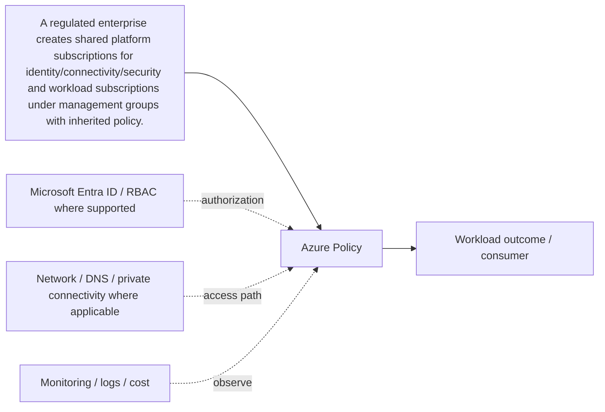

# Azure Policy

[← A. Cloud Foundation & Landing Zones](../README.md) · [← Master catalogue](../../README.md) · [Architecture diagram](architecture.mmd)

**Purpose.** Definitions describe conditions/effects; initiatives group policies; assignments apply at a scope. Start with audit, remediate existing drift, then enforce deny/modify/deploy-if-not-exists where supported and safe.

## Where it fits
establishes the cloud hierarchy, guardrails, placement and operational boundaries that workloads inherit. It interacts with upstream identity, governance and network decisions, and downstream workloads, data or operations depending on the selected pattern.

## When to use it
Use it before deploying production workloads or when defining enterprise-wide ownership, compliance and resource organization.

**Alternatives and trade-offs:** Compare alternative hierarchy and governance patterns against tenant boundaries, policy inheritance, ownership and billing requirements.

## Architecture design
The diagram is a component-level flow, showing the main source, component, consumer and cross-cutting controls. Dashed arrows indicate a governance, authorization, network, operations or resilience relationship rather than a mandatory packet path.

## Security and governance
Define tenant and subscription ownership, apply least-privilege Azure RBAC, assign policy at the right scope, and document approved exceptions.

## Network and connectivity
Confirm connectivity is planned at the platform level: address allocation, DNS, hybrid paths, private access and egress ownership.

## Availability, scale and recovery
Separate regional placement, zonal resilience, backup and disaster recovery; do not assume a hierarchy or policy control provides runtime availability.

## Cost and operations
Set subscription/resource ownership, budgets, tags, quota monitoring and chargeback rules before broad rollout.

## Enterprise scenario
A regulated enterprise creates shared platform subscriptions for identity/connectivity/security and workload subscriptions under management groups with inherited policy. For this component, document the exact scope, owner, dependencies, alert/runbook, rollback or recovery action, and the evidence that proves the design works.

## Implementation and validation
1. Confirm region/SKU/feature support, quota, naming rules and required permissions.
2. Review the component's architecture diagram and map each dependency to a real Azure resource or control.
3. Implement with the repository's Terraform/Bicep or configuration sample where available; use a policy/configuration sample rather than fake deployment code for conceptual governance topics.
4. Review Terraform plan or Bicep `what-if`; verify scope, identity, network access and cost before deployment.
5. Validate allowed and denied access, DNS/routing where applicable, telemetry, failure behavior and recovery.
6. Record expected outputs and operational ownership. Clean up only lab resources that are safe to delete; do not remove shared or production resources.

## Component-specific design note
Definitions describe conditions/effects; initiatives group policies; assignments apply at a scope. Start with audit, remediate existing drift, then enforce deny/modify/deploy-if-not-exists where supported and safe.

## Common mistakes
- Treating the component as a standalone solution without documenting dependencies.
- Assuming identity, private networking or redundancy automatically grants authorization or guarantees recovery.
- Skipping failure testing, telemetry, cost ownership and change/rollback planning.
- Deploying a generic sample without validating current SKU, region, API/provider version and service limits.

## Interview questions

**Q1. Where does Azure Policy fit in an Azure solution?**  
It implements one part of the larger cloud foundation & landing zones design. Explain its upstream dependencies, downstream consumers, identity and network boundaries, and how it is monitored and recovered.

**Q2. What trade-off drives the design?**  
Start with workload requirements and compare supported alternatives on security, operational burden, availability, scale, compliance and total cost. State the assumptions and test the critical failure mode.

## LinkedIn-ready summary
A strong Azure design explains not just what Azure Policy does, but where it fits, which identity and network boundaries apply, how failures are detected and recovered, and how cost is controlled. Architecture decisions should be validated with evidence—not assumptions. #Azure #CloudArchitecture #AzureSolutionsArchitect

## Official reference
- [Microsoft Learn: Azure Policy](<https://learn.microsoft.com/search/?terms=Azure%20Policy%20Azure>)
- [Azure Well-Architected Framework](https://learn.microsoft.com/azure/well-architected/)
