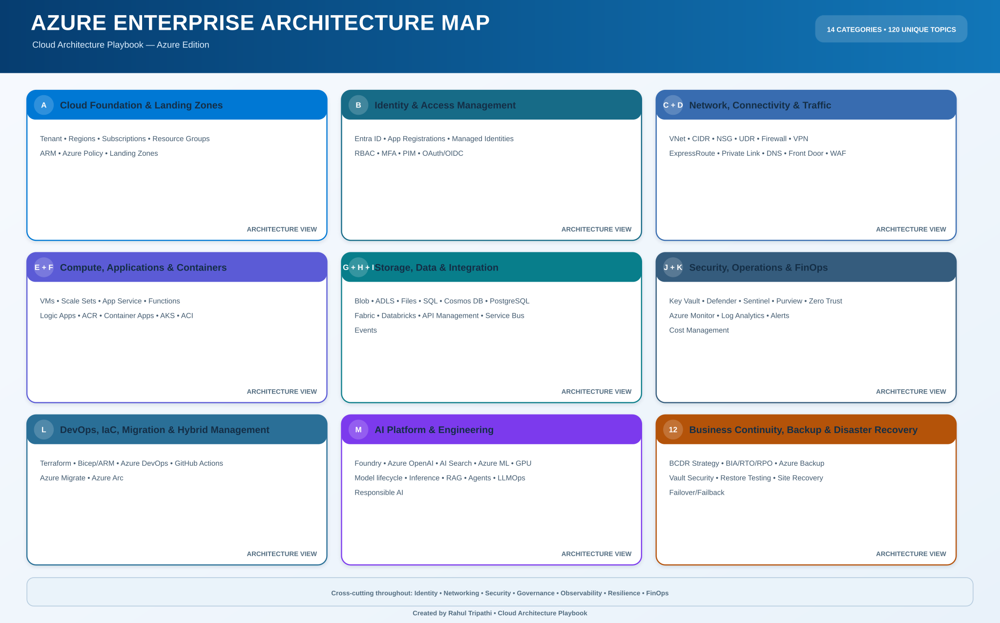

# Cloud Architecture Playbook — Architecture Map

> A linked architectural map of the Azure platform learning catalogue. Use it to navigate from the platform's foundational capabilities to workload services and cross-cutting engineering practices.

## How to read this map

- **Core catalogue:** the authoritative service/component guides in domains A–L. Every component page remains the source of detailed explanation, design decisions and implementation guidance.
- **Architecture lenses:** the ten views below group existing catalogue domains by the way architects reason about platforms. These are navigation groupings, not new service inventories.
- **AI specialization:** an advanced overlay built on compute, containers, data, identity, networking, security, observability and IaC. It does not imply that all example ecosystem tools are native Azure services.
- **Focused learning path:** [Domain 12 — Automation, Backup and Disaster Recovery](12-automation-backup-disaster-recovery/README.md) remains in the repository tracker. It intentionally repeats selected topics found in domain L, so it is not counted as additional unique components.

## Architecture lenses and navigation

### 01 • Cloud foundation & governance

Tenant, management groups, subscriptions, resource groups, Azure Policy, landing zones and Well-Architected design.

**Open the learning guides:** [A — Cloud Foundation & Landing Zones](A-cloud-foundation-landing-zones/README.md)

### 02 • Identity & security

Entra ID, app registrations, managed identities, RBAC, PIM, MFA, Key Vault, Defender, Sentinel and Zero Trust.

**Open the learning guides:** [B — Identity & Access Management](B-identity-access-management/README.md) · [J — Security, Secrets & Governance](J-security-secrets-governance/README.md)

### 03 • Network & private connectivity

VNet, subnet and CIDR planning, NSG, ASG, UDR, peering, Firewall, VPN, ExpressRoute, Private Link, private DNS and NAT.

**Open the learning guides:** [C — Networking & Private Connectivity](C-networking-private-connectivity/README.md)

### 04 • Traffic management & edge

Front Door, Application Gateway and WAF, Load Balancer, Traffic Manager, Bastion, DNS and DDoS protection.

**Open the learning guides:** [D — Traffic Management & Delivery](D-traffic-management-delivery/README.md)

### 05 • Compute & containers

VMs, disks, availability, scale sets, App Service, Functions, Logic Apps, Batch, ACR, Container Apps, AKS and ACI.

**Open the learning guides:** [E — Compute & Application Hosting](E-compute-application-hosting/README.md) · [F — Containers & Kubernetes](F-containers-kubernetes/README.md)

### 06 • Storage & data platforms

Storage Accounts, Blob, ADLS, Azure Files, redundancy, Azure SQL, Cosmos DB, PostgreSQL, MySQL, Redis, Data Factory, Databricks and Fabric.

**Open the learning guides:** [G — Storage & Enterprise File Services](G-storage-enterprise-file-services/README.md) · [H — Databases & Data Platforms](H-databases-data-platforms/README.md)

### 07 • Integration & API

API Management, Service Bus, Event Grid, Event Hubs, Stream Analytics and Data Explorer.

**Open the learning guides:** [I — Integration & API Management](I-integration-api-management/README.md)

### 08 • Operations & FinOps

Azure Monitor, Log Analytics, Application Insights, alerts, Service Health, Resource Graph, Cost Management, Advisor and Automation.

**Open the learning guides:** [K — Monitoring, Operations & Cost](K-monitoring-operations-cost/README.md)

### 09 • DevOps, IaC & resilience

Terraform, Bicep/ARM, Azure DevOps, GitHub Actions, Backup, Site Recovery, migration and Azure Arc.

**Open the learning guides:** [L — DevOps, Resilience, Migration & AI](L-devops-resilience-migration-ai/README.md)

### 10 • AI platform & infrastructure specialization

AI services, Foundry, Azure OpenAI and AI Search, GPU capacity, model deployment, inference serving, RAG, evaluation, LLMOps, AI security and AI observability. Advanced roadmap—not counted as a separate existing catalogue category.

**Open the learning guides:** [L — DevOps, Resilience, Migration & AI](L-devops-resilience-migration-ai/README.md)

## AI infrastructure specialization

- [M — AI Platform & Engineering](M-ai-platform-engineering/README.md)
 — suggested progression

This is an extension path, not part of the current 106 unique component count. Use the existing Vault guides for the Azure platform prerequisites and add specialist labs as they are authored.

1. **AI workload foundations:** Linux, Python, networking, storage, containers, Kubernetes, Terraform and CI/CD.
2. **AI compute and acceleration:** GPU-capable compute, accelerator drivers/runtime, capacity/quota planning, node pools, scheduling and utilization economics.
3. **Model lifecycle:** model sources and registries, artifact storage, versioning, deployment patterns, endpoints, rollout and rollback.
4. **Inference serving:** batching, concurrency, caching, latency/throughput trade-offs, autoscaling and serving frameworks such as vLLM or KServe where supported.
5. **Data and RAG:** ingestion, chunking, embeddings, vector/hybrid search, retrieval evaluation, access-aware retrieval and data governance.
6. **AI applications and agents:** tool calling, workflow orchestration, MCP integration, human approvals and bounded execution.
7. **LLMOps and observability:** quality evaluation, token/latency/cost telemetry, traces, drift, prompt/model version tracking and incident response.
8. **AI security and responsible operations:** identity, private networking, secrets, data protection, prompt-injection controls, output validation, auditability and abuse prevention.

### Design boundaries

- Separate the **Azure service catalogue** from the **vendor-neutral AI ecosystem**. For example, Kubernetes is an orchestration layer; vLLM and KServe are ecosystem serving technologies, not Azure-managed services by default.
- Choose managed services where they meet requirements; use self-managed frameworks only when control, portability or workload characteristics justify operational overhead.
- Validate current region, SKU, GPU-family availability, quotas, service support and pricing before committing to a design.
- Define workload objectives first: latency, throughput, availability, data residency, privacy, model quality, RTO/RPO and cost per request.
- AI does not remove platform engineering requirements. Identity, network, data, security, observability and FinOps remain foundational.

## Reference architecture and learning projects

- [Enterprise Azure reference architecture](AZURE-ENTERPRISE-REFERENCE-ARCHITECTURE.md)
- [Visual architecture library](ARCHITECTURE-MAPS.md)
- [LittleNest hands-on reference implementation](littlenest-azure-reference/README.md)
- [Machine-readable component catalogue](catalog.json)

## Catalogue accounting

The current machine-readable catalogue declares **111 entries across 13 categories**. Domains A–L contain **106 unique core entries**. Domain 12 contains five focused learning-path entries that intentionally overlap with domain L. Treat these as 106 unique catalogue subjects plus five cross-listed pathway entries—not 111 unique services.
