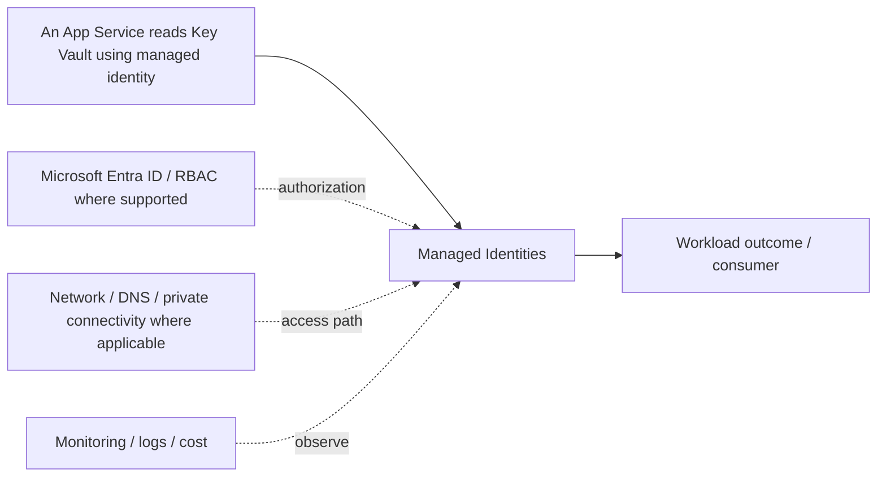

# Managed Identities

[← B. Identity & Access Management](../README.md) · [← Master catalogue](../../README.md) · [Architecture diagram](architecture.mmd)

**Purpose.** System-assigned identity lifecycle follows its Azure resource; user-assigned identity is separately managed and can be attached to supported resources. Grant target data-plane roles explicitly; identity creation grants no access by itself.

## Where it fits
defines how users, applications and workloads authenticate and how permissions are granted to Azure or APIs. It interacts with upstream identity, governance and network decisions, and downstream workloads, data or operations depending on the selected pattern.

## When to use it
Use it to establish identity boundaries, secure application-to-service access, govern privileged roles and reduce standing credentials.

**Alternatives and trade-offs:** Compare managed identity, federated identity and application credentials based on hosting support and credential lifecycle; distinguish authentication from authorization.

## Architecture design
The diagram is a component-level flow, showing the main source, component, consumer and cross-cutting controls. Dashed arrows indicate a governance, authorization, network, operations or resilience relationship rather than a mandatory packet path.

## Security and governance
Use MFA and Conditional Access for appropriate interactive access, PIM for privileged access, managed identity/federation for workloads, and least-privilege roles.

## Network and connectivity
Identity controls do not replace network controls; verify endpoints, private access, DNS and conditional access requirements independently.

## Availability, scale and recovery
Document emergency access, credential/certificate expiry, identity dependencies and monitoring for failed or suspicious sign-ins.

## Cost and operations
Review licensing requirements for Conditional Access/PIM and avoid unnecessary premium features; measure operational cost of credential rotation.

## Enterprise scenario
An App Service reads Key Vault using managed identity, while administrators use group-based RBAC and eligible privileged roles activated through PIM. For this component, document the exact scope, owner, dependencies, alert/runbook, rollback or recovery action, and the evidence that proves the design works.

## Implementation and validation
1. Confirm region/SKU/feature support, quota, naming rules and required permissions.
2. Review the component's architecture diagram and map each dependency to a real Azure resource or control.
3. Implement with the repository's Terraform/Bicep or configuration sample where available; use a policy/configuration sample rather than fake deployment code for conceptual governance topics.
4. Review Terraform plan or Bicep `what-if`; verify scope, identity, network access and cost before deployment.
5. Validate allowed and denied access, DNS/routing where applicable, telemetry, failure behavior and recovery.
6. Record expected outputs and operational ownership. Clean up only lab resources that are safe to delete; do not remove shared or production resources.

## Component-specific design note
System-assigned identity lifecycle follows its Azure resource; user-assigned identity is separately managed and can be attached to supported resources. Grant target data-plane roles explicitly; identity creation grants no access by itself.

## Common mistakes
- Treating the component as a standalone solution without documenting dependencies.
- Assuming identity, private networking or redundancy automatically grants authorization or guarantees recovery.
- Skipping failure testing, telemetry, cost ownership and change/rollback planning.
- Deploying a generic sample without validating current SKU, region, API/provider version and service limits.

## Interview questions

**Q1. Where does Managed Identities fit in an Azure solution?**  
It implements one part of the larger identity & access management design. Explain its upstream dependencies, downstream consumers, identity and network boundaries, and how it is monitored and recovered.

**Q2. What trade-off drives the design?**  
Start with workload requirements and compare supported alternatives on security, operational burden, availability, scale, compliance and total cost. State the assumptions and test the critical failure mode.

## LinkedIn-ready summary
A strong Azure design explains not just what Managed Identities does, but where it fits, which identity and network boundaries apply, how failures are detected and recovered, and how cost is controlled. Architecture decisions should be validated with evidence—not assumptions. #Azure #CloudArchitecture #AzureSolutionsArchitect

## Official reference
- [Microsoft Learn: Managed Identities](<https://learn.microsoft.com/search/?terms=Managed%20Identities%20Azure>)
- [Azure Well-Architected Framework](https://learn.microsoft.com/azure/well-architected/)
