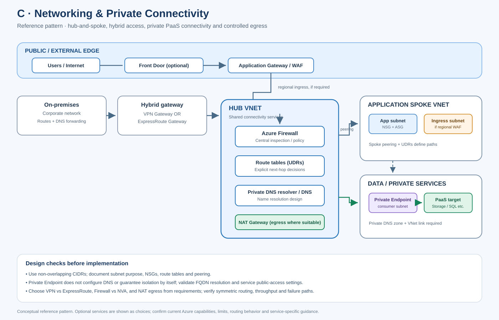

# C. Networking & Private Connectivity

- [Edit diagram in draw.io](architecture.drawio) · [Mermaid source](architecture.mmd)

## Component completion tracker

Use this checklist to review every component page. Mark an item complete only when content is present and verified; if an item is not applicable, record why.

- [ ] Component-specific purpose, architecture placement, use cases and alternatives
- [ ] Real Azure design details, not generic placeholder paragraphs
- [ ] Identity, access, security, governance and data protection
- [ ] Network design and private connectivity where applicable
- [ ] Availability, scaling, backup/DR, limits and failure modes where applicable
- [ ] Cost drivers, monitoring, operations and common mistakes
- [ ] Enterprise scenario and decision trade-offs
- [ ] Rendered Azure architecture diagram (SVG) and editable draw.io source
- [ ] Validated Terraform/Bicep or policy/configuration samples where appropriate
- [ ] Validation, deployment, output and cleanup steps where applicable
- [ ] Interview questions/model answers and LinkedIn-ready summary
- [ ] Current official Microsoft Learn references

**[Component architecture map](architecture.mmd)** — arrows show a typical dependency/learning flow, not a mandatory deployment order.

[← Master catalogue](../README.md) · [Machine-readable catalogue](../catalog.json)

This page keeps the core networking concepts together. Design the traffic path and trust boundaries first, then select Azure services that implement them.

## Category checklist
- [ ] Plan non-overlapping address spaces and subnet boundaries
- [ ] Explain NSGs vs ASGs vs Azure Firewall
- [ ] Design peering, UDRs and hub-spoke/VWAN routing
- [ ] Compare VPN Gateway with ExpressRoute
- [ ] Design Private Link, Private Endpoints and Private DNS end-to-end
- [ ] Explain NAT Gateway and outbound connectivity
- [ ] Validate routing symmetry, DNS resolution and failover
- [ ] Test and observe actual traffic paths

## Reference enterprise network

~~~mermaid
flowchart TB
    OnPrem[On-premises network] --> Hybrid{VPN Gateway or ExpressRoute}
    Hybrid --> Hub[Hub VNet / connectivity hub]
    Hub --> Firewall[Azure Firewall / central inspection]
    Hub <--> SpokeA[Application spoke VNet]
    Hub <--> SpokeB[Data spoke VNet]
    App[Application subnet] --> NSG[NSG rules]
    NSG --> PE[Private Endpoint subnet]
    PE --> PLS[Private Link service target]
    DNS[Private DNS zone and links] --> PE
    NAT[NAT Gateway] --> Internet[Approved outbound internet]
~~~

Illustrative design only. Exact routing depends on topology, appliance insertion, peering flags, route tables, DNS, service support and security requirements.

---

## C1. Virtual Networks (VNet)

A VNet is a private IP address space and connectivity boundary for Azure resources. It enables subnetting, routing, peering, hybrid connectivity and private endpoints. It is not automatically a firewall; effective security also depends on NSGs, routes, firewalls and service-level controls.

**Design checklist**
- [ ] Choose address space that does not overlap on-premises, partner or other cloud networks.
- [ ] Plan growth, peering, VPN/ExpressRoute and future mergers before assigning CIDRs.
- [ ] Separate workloads/subnets based on traffic and operational boundaries.
- [ ] Document default/system routes and any custom route tables.
- [ ] Use private DNS and private endpoints deliberately; test from every required client network.

## C2. Subnets and CIDR planning

Subnets divide a VNet address space. Azure reserves some IP addresses in each subnet, and some services require dedicated subnets or minimum sizes. Check the current service-specific requirements before finalizing CIDR allocations.

**Practical rules**
- Build an IPAM plan covering regions, environments, spokes, on-premises and future growth.
- Avoid overlapping CIDRs because they complicate peering and hybrid routing.
- Reserve ranges for gateways, firewall appliances, private endpoints and managed services according to current requirements.
- Document ownership and allocation source; do not let each project allocate addresses independently.

## C3. Network Security Groups (NSGs)

NSGs filter inbound and outbound network traffic using prioritized rules based on source/destination, port and protocol. They are stateful. Default rules exist, so review effective rules rather than assuming only custom rules apply.

**Use NSGs for:** subnet/NIC-level distributed filtering and basic segmentation.  
**Not a replacement for:** centralized application-aware firewall inspection, web application protection or service identity authorization.

**Checklist**
- [ ] Start with required flows; use narrow source/destination/port rules.
- [ ] Review priority conflicts and default rules.
- [ ] Use service tags where appropriate; verify the tag's documented meaning.
- [ ] Enable NSG flow logging/traffic analytics where supported and needed.
- [ ] Validate effective security rules and test denied/allowed paths.

## C4. Application Security Groups (ASGs)

ASGs let you group VM network interfaces by application role and use those groups in NSG rules instead of hardcoding every IP. They improve rule readability for supported VM NIC scenarios but do not replace NSGs or a firewall.

**Use when:** VM-tier rules should follow roles such as web, app and database as instances change.  
**Checklist:** keep group names aligned with workload roles; avoid overly broad rules; confirm supported resources and regional behavior.

## C5. VNet Peering

VNet peering connects VNets over Microsoft's backbone with low-latency private connectivity. Peering is not transitive by default: A-to-B and B-to-C do not automatically create A-to-C connectivity.

**Design considerations**
- Ensure address spaces do not overlap.
- Configure both sides and review forwarded traffic/gateway transit requirements.
- Peering does not automatically mean all traffic traverses a hub firewall.
- Use UDRs and supported appliance/peering settings when central inspection is required.
- Plan peering scale and operational complexity; consider Virtual WAN for larger distributed networks.

## C6. User-Defined Routes (UDRs)

Route tables override or influence effective routing for subnet traffic. A UDR can send traffic to a virtual appliance, virtual network gateway, internet or other supported next hop.

**Checklist**
- [ ] Draw the expected forward and return path.
- [ ] Avoid asymmetric routing when stateful firewalls/NVAs are involved.
- [ ] Validate system routes, BGP routes and UDR precedence/effective routes.
- [ ] Plan routes for private endpoints and hybrid networks carefully.
- [ ] Test failover when a next-hop appliance or gateway is unavailable.

## C7. Azure Firewall

Azure Firewall is a managed, centralized network security service with supported network/application rules, threat intelligence and other tier-dependent capabilities. It is commonly placed in a hub or secured virtual hub for controlled ingress/egress and east-west inspection.

**Design decisions**
- Select SKU/tier based on required features, throughput, TLS inspection needs and cost.
- Use policy and rule collections with explicit priority and ownership.
- Configure UDRs so the intended traffic actually traverses the firewall.
- Validate DNS, SNAT behavior, logging, availability and forced-tunneling requirements.
- Remember that firewall presence alone does not prove all traffic is inspected.

## C8. VPN Gateway

VPN Gateway provides encrypted connectivity over the internet using supported VPN protocols and configurations, commonly site-to-site, point-to-site or VNet-to-VNet.

**Use when:** encrypted connectivity is needed with internet transport and acceptable performance/availability.  
**Plan:** gateway SKU, tunnel redundancy, address overlap, routing/BGP, throughput, client addressing, authentication and failover. Validate route propagation and tunnel health during tests.

## C9. ExpressRoute

ExpressRoute provides private connectivity between on-premises environments and Microsoft cloud through connectivity providers/peering locations. It is not the same as an encrypted internet VPN, and private connectivity alone should not be treated as encryption for every traffic path.

**Use when:** predictable connectivity, enterprise hybrid integration or bandwidth/latency needs justify circuit and provider operations.  
**Plan:** provider/location, circuit and gateway sizing, BGP, route filters, redundancy across peering locations/providers, disaster recovery and cost. Consider VPN as backup where requirements support it.

## C10. Private Link and Private Endpoints

Private Link provides private connectivity to supported Azure services or customer-owned services. A private endpoint places a network interface with a private IP in a VNet for a specific target service/resource.

**Critical dependency:** private endpoint deployment is not the whole solution. DNS resolution must direct clients to the private endpoint IP from every required network, and public access must be controlled according to policy.

**Checklist**
- [ ] Confirm service/region/subresource support and approval requirements.
- [ ] Choose private endpoint subnet and address capacity.
- [ ] Configure the correct private DNS zone and VNet links/forwarding design.
- [ ] Test name resolution from Azure, peered VNets, on-premises and build agents as applicable.
- [ ] Decide whether public network access should be disabled.
- [ ] Monitor connection approval, DNS drift and connectivity failures.

## C11. Private DNS Zones

Azure Private DNS zones provide private name resolution for linked VNets. For private endpoints, the DNS zone name and record behavior depend on the target service. Centralized DNS may need forwarding/resolver architecture for on-premises and spoke networks.

**Checklist**
- [ ] Use the correct documented private DNS zone for the service.
- [ ] Link required VNets or design forwarding through a supported resolver.
- [ ] Avoid conflicting public/private records and stale manual records.
- [ ] Test from the actual client network; local DNS success does not prove hybrid DNS success.
- [ ] Document who owns zone links, records and changes.

## C12. NAT Gateway

NAT Gateway provides scalable, managed outbound internet connectivity for supported subnet workloads and uses associated public IP addresses/prefixes. It does not provide inbound connection initiation to private instances and is not a substitute for a firewall.

**Use when:** workloads need predictable scalable outbound SNAT without managing an NVA.  
**Checklist:** plan outbound public IP capacity, subnet association, interaction with other outbound methods, egress allow-listing, logs/monitoring and cost. Verify the effective outbound path rather than assuming NAT Gateway overrides every other routing/security mechanism.

---

## Troubleshooting sequence

1. Confirm source/destination IP, port, protocol and expected path.
2. Check effective routes and UDR/peering/gateway propagation.
3. Check NSG effective rules, firewall/NVA policy and appliance health.
4. Resolve DNS from the actual source network; inspect private endpoint records.
5. Verify service-side firewall/public access and private endpoint approval.
6. Review flow, firewall and platform diagnostics.
7. Test return path, failover path and the same flow after changes.

## Enterprise scenario

A three-tier application uses web, app and data subnets in a spoke VNet. NSGs enforce tier-to-tier rules; hub routing sends approved egress through Azure Firewall; a private endpoint connects to Storage or Key Vault; private DNS is linked or forwarded to every client network; NAT Gateway is used only where direct managed outbound SNAT is appropriate. On-premises connectivity uses VPN or ExpressRoute based on performance, availability and cost requirements. Validate every route and DNS path with tests and logs.

## Common mistakes
- Overlapping CIDRs between VNets and on-premises.
- Assuming peering is transitive or routes automatically traverse the firewall.
- Creating a private endpoint but leaving DNS unresolved or public access unintentionally open.
- Forgetting return routes and causing asymmetric traffic through stateful appliances.
- Treating NSGs as application-aware firewalls.
- Treating ExpressRoute as automatic end-to-end encryption.
- Deploying NAT Gateway without confirming the effective outbound path and public IP allow-list implications.

## Interview questions

**Q1. NSG vs Azure Firewall?** NSGs provide distributed L3/L4 filtering at subnet/NIC scope. Azure Firewall provides centralized managed firewall policy and supported application/network inspection features. They are complementary.

**Q2. VNet peering vs VPN?** Peering connects Azure VNets privately over Microsoft's backbone and is not transitive by default. VPN provides encrypted tunnel connectivity over the internet or between supported endpoints.

**Q3. Private endpoint works from one VNet but not on-premises. Why?** Check DNS forwarding/resolution, zone links, routing, firewall rules, address overlap, endpoint approval and client path. The private IP must resolve and be reachable from the source network.

**Q4. ExpressRoute vs VPN Gateway?** ExpressRoute uses a provider-backed private circuit and suits enterprise connectivity needs that justify its cost/operations. VPN Gateway provides encrypted tunnel connectivity over internet transport. Choose from performance, availability, security, topology and cost requirements.

## LinkedIn-ready post

Private connectivity is an end-to-end design, not a checkbox. A private endpoint needs correct DNS, routes, access controls and a tested client path. A firewall only inspects traffic routed through it. Document forward and return paths, prove effective rules, and test from the real network. #AzureNetworking #PrivateLink #CloudSecurity

## Official references
- [Azure Virtual Network](https://learn.microsoft.com/azure/virtual-network/virtual-networks-overview)
- [Network security groups](https://learn.microsoft.com/azure/virtual-network/network-security-groups-overview)
- [Azure Firewall](https://learn.microsoft.com/azure/firewall/overview)
- [VPN Gateway](https://learn.microsoft.com/azure/vpn-gateway/vpn-gateway-about-vpngateways)
- [ExpressRoute](https://learn.microsoft.com/azure/expressroute/expressroute-introduction)
- [Private Link](https://learn.microsoft.com/azure/private-link/private-link-overview)
- [NAT Gateway](https://learn.microsoft.com/azure/nat-gateway/nat-overview)

## Component dependency flow

The diagram includes every component in this catalog and shows a typical progression plus cross-cutting controls.

~~~mermaid
flowchart LR
  subgraph CATC["C · Networking and Private Connectivity"]
    n1["Virtual Networks VNet"]
    n2["Subnets and CIDR Planning"]
    n1 --> n2
    n3["Network Security Groups NSGs"]
    n2 --> n3
    n4["Application Security Groups ASGs"]
    n3 --> n4
    n5["VNet Peering"]
    n4 --> n5
    n6["User-Defined Routes UDRs"]
    n5 --> n6
    n7["Azure Firewall"]
    n6 --> n7
    n8["VPN Gateway"]
    n7 --> n8
    n9["ExpressRoute"]
    n8 --> n9
    n10["Private Link and Private Endpoints"]
    n9 --> n10
    n11["Private DNS Zones"]
    n10 --> n11
    n12["NAT Gateway"]
    n11 --> n12
  end
  Identity[Entra ID / RBAC] -. cross-cutting .-> n1
  Network[Network / DNS / private access] -. cross-cutting .-> n6
  Operations[Monitor / logs / cost] -. cross-cutting .-> n12
~~~
