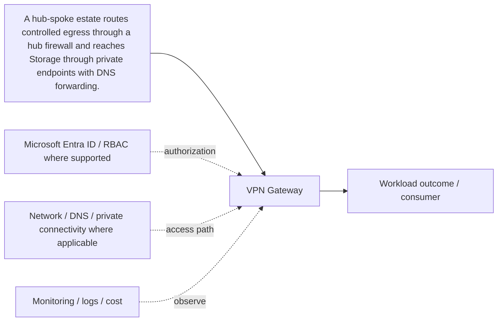

# VPN Gateway

[← C. Networking & Private Connectivity](../README.md) · [← Master catalogue](../../README.md) · [Architecture diagram](architecture.mmd)

**Purpose.** Treat this as a distinct architecture building block: define its contract, consumers, permissions, dependencies, failure behavior and operational owner. Confirm service limits and supported features against the linked Microsoft Learn documentation before production.

## Where it fits
provides address space, traffic paths, segmentation, hybrid connectivity and private service access. It interacts with upstream identity, governance and network decisions, and downstream workloads, data or operations depending on the selected pattern.

## When to use it
Use it to connect workloads with explicit trust boundaries and predictable routing, DNS and egress.

**Alternatives and trade-offs:** Compare native routing/security services against NVAs and hybrid options using traffic path, throughput, latency, inspection and operational burden.

## Architecture design
The diagram is a component-level flow, showing the main source, component, consumer and cross-cutting controls. Dashed arrows indicate a governance, authorization, network, operations or resilience relationship rather than a mandatory packet path.

## Security and governance
Use NSGs for distributed L3/L4 filtering, central firewall inspection where required, narrow public exposure, and service identity authorization in addition to network controls.

## Network and connectivity
Plan non-overlapping CIDRs, effective routes, peering/gateway transit, private DNS and forward/return paths; validate from the actual client network.

## Availability, scale and recovery
Design gateway/firewall/zone redundancy where supported, test route convergence and failover, and avoid asymmetric paths through stateful appliances.

## Cost and operations
Model gateway, firewall, NAT, public IP, private endpoint, egress and data processing charges; remove unused peerings and endpoints.

## Enterprise scenario
A hub-spoke estate routes controlled egress through a hub firewall and reaches Storage through private endpoints with DNS forwarding. For this component, document the exact scope, owner, dependencies, alert/runbook, rollback or recovery action, and the evidence that proves the design works.

## Implementation and validation
1. Confirm region/SKU/feature support, quota, naming rules and required permissions.
2. Review the component's architecture diagram and map each dependency to a real Azure resource or control.
3. Implement with the repository's Terraform/Bicep or configuration sample where available; use a policy/configuration sample rather than fake deployment code for conceptual governance topics.
4. Review Terraform plan or Bicep `what-if`; verify scope, identity, network access and cost before deployment.
5. Validate allowed and denied access, DNS/routing where applicable, telemetry, failure behavior and recovery.
6. Record expected outputs and operational ownership. Clean up only lab resources that are safe to delete; do not remove shared or production resources.

## Component-specific design note
Treat this as a distinct architecture building block: define its contract, consumers, permissions, dependencies, failure behavior and operational owner. Confirm service limits and supported features against the linked Microsoft Learn documentation before production.

## Common mistakes
- Treating the component as a standalone solution without documenting dependencies.
- Assuming identity, private networking or redundancy automatically grants authorization or guarantees recovery.
- Skipping failure testing, telemetry, cost ownership and change/rollback planning.
- Deploying a generic sample without validating current SKU, region, API/provider version and service limits.

## Interview questions

**Q1. Where does VPN Gateway fit in an Azure solution?**  
It implements one part of the larger networking & private connectivity design. Explain its upstream dependencies, downstream consumers, identity and network boundaries, and how it is monitored and recovered.

**Q2. What trade-off drives the design?**  
Start with workload requirements and compare supported alternatives on security, operational burden, availability, scale, compliance and total cost. State the assumptions and test the critical failure mode.

## LinkedIn-ready summary
A strong Azure design explains not just what VPN Gateway does, but where it fits, which identity and network boundaries apply, how failures are detected and recovered, and how cost is controlled. Architecture decisions should be validated with evidence—not assumptions. #Azure #CloudArchitecture #AzureSolutionsArchitect

## Official reference
- [Microsoft Learn: VPN Gateway](<https://learn.microsoft.com/search/?terms=VPN%20Gateway%20Azure>)
- [Azure Well-Architected Framework](https://learn.microsoft.com/azure/well-architected/)
