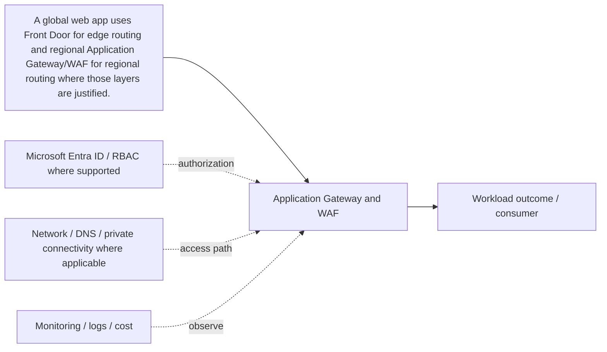

# Application Gateway & WAF

[← D. Traffic Management & Delivery](../README.md) · [← Master catalogue](../../README.md) · [Architecture diagram](architecture.mmd)

**Purpose.** A regional Layer 7 HTTP(S) gateway supports listeners, host/path routing, TLS and WAF options. Tune WAF with telemetry and confirm backend health/TLS and origin reachability.

## Where it fits
directs client traffic to healthy application endpoints and provides global or regional ingress controls. It interacts with upstream identity, governance and network decisions, and downstream workloads, data or operations depending on the selected pattern.

## When to use it
Use it when availability, regional/global routing, TLS termination, WAF, private administration or DNS hosting is required.

**Alternatives and trade-offs:** Compare Layer 4, regional Layer 7, global edge and DNS-based routing; choose only layers justified by explicit requirements.

## Architecture design
The diagram is a component-level flow, showing the main source, component, consumer and cross-cutting controls. Dashed arrows indicate a governance, authorization, network, operations or resilience relationship rather than a mandatory packet path.

## Security and governance
Restrict origins to intended entry points, configure TLS and WAF deliberately, protect admin paths with Bastion and avoid exposing management ports.

## Network and connectivity
Map DNS, health probes, frontend/backend ports, origin reachability, private connectivity and return traffic.

## Availability, scale and recovery
Test backend and regional failure, health probe accuracy, DNS caching, zone behavior and rollback; don't promise instant DNS failover.

## Cost and operations
Compare service tiers, WAF, bandwidth, request volume, public IPs and duplicate layers; only deploy each traffic component for a stated requirement.

## Enterprise scenario
A global web app uses Front Door for edge routing and regional Application Gateway/WAF for regional routing where those layers are justified. For this component, document the exact scope, owner, dependencies, alert/runbook, rollback or recovery action, and the evidence that proves the design works.

## Implementation and validation
1. Confirm region/SKU/feature support, quota, naming rules and required permissions.
2. Review the component's architecture diagram and map each dependency to a real Azure resource or control.
3. Implement with the repository's Terraform/Bicep or configuration sample where available; use a policy/configuration sample rather than fake deployment code for conceptual governance topics.
4. Review Terraform plan or Bicep `what-if`; verify scope, identity, network access and cost before deployment.
5. Validate allowed and denied access, DNS/routing where applicable, telemetry, failure behavior and recovery.
6. Record expected outputs and operational ownership. Clean up only lab resources that are safe to delete; do not remove shared or production resources.

## Component-specific design note
A regional Layer 7 HTTP(S) gateway supports listeners, host/path routing, TLS and WAF options. Tune WAF with telemetry and confirm backend health/TLS and origin reachability.

## Common mistakes
- Treating the component as a standalone solution without documenting dependencies.
- Assuming identity, private networking or redundancy automatically grants authorization or guarantees recovery.
- Skipping failure testing, telemetry, cost ownership and change/rollback planning.
- Deploying a generic sample without validating current SKU, region, API/provider version and service limits.

## Interview questions

**Q1. Where does Application Gateway & WAF fit in an Azure solution?**  
It implements one part of the larger traffic management & delivery design. Explain its upstream dependencies, downstream consumers, identity and network boundaries, and how it is monitored and recovered.

**Q2. What trade-off drives the design?**  
Start with workload requirements and compare supported alternatives on security, operational burden, availability, scale, compliance and total cost. State the assumptions and test the critical failure mode.

## LinkedIn-ready summary
A strong Azure design explains not just what Application Gateway & WAF does, but where it fits, which identity and network boundaries apply, how failures are detected and recovered, and how cost is controlled. Architecture decisions should be validated with evidence—not assumptions. #Azure #CloudArchitecture #AzureSolutionsArchitect

## Official reference
- [Microsoft Learn: Application Gateway & WAF](<https://learn.microsoft.com/search/?terms=Application%20Gateway%20%26%20WAF%20Azure>)
- [Azure Well-Architected Framework](https://learn.microsoft.com/azure/well-architected/)
