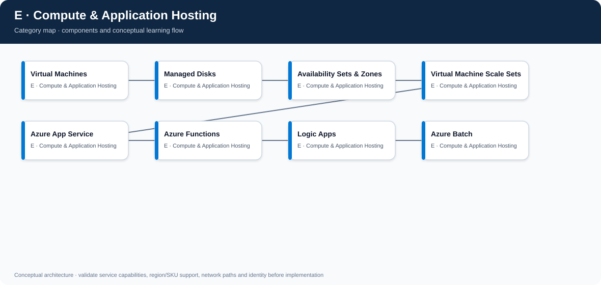

# E. Compute & Application Hosting

- [Edit diagram in draw.io](architecture.drawio) · [Mermaid source](architecture.mmd)

## Component completion tracker

Use this checklist to review every component page. Mark an item complete only when content is present and verified; if an item is not applicable, record why.

- [ ] Component-specific purpose, architecture placement, use cases and alternatives
- [ ] Real Azure design details, not generic placeholder paragraphs
- [ ] Identity, access, security, governance and data protection
- [ ] Network design and private connectivity where applicable
- [ ] Availability, scaling, backup/DR, limits and failure modes where applicable
- [ ] Cost drivers, monitoring, operations and common mistakes
- [ ] Enterprise scenario and decision trade-offs
- [ ] Rendered Azure architecture diagram (SVG) and editable draw.io source
- [ ] Validated Terraform/Bicep or policy/configuration samples where appropriate
- [ ] Validation, deployment, output and cleanup steps where applicable
- [ ] Interview questions/model answers and LinkedIn-ready summary
- [ ] Current official Microsoft Learn references

**[Component architecture map](architecture.mmd)** — arrows show a typical dependency/learning flow, not a mandatory deployment order.

[← Master catalogue](../README.md) · [Machine-readable catalogue](../catalog.json)

This page compares Azure compute models and explains operational responsibility, scaling, identity, network integration, resilience and cost.

## Checklist
- [ ] Choose IaaS VM vs managed PaaS vs serverless vs batch
- [ ] Design disks, availability zones, scale sets and patching
- [ ] Explain App Service deployment slots, identity and networking
- [ ] Explain Functions triggers, hosting plans, scaling and execution limits
- [ ] Explain Logic Apps connectors, workflow reliability and identity
- [ ] Choose Azure Batch for parallel/batch compute when appropriate
- [ ] Include monitoring, backup/DR, capacity and cost

## Compute decision path

~~~mermaid
flowchart TD
    NeedOS{Need OS / kernel control?}
    NeedOS -->|Yes| VM[Azure Virtual Machines]
    NeedOS -->|No| Event{Event-driven function?}
    Event -->|Yes| Functions[Azure Functions]
    Event -->|No| Web{Web/API application?}
    Web -->|Yes| AppService[Azure App Service]
    Web -->|No| Workflow{Orchestrated business workflow?}
    Workflow -->|Yes| Logic[Logic Apps]
    Workflow -->|No| Parallel{Large parallel batch?}
    Parallel -->|Yes| Batch[Azure Batch]
    Parallel -->|No| Review[Evaluate containers and other managed services]
~~~

This is a starting heuristic, not a hard rule. Compare runtime, scaling, control, dependencies, deployment model and operational cost.

## E1. Virtual Machines

IaaS compute provides control over OS, runtime, installed software and networking, while the customer owns much of OS patching, hardening, application runtime and backup configuration.

**Use when:** legacy software, custom OS requirements, specialized agents or control needs cannot be met by PaaS. Prefer managed PaaS when it meets requirements with lower operational burden.

**Checklist**
- [ ] Select VM family/size from CPU, memory, disk and network needs.
- [ ] Use managed disks and choose performance/redundancy based on workload.
- [ ] Apply patching, endpoint protection, least-privilege administration and monitoring.
- [ ] Avoid public SSH/RDP; use Bastion or approved access patterns.
- [ ] Define availability, backup, restore and DR; a VM alone is not a resilience design.
- [ ] Track utilization, reservations/savings options and idle capacity.

## E2. Managed Disks

Managed disks are block storage for Azure VMs. Disk types differ in performance, throughput, latency and cost; availability and redundancy options vary by type/region.

**Checklist:** size for IOPS/throughput and capacity; separate OS/data disks when useful; understand caching and host/disk limits; use snapshots/backup according to recovery requirements; monitor throttling and latency; validate encryption and disk performance settings.

## E3. Availability Sets and Zones

Availability Sets distribute supported VMs across fault/update domains within a datacenter-level arrangement; Availability Zones are physically separate locations within a supported region. They address different failure domains and have different service/architecture constraints.

**Checklist:** choose zones when supported and zonal failure protection is required; ensure the application and data tier are also resilient; use load balancing/health checks; verify capacity and region support; test zone failure assumptions. Neither choice replaces backups or regional DR.

## E4. Virtual Machine Scale Sets (VMSS)

VMSS manages a group of similar VM instances with scaling and orchestration capabilities. Use it for repeatable VM fleets, autoscaling or specialized workloads that need VM control.

**Checklist:** define scaling metrics and guardrails; use health extensions/probes; plan image updates and rolling upgrades; use zones where supported; avoid scaling solely on CPU if queue depth or latency is a better demand signal; validate quota and capacity.

## E5. Azure App Service

Managed hosting for web apps and APIs. Azure manages much of the underlying platform, while customers own application code, configuration, identity, network settings and app-level resilience.

**Design:** select plan/SKU for runtime, scaling, networking and availability; use deployment slots where supported for staged release; configure managed identity, TLS, logging, health checks, autoscale and private access as needed.

**Checklist**
- [ ] Separate app configuration by environment; never bake secrets into code.
- [ ] Use managed identity for supported Azure dependencies.
- [ ] Decide inbound private/public access and outbound VNet integration separately.
- [ ] Test slot swap, warm-up, database compatibility and rollback.
- [ ] Monitor latency, failures, dependencies and plan capacity.

## E6. Azure Functions

Serverless/event-driven compute for supported triggers and bindings. Hosting plan affects scaling, networking, execution behavior, cold starts, instance limits and cost.

**Use when:** event processing, scheduled tasks, lightweight APIs and integrations fit the Functions execution model. Avoid assuming every plan has identical limits or scale behavior.

**Checklist:** select a plan based on networking, duration, scale and startup needs; use managed identity; design idempotency and retries; configure poison/dead-letter handling where relevant; instrument dependencies; review timeout, concurrency and storage requirements.

## E7. Logic Apps

Managed workflow orchestration for integrations, approvals and business processes using triggers and connectors. Consumption/Standard and connector choices affect hosting, networking, isolation, availability and cost.

**Checklist:** choose hosting model and connector type; use managed identity where supported; handle retries, timeouts, duplicate events and idempotency; protect connector credentials; add run-history monitoring and alerting; design replay and failure handling.

## E8. Azure Batch

Managed job scheduling for large-scale parallel or high-performance batch workloads. You manage pools, node sizing/images, job/task dependencies and input/output data patterns while Batch coordinates execution.

**Checklist:** size pools from task concurrency and startup overhead; choose autoscale carefully; secure data access and node images; make tasks retry-safe; store logs and outputs; define quota, capacity, job failure and cost controls.

---

## Cross-cutting production checklist

- [ ] Identity: use managed identity where supported and grant only required roles.
- [ ] Network: document ingress, egress, private connectivity, DNS and administrative access.
- [ ] Reliability: define health checks, autoscale, zones, backup and DR according to RTO/RPO.
- [ ] Operations: metrics, logs, traces, alert ownership, patching and runbooks.
- [ ] Delivery: infrastructure as code, staged releases, smoke tests and rollback/forward-fix.
- [ ] Cost: model compute uptime, storage, data transfer, logs, reservations/savings and idle resources.

## Enterprise scenario

A company hosts a customer API and background processing. App Service hosts the API with managed identity and staged deployment slots; Functions handles asynchronous events; a queue decouples workload spikes; VMSS is used only for a legacy processor needing OS-level control. Monitoring, autoscale and recovery are designed per workload rather than assuming one compute service fits everything.

## Common mistakes
- Selecting VMs when a managed service would meet requirements.
- Treating availability zones as a complete backup/DR plan.
- Autoscaling on the wrong signal or without quota/capacity checks.
- Keeping secrets in application configuration or images.
- Ignoring runtime/plan-specific Functions and App Service limits.
- Failing to test deployment-slot swaps or retry/idempotency behavior.

## Interview questions
**Q1. App Service vs VM?** App Service reduces OS/platform operations for supported web workloads; VM offers greater OS/runtime control but requires more patching, hardening and lifecycle management.

**Q2. Availability zone vs availability set?** Zones are separate physical locations within a region; availability sets distribute VMs across fault/update domains within the supported datacenter arrangement. Pick based on required failure domain and service support.

**Q3. Functions vs Logic Apps?** Functions are code-centric event-driven compute; Logic Apps are workflow/orchestration-centric with managed connectors. They can complement each other.

## LinkedIn-ready post
The best Azure compute choice is the one that meets workload requirements with the least unnecessary operational burden. Compare control, runtime, scale, networking, identity, resilience, observability and cost. Use VMs when control is necessary—not by default. #AzureCompute #CloudArchitecture #PlatformEngineering

## Official references
- [Virtual Machines](https://learn.microsoft.com/azure/virtual-machines/overview)
- [App Service](https://learn.microsoft.com/azure/app-service/overview)
- [Azure Functions](https://learn.microsoft.com/azure/azure-functions/functions-overview)
- [Logic Apps](https://learn.microsoft.com/azure/logic-apps/logic-apps-overview)
- [Azure Batch](https://learn.microsoft.com/azure/batch/batch-technical-overview)

## Component dependency flow

The diagram includes every component in this catalog and shows a typical progression plus cross-cutting controls.

~~~mermaid
flowchart LR
  subgraph CATE["E · Compute and Application Hosting"]
    n1["Virtual Machines"]
    n2["Managed Disks"]
    n1 --> n2
    n3["Availability Sets and Zones"]
    n2 --> n3
    n4["Virtual Machine Scale Sets"]
    n3 --> n4
    n5["Azure App Service"]
    n4 --> n5
    n6["Azure Functions"]
    n5 --> n6
    n7["Logic Apps"]
    n6 --> n7
    n8["Azure Batch"]
    n7 --> n8
  end
  Identity[Entra ID / RBAC] -. cross-cutting .-> n1
  Network[Network / DNS / private access] -. cross-cutting .-> n4
  Operations[Monitor / logs / cost] -. cross-cutting .-> n8
~~~
