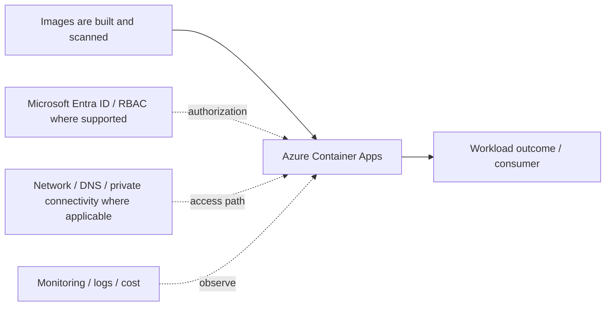

# Azure Container Apps

[← F. Containers & Kubernetes](../README.md) · [← Master catalogue](../../README.md) · [Architecture diagram](architecture.mmd)

**Purpose.** Managed container application platform for APIs, microservices, jobs and event-driven scale without operating Kubernetes directly. Configure revisions, identity, ingress and scaling bounds.

## Where it fits
packages and runs containerized workloads, ranging from simple single-container execution to managed application platforms and Kubernetes. It interacts with upstream identity, governance and network decisions, and downstream workloads, data or operations depending on the selected pattern.

## When to use it
Choose ACI for suitable simple tasks, Container Apps for app-centric managed containers, and AKS when Kubernetes APIs or cluster-level control are required.

**Alternatives and trade-offs:** Compare ACI, Container Apps and AKS based on orchestration need, control, scaling, networking and team capability.

## Architecture design
The diagram is a component-level flow, showing the main source, component, consumer and cross-cutting controls. Dashed arrows indicate a governance, authorization, network, operations or resilience relationship rather than a mandatory packet path.

## Security and governance
Use trusted base images, scanning, immutable digests, protected registries, managed/workload identity, least privilege and non-root execution where possible.

## Network and connectivity
Plan registry access, cluster/pod/service CIDRs, ingress, egress, DNS, private cluster/API access and network policies according to the runtime.

## Availability, scale and recovery
Configure probes, replica/node scaling, disruption budgets, upgrades, zone-aware placement and workload recovery; manifests alone are not backup.

## Cost and operations
Model node pools, replicas, registry storage, log ingestion, idle capacity and scale-to-zero behavior.

## Enterprise scenario
Images are built and scanned, stored in ACR, and deployed to Container Apps or AKS based on orchestration requirements. For this component, document the exact scope, owner, dependencies, alert/runbook, rollback or recovery action, and the evidence that proves the design works.

## Implementation and validation
1. Confirm region/SKU/feature support, quota, naming rules and required permissions.
2. Review the component's architecture diagram and map each dependency to a real Azure resource or control.
3. Implement with the repository's Terraform/Bicep or configuration sample where available; use a policy/configuration sample rather than fake deployment code for conceptual governance topics.
4. Review Terraform plan or Bicep `what-if`; verify scope, identity, network access and cost before deployment.
5. Validate allowed and denied access, DNS/routing where applicable, telemetry, failure behavior and recovery.
6. Record expected outputs and operational ownership. Clean up only lab resources that are safe to delete; do not remove shared or production resources.

## Component-specific design note
Managed container application platform for APIs, microservices, jobs and event-driven scale without operating Kubernetes directly. Configure revisions, identity, ingress and scaling bounds.

## Common mistakes
- Treating the component as a standalone solution without documenting dependencies.
- Assuming identity, private networking or redundancy automatically grants authorization or guarantees recovery.
- Skipping failure testing, telemetry, cost ownership and change/rollback planning.
- Deploying a generic sample without validating current SKU, region, API/provider version and service limits.

## Interview questions

**Q1. Where does Azure Container Apps fit in an Azure solution?**  
It implements one part of the larger containers & kubernetes design. Explain its upstream dependencies, downstream consumers, identity and network boundaries, and how it is monitored and recovered.

**Q2. What trade-off drives the design?**  
Start with workload requirements and compare supported alternatives on security, operational burden, availability, scale, compliance and total cost. State the assumptions and test the critical failure mode.

## LinkedIn-ready summary
A strong Azure design explains not just what Azure Container Apps does, but where it fits, which identity and network boundaries apply, how failures are detected and recovered, and how cost is controlled. Architecture decisions should be validated with evidence—not assumptions. #Azure #CloudArchitecture #AzureSolutionsArchitect

## Official reference
- [Microsoft Learn: Azure Container Apps](<https://learn.microsoft.com/search/?terms=Azure%20Container%20Apps%20Azure>)
- [Azure Well-Architected Framework](https://learn.microsoft.com/azure/well-architected/)
