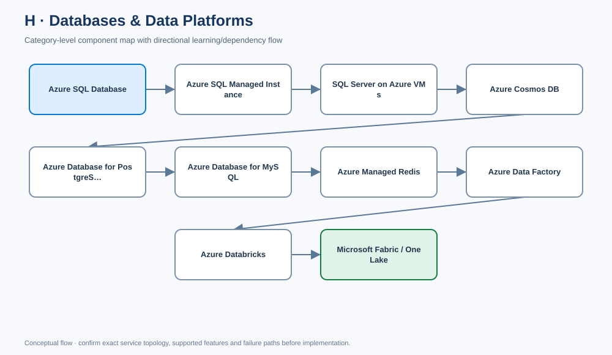

# H. Databases & Data Platforms

- [Edit diagram in draw.io](architecture.drawio) · [Mermaid source](architecture.mmd)

## Component completion tracker

Use this checklist to review every component page. Mark an item complete only when content is present and verified; if an item is not applicable, record why.

- [ ] Component-specific purpose, architecture placement, use cases and alternatives
- [ ] Real Azure design details, not generic placeholder paragraphs
- [ ] Identity, access, security, governance and data protection
- [ ] Network design and private connectivity where applicable
- [ ] Availability, scaling, backup/DR, limits and failure modes where applicable
- [ ] Cost drivers, monitoring, operations and common mistakes
- [ ] Enterprise scenario and decision trade-offs
- [ ] Rendered Azure architecture diagram (SVG) and editable draw.io source
- [ ] Validated Terraform/Bicep or policy/configuration samples where appropriate
- [ ] Validation, deployment, output and cleanup steps where applicable
- [ ] Interview questions/model answers and LinkedIn-ready summary
- [ ] Current official Microsoft Learn references

**[Component architecture map](architecture.mmd)** — arrows show a typical dependency/learning flow, not a mandatory deployment order.

[← Master catalogue](../README.md) · [Machine-readable catalogue](../catalog.json)

Database and data-platform selection should start with data model, query pattern, consistency, latency, scale, availability, migration constraints, governance and operating skills.

## Checklist
- [ ] Choose managed relational DB vs SQL Server on VM vs NoSQL
- [ ] Compare SQL Database and Managed Instance compatibility/operations
- [ ] Explain Cosmos DB partitioning, consistency and global distribution
- [ ] Secure database identity, networking, secrets and data access
- [ ] Design backup, point-in-time restore, replication and DR
- [ ] Compare Data Factory, Databricks and Fabric/OneLake roles
- [ ] Include observability, cost and lifecycle management

## Decision guide

~~~mermaid
flowchart TD
    Workload[Data workload] --> Rel{Relational SQL?}
    Rel -->|Yes| Managed{Need instance-level SQL compatibility?}
    Managed -->|Mostly database engine features| SQLDB[Azure SQL Database]
    Managed -->|Instance-level compatibility / migration| MI[Azure SQL Managed Instance]
    Rel -->|No| NoSQL{Document / key-value / global NoSQL?}
    NoSQL -->|Yes| Cosmos[Azure Cosmos DB]
    NoSQL -->|No| Analytics{Analytics / integration platform?}
    Analytics -->|Data movement/orchestration| ADF[Azure Data Factory]
    Analytics -->|Spark engineering / ML| DBX[Azure Databricks]
    Analytics -->|Unified analytics estate| Fabric[Microsoft Fabric / OneLake]
~~~

## H1. Azure SQL Database

Managed relational database service with Microsoft operating much of the database platform. It reduces OS/instance management compared with SQL Server on VMs.

**Use when:** application needs SQL Server database engine capabilities without managing a full SQL Server instance. Compare compute/service tiers, serverless vs provisioned options, pooling, networking and compatibility against current feature availability.

**Checklist:** Entra authentication where supported; least-privilege database roles; private endpoint/firewall design; auditing and threat detection; automatic backups and point-in-time restore; zone/geo-replication requirements; query performance monitoring; cost controls and tested restore.

## H2. Azure SQL Managed Instance

Managed SQL instance with broader instance-level compatibility than Azure SQL Database, often useful for migrations that rely on instance features. It still differs from SQL Server running on a VM and has specific network, capacity and feature constraints.

**Checklist:** compatibility assessment; VNet/subnet sizing and delegation; DNS/private connectivity; migration downtime strategy; maintenance/patching and backup behavior; business continuity configuration; capacity and license model; test application behavior before cutover.

## H3. SQL Server on Azure Virtual Machines

IaaS SQL Server provides greater control over OS, SQL Server configuration and compatibility, but the customer owns more OS/database lifecycle operations.

**Use when:** OS/instance control, unsupported managed-service features or specific migration constraints justify the operational burden.

**Checklist:** patching and SQL maintenance; storage layout/IOPS/latency; high availability with supported SQL mechanisms; backup/restore; security baselines; monitoring; licensing; recovery testing. VM availability alone does not guarantee database HA.

## H4. Azure Cosmos DB

Globally distributed NoSQL database with multiple APIs and consistency choices. Partition key design is central to throughput, scalability and avoiding hot partitions. Consistency and multi-region write/read behavior depend on API and configuration.

**Checklist:** choose API and data model; design partition key around access and distribution; select consistency from correctness/latency needs; configure RU/s or throughput model; design indexing and TTL; choose region/write strategy; secure data-plane access; test throttling, failover and cost.

**Common trap:** a poor partition key can limit scale or concentrate load. Test realistic access patterns and hot-key behavior early.

## H5. Azure Database for PostgreSQL

Managed PostgreSQL service. Choose based on supported engine version, extensions, compute/storage, networking, HA and migration requirements.

**Checklist:** Entra integration where supported; private access; extension/version compatibility; HA and backup/PITR; connection pooling and connection limits; query/slow-query monitoring; maintenance windows; migration and rollback plan.

## H6. Azure Database for MySQL

Managed MySQL service with supported version/feature boundaries and operational model. Validate compatibility and migration assumptions against the current offering.

**Checklist:** engine/version and feature compatibility; private access and identity; connection limits and pooling; HA/backup/PITR; replication and recovery needs; query monitoring; data migration validation and cost.

## H7. Azure Managed Redis

Managed Redis-compatible caching/in-memory data service for supported scenarios. Treat it as a performance/data-access component, not automatically as the durable source of truth. Product capabilities and transition guidance can change; verify the current Azure service offering and migration path before new production selection.

**Checklist:** latency/throughput needs; data durability expectations; cache eviction/TTL; network exposure and authentication; HA/failover behavior; client compatibility; connection limits and cost; cache stampede and fallback behavior.

## H8. Azure Data Factory

Data integration/orchestration service for pipelines, copy activities, connectors and scheduled/event-driven data movement. It is not the same thing as a general-purpose Spark analytics runtime.

**Checklist:** integration runtime/network placement; managed identity and credential stores; private endpoints/managed VNet where supported; incremental loads and watermarking; retry/idempotency; pipeline observability; data lineage and secrets; throughput/cost and recovery.

## H9. Azure Databricks

Managed analytics platform built around Apache Spark and collaborative data engineering/analytics. It suits large-scale transformations, lakehouse patterns and ML/data science workflows when the operating model and skills fit.

**Checklist:** workspace/network isolation; identity and access governance; data catalog/permissions; cluster/job policy and autoscaling; secret management; data layout and performance; workload isolation; cost tagging/budgets; audit logs and CI/CD.

## H10. Microsoft Fabric / OneLake

Fabric is an integrated analytics SaaS platform; OneLake provides a unified logical data lake foundation for Fabric workloads. It can simplify integrated BI/engineering experiences but differs from assembling individual Azure data services.

**Checklist:** tenant/workspace governance; capacity sizing and throttling; data ownership and access controls; data residency/compliance; lakehouse/warehouse semantic choices; lineage and data quality; capacity cost; integration with existing Azure data estate and exit/portability requirements.

---

## Data platform security baseline
- [ ] Prefer Entra identity and managed identity where supported; rotate or eliminate secrets.
- [ ] Use private connectivity where required and test DNS from actual clients.
- [ ] Separate control-plane administration from database/data-plane access.
- [ ] Encrypt data, classify sensitive fields and define retention/deletion policies.
- [ ] Configure audit logs, query diagnostics and actionable alerts.
- [ ] Define backup, PITR, geo-recovery and restore test cadence.
- [ ] Model capacity, transactions, compute, storage, egress and analytics capacity charges.

## Enterprise scenario

A transactional customer application uses Azure SQL Database with private access, Entra authentication and point-in-time recovery. Change events feed an analytics pipeline through Data Factory; Databricks performs complex Spark transformations and curated outputs are exposed through the chosen analytics/BI platform. The design keeps transactional and analytical workloads isolated, uses managed identity, tracks lineage and cost, and tests both database restore and data-pipeline replay.

## Common mistakes
- Choosing a database before understanding access patterns and compatibility.
- Treating SQL Database, Managed Instance and SQL on VM as identical.
- Ignoring Cosmos DB partition-key design and consistency trade-offs.
- Treating caches as durable source-of-truth stores without a recovery plan.
- Putting credentials in pipelines/notebooks instead of managed identity/secret controls.
- Assuming analytics capacity and transactional database capacity scale the same way.

## Interview questions
**Q1. SQL Database vs Managed Instance vs SQL on VM?** Database offers managed database-level operation; Managed Instance offers broader instance compatibility with managed platform operations; SQL on VM provides most control and the most OS/database operational responsibility.

**Q2. How do you choose a Cosmos DB partition key?** Use access patterns, cardinality and distribution; avoid hot keys and validate throughput, query and consistency behavior under realistic load.

**Q3. Data Factory vs Databricks?** Data Factory orchestrates and moves data; Databricks provides Spark-based data processing/engineering. They commonly complement each other.

## LinkedIn-ready post
Data architecture starts with workload semantics. Relational compatibility, NoSQL partitioning, transactional consistency, analytics processing, governance and recovery are different decisions. Choose each service for its role, secure identity and network paths, and test restore/replay—not just the happy path. #AzureData #DataEngineering #CloudArchitecture

## Official references
- [Azure SQL](https://learn.microsoft.com/azure/azure-sql/)
- [Azure Cosmos DB](https://learn.microsoft.com/azure/cosmos-db/introduction)
- [Azure Database for PostgreSQL](https://learn.microsoft.com/azure/postgresql/)
- [Azure Data Factory](https://learn.microsoft.com/azure/data-factory/introduction)
- [Azure Databricks](https://learn.microsoft.com/azure/databricks/)
- [Microsoft Fabric](https://learn.microsoft.com/fabric/)

## Component dependency flow

The diagram includes every component in this catalog and shows a typical progression plus cross-cutting controls.

~~~mermaid
flowchart LR
  subgraph CATH["H · Databases and Data Platforms"]
    n1["Azure SQL Database"]
    n2["Azure SQL Managed Instance"]
    n1 --> n2
    n3["SQL Server on Azure VMs"]
    n2 --> n3
    n4["Azure Cosmos DB"]
    n3 --> n4
    n5["Azure Database for PostgreSQL"]
    n4 --> n5
    n6["Azure Database for MySQL"]
    n5 --> n6
    n7["Azure Managed Redis"]
    n6 --> n7
    n8["Azure Data Factory"]
    n7 --> n8
    n9["Azure Databricks"]
    n8 --> n9
    n10["Microsoft Fabric / OneLake"]
    n9 --> n10
  end
  Identity[Entra ID / RBAC] -. cross-cutting .-> n1
  Network[Network / DNS / private access] -. cross-cutting .-> n5
  Operations[Monitor / logs / cost] -. cross-cutting .-> n10
~~~
