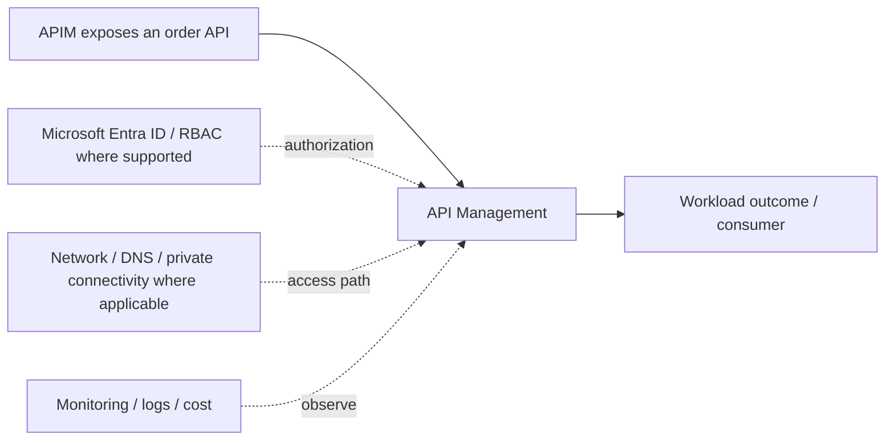

# API Management

[← I. Integration & API Management](../README.md) · [← Master catalogue](../../README.md) · [Architecture diagram](architecture.mmd)

**Purpose.** Treat this as a distinct architecture building block: define its contract, consumers, permissions, dependencies, failure behavior and operational owner. Confirm service limits and supported features against the linked Microsoft Learn documentation before production.

## Where it fits
connects APIs, business messages, discrete events and high-volume streams while decoupling producers from consumers. It interacts with upstream identity, governance and network decisions, and downstream workloads, data or operations depending on the selected pattern.

## When to use it
Choose API Management for governed synchronous APIs, Service Bus for brokered business messages, Event Grid for event routing, and Event Hubs for high-volume streams.

**Alternatives and trade-offs:** Compare synchronous API, durable broker, discrete event routing and high-volume streaming semantics; they are not interchangeable.

## Architecture design
The diagram is a component-level flow, showing the main source, component, consumer and cross-cutting controls. Dashed arrows indicate a governance, authorization, network, operations or resilience relationship rather than a mandatory packet path.

## Security and governance
Validate tokens and backend authorization, use managed identity where supported, scope data-plane roles, secure endpoints and avoid logging secrets.

## Network and connectivity
Map caller-to-gateway and producer-to-broker paths, private endpoints, DNS, backend reachability and inbound/outbound controls.

## Availability, scale and recovery
Design retries, idempotency, dead-lettering, ordering/partitioning, consumer lag, replay and regional recovery explicitly.

## Cost and operations
Model throughput tier, requests, messages, retention, event volume, consumers, integration runtime and diagnostic ingestion.

## Enterprise scenario
APIM exposes an order API, Service Bus queues durable work, Event Grid distributes discrete notifications, and Event Hubs ingests telemetry. For this component, document the exact scope, owner, dependencies, alert/runbook, rollback or recovery action, and the evidence that proves the design works.

## Implementation and validation
1. Confirm region/SKU/feature support, quota, naming rules and required permissions.
2. Review the component's architecture diagram and map each dependency to a real Azure resource or control.
3. Implement with the repository's Terraform/Bicep or configuration sample where available; use a policy/configuration sample rather than fake deployment code for conceptual governance topics.
4. Review Terraform plan or Bicep `what-if`; verify scope, identity, network access and cost before deployment.
5. Validate allowed and denied access, DNS/routing where applicable, telemetry, failure behavior and recovery.
6. Record expected outputs and operational ownership. Clean up only lab resources that are safe to delete; do not remove shared or production resources.

## Component-specific design note
Treat this as a distinct architecture building block: define its contract, consumers, permissions, dependencies, failure behavior and operational owner. Confirm service limits and supported features against the linked Microsoft Learn documentation before production.

## Common mistakes
- Treating the component as a standalone solution without documenting dependencies.
- Assuming identity, private networking or redundancy automatically grants authorization or guarantees recovery.
- Skipping failure testing, telemetry, cost ownership and change/rollback planning.
- Deploying a generic sample without validating current SKU, region, API/provider version and service limits.

## Interview questions

**Q1. Where does API Management fit in an Azure solution?**  
It implements one part of the larger integration & api management design. Explain its upstream dependencies, downstream consumers, identity and network boundaries, and how it is monitored and recovered.

**Q2. What trade-off drives the design?**  
Start with workload requirements and compare supported alternatives on security, operational burden, availability, scale, compliance and total cost. State the assumptions and test the critical failure mode.

## LinkedIn-ready summary
A strong Azure design explains not just what API Management does, but where it fits, which identity and network boundaries apply, how failures are detected and recovered, and how cost is controlled. Architecture decisions should be validated with evidence—not assumptions. #Azure #CloudArchitecture #AzureSolutionsArchitect

## Official reference
- [Microsoft Learn: API Management](<https://learn.microsoft.com/search/?terms=API%20Management%20Azure>)
- [Azure Well-Architected Framework](https://learn.microsoft.com/azure/well-architected/)
