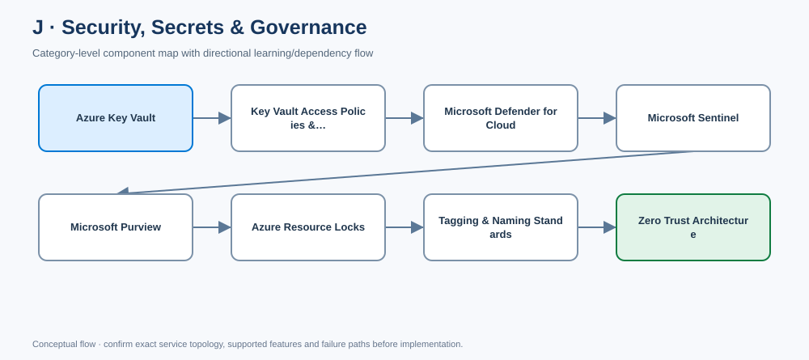

# J. Security, Secrets & Governance

- [Edit diagram in draw.io](architecture.drawio) · [Mermaid source](architecture.mmd)

## Component completion tracker

Use this checklist to review every component page. Mark an item complete only when content is present and verified; if an item is not applicable, record why.

- [ ] Component-specific purpose, architecture placement, use cases and alternatives
- [ ] Real Azure design details, not generic placeholder paragraphs
- [ ] Identity, access, security, governance and data protection
- [ ] Network design and private connectivity where applicable
- [ ] Availability, scaling, backup/DR, limits and failure modes where applicable
- [ ] Cost drivers, monitoring, operations and common mistakes
- [ ] Enterprise scenario and decision trade-offs
- [ ] Rendered Azure architecture diagram (SVG) and editable draw.io source
- [ ] Validated Terraform/Bicep or policy/configuration samples where appropriate
- [ ] Validation, deployment, output and cleanup steps where applicable
- [ ] Interview questions/model answers and LinkedIn-ready summary
- [ ] Current official Microsoft Learn references

**[Component architecture map](architecture.mmd)** — arrows show a typical dependency/learning flow, not a mandatory deployment order.

[← Master catalogue](../README.md) · [Machine-readable catalogue](../catalog.json)

Security is a system of identity, configuration, data, detection and response controls—not one product.

## Checklist
- [ ] Protect secrets, keys and certificates in Key Vault
- [ ] Choose Key Vault RBAC/access policies deliberately
- [ ] Triage Defender for Cloud findings
- [ ] Design Sentinel ingestion, detections and incident response
- [ ] Govern data discovery and classification with Purview
- [ ] Apply resource locks without blocking operations
- [ ] Enforce naming/tagging standards
- [ ] Map Zero Trust to identity, network, app and data controls

~~~mermaid
flowchart TB
    Identity[Entra ID / MFA / PIM] --> Access[Least-privilege access]
    Access --> Vault[Key Vault]
    Policy[Azure Policy and resource locks] --> Governance[Preventive governance]
    Defender[Defender for Cloud] --> Posture[Posture findings]
    Logs[Azure and workload logs] --> Sentinel[Microsoft Sentinel]
    Data[Enterprise data] --> Purview[Microsoft Purview]
    Posture --> Response[Remediation and incident response]
    Sentinel --> Response
~~~

## J1. Azure Key Vault
Stores secrets, cryptographic keys and certificates. Prefer managed identity for workload access; assign narrow data-plane roles; separate vault administration from secret use; restrict networking and configure private endpoints/DNS when required; enable supported soft delete and purge protection; alert on expiry; define rotation and recovery. Never commit secrets to code, IaC state, pipeline logs or outputs.

## J2. Key Vault access policies vs RBAC
These are separate data-plane authorization models. Standardize the supported model for the vault and validate feature compatibility against current guidance. Scope access narrowly, distinguish control-plane administration from secret/key use, audit effective access and test workload identity access end-to-end.

## J3. Microsoft Defender for Cloud
Provides cloud security posture management and supported workload protection. Enable relevant plans based on risk and requirements; assign recommendation owners and due dates; integrate alerts with response; review coverage, exceptions and cost. A recommendation without accountable remediation is not a control.

## J4. Microsoft Sentinel
Cloud SIEM/SOAR for collecting security telemetry, correlating detections, investigating incidents and automating supported responses. Select data sources by threat/use case; tune analytics and suppression; monitor connector health and ingestion delay; secure workspace/playbook permissions; avoid indiscriminate high-volume logging; rehearse response actions.

## J5. Microsoft Purview
Data governance and discovery/classification capabilities across supported sources. Assign data owners/stewards, define classification taxonomy, manage catalog and lineage, scope scanning permissions, protect sensitive metadata and track remediation. A catalog is only useful when ownership and data-quality processes are maintained.

## J6. Azure resource locks
CanNotDelete and ReadOnly locks apply at supported scopes and may inherit to descendants. They reduce accidental changes but do not replace RBAC, backups or change management; privileged operators can manage locks. Use selectively, document removal approval, and test deployment pipelines for lock conflicts.

## J7. Naming and tagging standards
Use service-valid naming conventions and canonical tags such as `environment`, `owner`, `application`, `costCenter`, `dataClassification` and `managedBy` where appropriate. Tags improve reporting but do not grant access control and have service/scope limitations. Enforce via IaC and Policy, report missing values and govern exceptions.

## J8. Zero Trust
Apply “verify explicitly, use least privilege, assume breach.” Use MFA/Conditional Access/PIM, managed workload identity, narrow authorization, network segmentation, secure development, data protection, continuous monitoring and rehearsed recovery. Private IP alone is not Zero Trust: authentication and authorization remain necessary.

## Enterprise scenario
A production API uses managed identity to access Key Vault with narrowly scoped permissions and private networking where required. Defender findings have owners and due dates; Sentinel detections have tuned sources and incident playbooks; Purview tracks sensitive datasets; locks protect critical resources only where operationally safe; tags support cost and ownership reporting.

## Common mistakes
- Treating private networking as authorization.
- Granting Key Vault Administrator when only secret read is needed.
- Ingesting every log into Sentinel without a threat/use-case and cost plan.
- Treating locks as protection against a privileged malicious actor.
- Creating tags without enforcement or owners.
- Calling a private-only network Zero Trust.

## Interview questions
**Defender for Cloud vs Sentinel?** Defender focuses on posture and workload protection; Sentinel correlates security telemetry and supports incident investigation/response. They complement each other.

**How do you implement Zero Trust?** Verify identity and context, enforce least privilege, segment traffic, protect data/workloads, monitor continuously and test response/recovery.

## LinkedIn-ready post
Security controls must be owned and observable. Use least privilege and managed identity, protect secrets, enforce governance with policy, prioritize Defender findings, tune Sentinel detections, classify data and rehearse response. Private networking reduces exposure but never replaces authorization. #AzureSecurity #ZeroTrust #CloudGovernance

## Official references
- [Key Vault](https://learn.microsoft.com/azure/key-vault/general/overview)
- [Defender for Cloud](https://learn.microsoft.com/azure/defender-for-cloud/defender-for-cloud-introduction)
- [Microsoft Sentinel](https://learn.microsoft.com/azure/sentinel/overview)
- [Microsoft Purview](https://learn.microsoft.com/purview/)
- [Resource locks](https://learn.microsoft.com/azure/azure-resource-manager/management/lock-resources)

## Component dependency flow

The diagram includes every component in this catalog and shows a typical progression plus cross-cutting controls.

~~~mermaid
flowchart LR
  subgraph CATJ["J · Security Secrets and Governance"]
    n1["Azure Key Vault"]
    n2["Key Vault Access Policies and RBAC"]
    n1 --> n2
    n3["Microsoft Defender for Cloud"]
    n2 --> n3
    n4["Microsoft Sentinel"]
    n3 --> n4
    n5["Microsoft Purview"]
    n4 --> n5
    n6["Azure Resource Locks"]
    n5 --> n6
    n7["Tagging and Naming Standards"]
    n6 --> n7
    n8["Zero Trust Architecture"]
    n7 --> n8
  end
  Identity[Entra ID / RBAC] -. cross-cutting .-> n1
  Network[Network / DNS / private access] -. cross-cutting .-> n4
  Operations[Monitor / logs / cost] -. cross-cutting .-> n8
~~~
