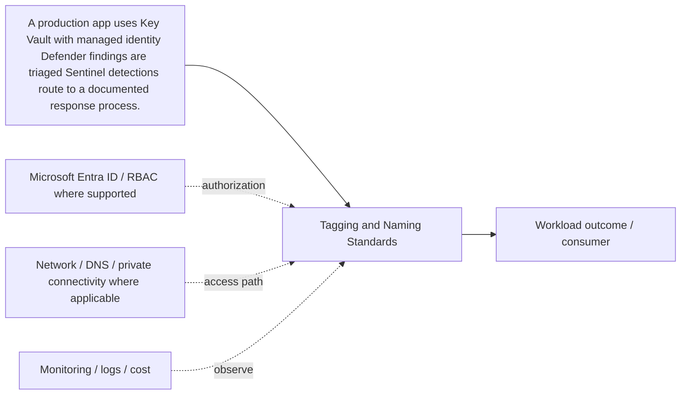

# Tagging & Naming Standards

[← J. Security, Secrets & Governance](../README.md) · [← Master catalogue](../../README.md) · [Architecture diagram](architecture.mmd)

**Purpose.** Treat this as a distinct architecture building block: define its contract, consumers, permissions, dependencies, failure behavior and operational owner. Confirm service limits and supported features against the linked Microsoft Learn documentation before production.

## Where it fits
protects secrets and data, evaluates security posture, detects threats and enforces governance. It interacts with upstream identity, governance and network decisions, and downstream workloads, data or operations depending on the selected pattern.

## When to use it
Use a layered approach combining identity, preventive policy, workload protection, detection, data governance and response.

**Alternatives and trade-offs:** Pair preventive controls with detection and response; no single security product replaces identity, network and data controls.

## Architecture design
The diagram is a component-level flow, showing the main source, component, consumer and cross-cutting controls. Dashed arrows indicate a governance, authorization, network, operations or resilience relationship rather than a mandatory packet path.

## Security and governance
Apply least privilege, managed identities, secret/key rotation, Defender recommendations with owners, Sentinel detections and data classification.

## Network and connectivity
Use private connectivity where supported, but never treat a private IP as authorization; validate DNS and service access independently.

## Availability, scale and recovery
Protect vault recovery, security logs, incident playbooks and break-glass access; rehearse response and recovery.

## Cost and operations
Scope Sentinel ingestion by use case, review Defender plans and retention, and quantify the cost of data scanning and long-term logs.

## Enterprise scenario
A production app uses Key Vault with managed identity; Defender findings are triaged; Sentinel detections route to a documented response process. For this component, document the exact scope, owner, dependencies, alert/runbook, rollback or recovery action, and the evidence that proves the design works.

## Implementation and validation
1. Confirm region/SKU/feature support, quota, naming rules and required permissions.
2. Review the component's architecture diagram and map each dependency to a real Azure resource or control.
3. Implement with the repository's Terraform/Bicep or configuration sample where available; use a policy/configuration sample rather than fake deployment code for conceptual governance topics.
4. Review Terraform plan or Bicep `what-if`; verify scope, identity, network access and cost before deployment.
5. Validate allowed and denied access, DNS/routing where applicable, telemetry, failure behavior and recovery.
6. Record expected outputs and operational ownership. Clean up only lab resources that are safe to delete; do not remove shared or production resources.

## Component-specific design note
Treat this as a distinct architecture building block: define its contract, consumers, permissions, dependencies, failure behavior and operational owner. Confirm service limits and supported features against the linked Microsoft Learn documentation before production.

## Common mistakes
- Treating the component as a standalone solution without documenting dependencies.
- Assuming identity, private networking or redundancy automatically grants authorization or guarantees recovery.
- Skipping failure testing, telemetry, cost ownership and change/rollback planning.
- Deploying a generic sample without validating current SKU, region, API/provider version and service limits.

## Interview questions

**Q1. Where does Tagging & Naming Standards fit in an Azure solution?**  
It implements one part of the larger security, secrets & governance design. Explain its upstream dependencies, downstream consumers, identity and network boundaries, and how it is monitored and recovered.

**Q2. What trade-off drives the design?**  
Start with workload requirements and compare supported alternatives on security, operational burden, availability, scale, compliance and total cost. State the assumptions and test the critical failure mode.

## LinkedIn-ready summary
A strong Azure design explains not just what Tagging & Naming Standards does, but where it fits, which identity and network boundaries apply, how failures are detected and recovered, and how cost is controlled. Architecture decisions should be validated with evidence—not assumptions. #Azure #CloudArchitecture #AzureSolutionsArchitect

## Official reference
- [Microsoft Learn: Tagging & Naming Standards](<https://learn.microsoft.com/search/?terms=Tagging%20%26%20Naming%20Standards%20Azure>)
- [Azure Well-Architected Framework](https://learn.microsoft.com/azure/well-architected/)
