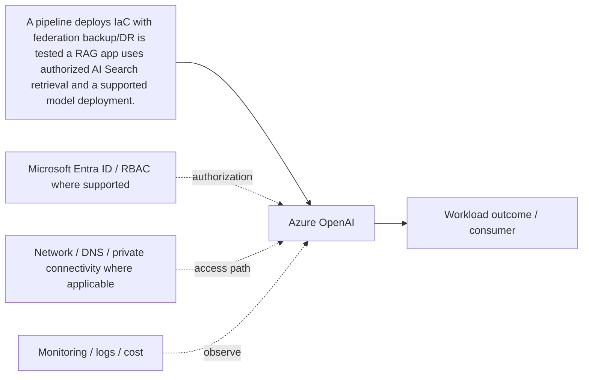

# Azure OpenAI

[← L. DevOps, Resilience, Migration & AI](../README.md) · [← Master catalogue](../../README.md) · [Architecture diagram](architecture.mmd)

**Purpose.** Model endpoint availability, quotas, deployment types and regions vary. Use identity and network controls, handle rate limits, evaluate safety/grounding and monitor token cost.

## Where it fits
automates infrastructure delivery, restores workloads, moves existing estates and enables governed AI applications. It interacts with upstream identity, governance and network decisions, and downstream workloads, data or operations depending on the selected pattern.

## When to use it
Use versioned IaC and protected pipelines; choose backup/replication from RTO/RPO; assess migration dependencies; choose AI services from the use case.

**Alternatives and trade-offs:** Choose tooling and platform from workload needs; validate identity, recovery objectives, model/data governance and current service support.

## Architecture design
The diagram is a component-level flow, showing the main source, component, consumer and cross-cutting controls. Dashed arrows indicate a governance, authorization, network, operations or resilience relationship rather than a mandatory packet path.

## Security and governance
Use federated CI/CD identity, least privilege, protected state, managed identity, data authorization and AI safety/evaluation controls.

## Network and connectivity
Plan pipeline agent access, private deployment paths, hybrid connectivity, data-source access and private AI/search endpoints where supported.

## Availability, scale and recovery
Test restore/failover, migration rollback, pipeline recovery, model/search fallback and operational handover.

## Cost and operations
Model pipeline runners, recovery storage/replication, migration data transfer, model tokens, search capacity and ML compute.

## Enterprise scenario
A pipeline deploys IaC with federation; backup/DR is tested; a RAG app uses authorized AI Search retrieval and a supported model deployment. For this component, document the exact scope, owner, dependencies, alert/runbook, rollback or recovery action, and the evidence that proves the design works.

## Implementation and validation
1. Confirm region/SKU/feature support, quota, naming rules and required permissions.
2. Review the component's architecture diagram and map each dependency to a real Azure resource or control.
3. Implement with the repository's Terraform/Bicep or configuration sample where available; use a policy/configuration sample rather than fake deployment code for conceptual governance topics.
4. Review Terraform plan or Bicep `what-if`; verify scope, identity, network access and cost before deployment.
5. Validate allowed and denied access, DNS/routing where applicable, telemetry, failure behavior and recovery.
6. Record expected outputs and operational ownership. Clean up only lab resources that are safe to delete; do not remove shared or production resources.

## Component-specific design note
Model endpoint availability, quotas, deployment types and regions vary. Use identity and network controls, handle rate limits, evaluate safety/grounding and monitor token cost.

## Common mistakes
- Treating the component as a standalone solution without documenting dependencies.
- Assuming identity, private networking or redundancy automatically grants authorization or guarantees recovery.
- Skipping failure testing, telemetry, cost ownership and change/rollback planning.
- Deploying a generic sample without validating current SKU, region, API/provider version and service limits.

## Interview questions

**Q1. Where does Azure OpenAI fit in an Azure solution?**  
It implements one part of the larger devops, resilience, migration & ai design. Explain its upstream dependencies, downstream consumers, identity and network boundaries, and how it is monitored and recovered.

**Q2. What trade-off drives the design?**  
Start with workload requirements and compare supported alternatives on security, operational burden, availability, scale, compliance and total cost. State the assumptions and test the critical failure mode.

## LinkedIn-ready summary
A strong Azure design explains not just what Azure OpenAI does, but where it fits, which identity and network boundaries apply, how failures are detected and recovered, and how cost is controlled. Architecture decisions should be validated with evidence—not assumptions. #Azure #CloudArchitecture #AzureSolutionsArchitect

## Official reference
- [Microsoft Learn: Azure OpenAI](<https://learn.microsoft.com/search/?terms=Azure%20OpenAI%20Azure>)
- [Azure Well-Architected Framework](https://learn.microsoft.com/azure/well-architected/)
