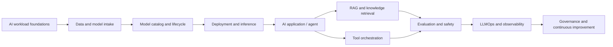

# M. AI Platform & Engineering

\n\n- [Editable diagram](architecture.drawio) · [Mermaid source](architecture.mmd)\n\n> Build, ground, deploy, evaluate and govern AI applications, models and agents on Azure. This category covers both Microsoft AI services and the platform engineering capabilities needed to operate AI workloads responsibly.

[← Master catalogue](../README.md) · [Machine-readable catalogue](../catalog.json) · [Azure reference architecture](../AZURE-ENTERPRISE-REFERENCE-ARCHITECTURE.md)

## AI platform lifecycle

## Component catalogue

- [ ] [Microsoft Foundry](microsoft-foundry/README.md)
- [ ] [Azure OpenAI](azure-openai/README.md)
- [ ] [Azure AI Search](azure-ai-search/README.md)
- [ ] [Azure Machine Learning](azure-machine-learning/README.md)
- [ ] [AI Infrastructure Foundations](ai-infrastructure-foundations/README.md)
- [ ] [GPU & Accelerated Compute](gpu-accelerated-compute/README.md)
- [ ] [Model Catalog, Registry & Lifecycle](model-catalog-registry-lifecycle/README.md)
- [ ] [Model Deployment & Inference](model-deployment-inference/README.md)
- [ ] [RAG & Vector Search Architecture](rag-vector-search-architecture/README.md)
- [ ] [AI Agents & Orchestration](ai-agents-orchestration/README.md)
- [ ] [Prompt Engineering & Evaluation](prompt-engineering-evaluation/README.md)
- [ ] [LLMOps & AI Observability](llmops-ai-observability/README.md)
- [ ] [Responsible AI, Security & Governance](responsible-ai-security-governance/README.md)

## Platform dependencies

AI capabilities are not isolated. Use the existing catalogue for:

- **Identity:** Microsoft Entra ID, managed identities, Azure RBAC and PIM.
- **Network:** VNets, private endpoints, private DNS, firewall and ingress controls.
- **Compute:** Virtual Machines, AKS, Container Apps and GPU-capable VM families where available.
- **Data:** Blob Storage, ADLS Gen2, Azure SQL, Cosmos DB and governed data platforms.
- **Security:** Key Vault, Defender for Cloud, Sentinel, Purview and Zero Trust.
- **Operations:** Azure Monitor, Log Analytics, Application Insights, Cost Management and Advisor.
- **Delivery:** Terraform, Bicep, Azure DevOps and GitHub Actions.

## Architecture guardrails

1. Choose a managed platform or model endpoint when it meets requirements; self-manage serving and orchestration only when the extra control justifies the operational burden.
2. Do not assume model, GPU SKU, region or quota availability. Validate these before finalizing the design.
3. Treat prompts, retrieved content, tool outputs and model responses as untrusted data.
4. Enforce source-data authorization before retrieval. A model endpoint does not grant access to enterprise content.
5. Evaluate quality, safety, latency and cost before production and continuously after release.
6. Keep human approval for consequential actions and provide safe fallback paths.

## AI architecture references

- [Microsoft Foundry documentation](https://learn.microsoft.com/en-us/azure/foundry/)
- [Azure AI Search vector indexes](https://learn.microsoft.com/en-us/azure/search/vector-store)
- [Azure AI Search hybrid search](https://learn.microsoft.com/en-us/azure/search/hybrid-search-overview)
- [RAG with Azure AI Search](https://learn.microsoft.com/en-us/azure/search/retrieval-augmented-generation-overview)
- [GPU workloads on AKS](https://learn.microsoft.com/en-us/azure/aks/use-nvidia-gpu)
- [Model catalog in Azure Machine Learning](https://learn.microsoft.com/en-us/azure/machine-learning/concept-model-catalog)
- [Model deployment and management](https://learn.microsoft.com/en-us/azure/machine-learning/concept-model-management-and-deployment)
- [Agent evaluation in Microsoft Foundry](https://learn.microsoft.com/en-us/azure/foundry/observability/how-to/evaluate-agent)

> **Service currency:** Azure AI services, product names, deployment modes, supported regions, quotas and preview status change. Validate current Microsoft Learn documentation and subscription availability before production design.
