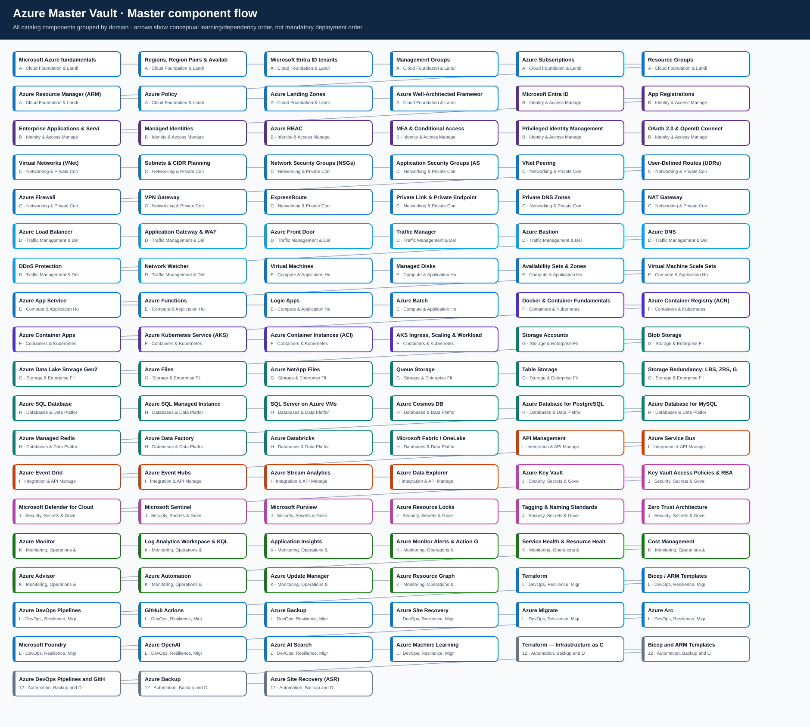

# Azure Master Vault

> **Azure Solution Architect learning portal** — track your learning, explore the end-to-end reference design, and open a focused guide for any Azure topic.

## Start here

| 
📚 Learning tracker
 | 
🏗️ End-to-end design
 | 
🗺️ Diagram library
 |
|---|---|---|
| Work through the catalogue by category. Every topic name opens its own guide. | Explore how governance, identity, network, application, data, security and operations fit together. | Preview category diagrams and open editable draw.io sources. |
| [**Track topics below ↓**](#your-azure-learning-tracker) | [**Open reference design →**](AZURE-ENTERPRISE-REFERENCE-ARCHITECTURE.md) | [**Open visual library →**](VISUAL-DIAGRAMS.md) |

## Architecture Hub and Solution Blueprints

**[Launch the visual Azure Architecture Hub](https://tripathies.github.io/azure-master-vault/)** · [Solution blueprint catalogue](SOLUTION-BLUEPRINTS.md) · [Azure CLI and Terraform getting started](GETTING-STARTED-AZURE.md)

The existing component Vault remains the source of truth for Azure service guidance. The Architecture Hub connects those components into foundations, reusable patterns and end-to-end business solutions.

**Featured solution:** [LittleNest Kidswear — Profile A](solutions/littlenest-kidswear-profile-a/README.md) is a low-cost, non-production lab showing private App Service and Functions patterns, Cosmos DB Free Tier, Key Vault, private Storage and managed identity. It does not provision production subscriptions or claim production readiness.

## Your Azure learning tracker

Use the checkboxes as a visible checklist and open a topic by clicking its name. Category totals are generated from the repository catalogue; the checkboxes in GitHub Markdown do **not** provide per-user automatic progress tracking or calculate a live completion percentage.

**Catalogue size:** 111 component/topic guides across 13 categories.

### Browse categories

| Domain | Category | Topics | Tracker |
|---|---|---:|---|
| **A** | [Cloud Foundation & Landing Zones](A-cloud-foundation-landing-zones/README.md) | 10 | [Open tracker](#a-cloud-foundation-landing-zones) |
| **B** | [Identity & Access Management](B-identity-access-management/README.md) | 8 | [Open tracker](#b-identity-access-management) |
| **C** | [Networking & Private Connectivity](C-networking-private-connectivity/README.md) | 12 | [Open tracker](#c-networking-private-connectivity) |
| **D** | [Traffic Management & Delivery](D-traffic-management-delivery/README.md) | 8 | [Open tracker](#d-traffic-management-delivery) |
| **E** | [Compute & Application Hosting](E-compute-application-hosting/README.md) | 8 | [Open tracker](#e-compute-application-hosting) |
| **F** | [Containers & Kubernetes](F-containers-kubernetes/README.md) | 6 | [Open tracker](#f-containers-kubernetes) |
| **G** | [Storage & Enterprise File Services](G-storage-enterprise-file-services/README.md) | 8 | [Open tracker](#g-storage-enterprise-file-services) |
| **H** | [Databases & Data Platforms](H-databases-data-platforms/README.md) | 10 | [Open tracker](#h-databases-data-platforms) |
| **I** | [Integration & API Management](I-integration-api-management/README.md) | 6 | [Open tracker](#i-integration-api-management) |
| **J** | [Security, Secrets & Governance](J-security-secrets-governance/README.md) | 8 | [Open tracker](#j-security-secrets-governance) |
| **K** | [Monitoring, Operations & Cost](K-monitoring-operations-cost/README.md) | 10 | [Open tracker](#k-monitoring-operations-cost) |
| **L** | [DevOps, Resilience, Migration & AI](L-devops-resilience-migration-ai/README.md) | 12 | [Open tracker](#l-devops-resilience-migration-ai) |
| **12** | [Automation, Backup and Disaster Recovery](12-automation-backup-disaster-recovery/README.md) | 5 | [Open tracker](#12-automation-backup-and-disaster-recovery) |

### Component checklist

<strong>A. Cloud Foundation & Landing Zones</strong> — 10 topics

- [ ] [Microsoft Azure fundamentals](A-cloud-foundation-landing-zones/microsoft-azure-fundamentals/README.md)
- [ ] [Regions, Region Pairs & Availability Zones](A-cloud-foundation-landing-zones/regions-region-pairs-and-availability-zones/README.md)
- [ ] [Microsoft Entra ID tenants](A-cloud-foundation-landing-zones/microsoft-entra-id-tenants/README.md)
- [ ] [Management Groups](A-cloud-foundation-landing-zones/management-groups/README.md)
- [ ] [Azure Subscriptions](A-cloud-foundation-landing-zones/azure-subscriptions/README.md)
- [ ] [Resource Groups](A-cloud-foundation-landing-zones/resource-groups/README.md)
- [ ] [Azure Resource Manager (ARM)](A-cloud-foundation-landing-zones/azure-resource-manager-arm/README.md)
- [ ] [Azure Policy](A-cloud-foundation-landing-zones/azure-policy/README.md)
- [ ] [Azure Landing Zones](A-cloud-foundation-landing-zones/azure-landing-zones/README.md)
- [ ] [Azure Well-Architected Framework](A-cloud-foundation-landing-zones/azure-well-architected-framework/README.md)

[Open full category guide](<A-cloud-foundation-landing-zones/README.md>)

<strong>B. Identity & Access Management</strong> — 8 topics

- [ ] [Microsoft Entra ID](B-identity-access-management/microsoft-entra-id/README.md)
- [ ] [App Registrations](B-identity-access-management/app-registrations/README.md)
- [ ] [Enterprise Applications & Service Principals](B-identity-access-management/enterprise-applications-and-service-principals/README.md)
- [ ] [Managed Identities](B-identity-access-management/managed-identities/README.md)
- [ ] [Azure RBAC](B-identity-access-management/azure-rbac/README.md)
- [ ] [MFA & Conditional Access](B-identity-access-management/mfa-and-conditional-access/README.md)
- [ ] [Privileged Identity Management (PIM)](B-identity-access-management/privileged-identity-management-pim/README.md)
- [ ] [OAuth 2.0 & OpenID Connect](B-identity-access-management/oauth-2-0-and-openid-connect/README.md)

[Open full category guide](<B-identity-access-management/README.md>)

<strong>C. Networking & Private Connectivity</strong> — 12 topics

- [ ] [Virtual Networks (VNet)](C-networking-private-connectivity/virtual-networks-vnet/README.md)
- [ ] [Subnets & CIDR Planning](C-networking-private-connectivity/subnets-and-cidr-planning/README.md)
- [ ] [Network Security Groups (NSGs)](C-networking-private-connectivity/network-security-groups-nsgs/README.md)
- [ ] [Application Security Groups (ASGs)](C-networking-private-connectivity/application-security-groups-asgs/README.md)
- [ ] [VNet Peering](C-networking-private-connectivity/vnet-peering/README.md)
- [ ] [User-Defined Routes (UDRs)](C-networking-private-connectivity/user-defined-routes-udrs/README.md)
- [ ] [Azure Firewall](C-networking-private-connectivity/azure-firewall/README.md)
- [ ] [VPN Gateway](C-networking-private-connectivity/vpn-gateway/README.md)
- [ ] [ExpressRoute](C-networking-private-connectivity/expressroute/README.md)
- [ ] [Private Link & Private Endpoints](C-networking-private-connectivity/private-link-and-private-endpoints/README.md)
- [ ] [Private DNS Zones](C-networking-private-connectivity/private-dns-zones/README.md)
- [ ] [NAT Gateway](C-networking-private-connectivity/nat-gateway/README.md)

[Open full category guide](<C-networking-private-connectivity/README.md>)

<strong>D. Traffic Management & Delivery</strong> — 8 topics

- [ ] [Azure Load Balancer](D-traffic-management-delivery/azure-load-balancer/README.md)
- [ ] [Application Gateway & WAF](D-traffic-management-delivery/application-gateway-and-waf/README.md)
- [ ] [Azure Front Door](D-traffic-management-delivery/azure-front-door/README.md)
- [ ] [Traffic Manager](D-traffic-management-delivery/traffic-manager/README.md)
- [ ] [Azure Bastion](D-traffic-management-delivery/azure-bastion/README.md)
- [ ] [Azure DNS](D-traffic-management-delivery/azure-dns/README.md)
- [ ] [DDoS Protection](D-traffic-management-delivery/ddos-protection/README.md)
- [ ] [Network Watcher](D-traffic-management-delivery/network-watcher/README.md)

[Open full category guide](<D-traffic-management-delivery/README.md>)

<strong>E. Compute & Application Hosting</strong> — 8 topics

- [ ] [Virtual Machines](E-compute-application-hosting/virtual-machines/README.md)
- [ ] [Managed Disks](E-compute-application-hosting/managed-disks/README.md)
- [ ] [Availability Sets & Zones](E-compute-application-hosting/availability-sets-and-zones/README.md)
- [ ] [Virtual Machine Scale Sets](E-compute-application-hosting/virtual-machine-scale-sets/README.md)
- [ ] [Azure App Service](E-compute-application-hosting/azure-app-service/README.md)
- [ ] [Azure Functions](E-compute-application-hosting/azure-functions/README.md)
- [ ] [Logic Apps](E-compute-application-hosting/logic-apps/README.md)
- [ ] [Azure Batch](E-compute-application-hosting/azure-batch/README.md)

[Open full category guide](<E-compute-application-hosting/README.md>)

<strong>F. Containers & Kubernetes</strong> — 6 topics

- [ ] [Docker & Container Fundamentals](F-containers-kubernetes/docker-and-container-fundamentals/README.md)
- [ ] [Azure Container Registry (ACR)](F-containers-kubernetes/azure-container-registry-acr/README.md)
- [ ] [Azure Container Apps](F-containers-kubernetes/azure-container-apps/README.md)
- [ ] [Azure Kubernetes Service (AKS)](F-containers-kubernetes/azure-kubernetes-service-aks/README.md)
- [ ] [Azure Container Instances (ACI)](F-containers-kubernetes/azure-container-instances-aci/README.md)
- [ ] [AKS Ingress, Scaling & Workload Identity](F-containers-kubernetes/aks-ingress-scaling-and-workload-identity/README.md)

[Open full category guide](<F-containers-kubernetes/README.md>)

<strong>G. Storage & Enterprise File Services</strong> — 8 topics

- [ ] [Storage Accounts](G-storage-enterprise-file-services/storage-accounts/README.md)
- [ ] [Blob Storage](G-storage-enterprise-file-services/blob-storage/README.md)
- [ ] [Azure Data Lake Storage Gen2](G-storage-enterprise-file-services/azure-data-lake-storage-gen2/README.md)
- [ ] [Azure Files](G-storage-enterprise-file-services/azure-files/README.md)
- [ ] [Azure NetApp Files](G-storage-enterprise-file-services/azure-netapp-files/README.md)
- [ ] [Queue Storage](G-storage-enterprise-file-services/queue-storage/README.md)
- [ ] [Table Storage](G-storage-enterprise-file-services/table-storage/README.md)
- [ ] [Storage Redundancy: LRS, ZRS, GRS & GZRS](G-storage-enterprise-file-services/storage-redundancy-lrs-zrs-grs-and-gzrs/README.md)

[Open full category guide](<G-storage-enterprise-file-services/README.md>)

<strong>H. Databases & Data Platforms</strong> — 10 topics

- [ ] [Azure SQL Database](H-databases-data-platforms/azure-sql-database/README.md)
- [ ] [Azure SQL Managed Instance](H-databases-data-platforms/azure-sql-managed-instance/README.md)
- [ ] [SQL Server on Azure VMs](H-databases-data-platforms/sql-server-on-azure-vms/README.md)
- [ ] [Azure Cosmos DB](H-databases-data-platforms/azure-cosmos-db/README.md)
- [ ] [Azure Database for PostgreSQL](H-databases-data-platforms/azure-database-for-postgresql/README.md)
- [ ] [Azure Database for MySQL](H-databases-data-platforms/azure-database-for-mysql/README.md)
- [ ] [Azure Managed Redis](H-databases-data-platforms/azure-managed-redis/README.md)
- [ ] [Azure Data Factory](H-databases-data-platforms/azure-data-factory/README.md)
- [ ] [Azure Databricks](H-databases-data-platforms/azure-databricks/README.md)
- [ ] [Microsoft Fabric / OneLake](H-databases-data-platforms/microsoft-fabric-onelake/README.md)

[Open full category guide](<H-databases-data-platforms/README.md>)

<strong>I. Integration & API Management</strong> — 6 topics

- [ ] [API Management](I-integration-api-management/api-management/README.md)
- [ ] [Azure Service Bus](I-integration-api-management/azure-service-bus/README.md)
- [ ] [Azure Event Grid](I-integration-api-management/azure-event-grid/README.md)
- [ ] [Azure Event Hubs](I-integration-api-management/azure-event-hubs/README.md)
- [ ] [Azure Stream Analytics](I-integration-api-management/azure-stream-analytics/README.md)
- [ ] [Azure Data Explorer](I-integration-api-management/azure-data-explorer/README.md)

[Open full category guide](<I-integration-api-management/README.md>)

<strong>J. Security, Secrets & Governance</strong> — 8 topics

- [ ] [Azure Key Vault](J-security-secrets-governance/azure-key-vault/README.md)
- [ ] [Key Vault Access Policies & RBAC](J-security-secrets-governance/key-vault-access-policies-and-rbac/README.md)
- [ ] [Microsoft Defender for Cloud](J-security-secrets-governance/microsoft-defender-for-cloud/README.md)
- [ ] [Microsoft Sentinel](J-security-secrets-governance/microsoft-sentinel/README.md)
- [ ] [Microsoft Purview](J-security-secrets-governance/microsoft-purview/README.md)
- [ ] [Azure Resource Locks](J-security-secrets-governance/azure-resource-locks/README.md)
- [ ] [Tagging & Naming Standards](J-security-secrets-governance/tagging-and-naming-standards/README.md)
- [ ] [Zero Trust Architecture](J-security-secrets-governance/zero-trust-architecture/README.md)

[Open full category guide](<J-security-secrets-governance/README.md>)

<strong>K. Monitoring, Operations & Cost</strong> — 10 topics

- [ ] [Azure Monitor](K-monitoring-operations-cost/azure-monitor/README.md)
- [ ] [Log Analytics Workspace & KQL](K-monitoring-operations-cost/log-analytics-workspace-and-kql/README.md)
- [ ] [Application Insights](K-monitoring-operations-cost/application-insights/README.md)
- [ ] [Azure Monitor Alerts & Action Groups](K-monitoring-operations-cost/azure-monitor-alerts-and-action-groups/README.md)
- [ ] [Service Health & Resource Health](K-monitoring-operations-cost/service-health-and-resource-health/README.md)
- [ ] [Cost Management](K-monitoring-operations-cost/cost-management/README.md)
- [ ] [Azure Advisor](K-monitoring-operations-cost/azure-advisor/README.md)
- [ ] [Azure Automation](K-monitoring-operations-cost/azure-automation/README.md)
- [ ] [Azure Update Manager](K-monitoring-operations-cost/azure-update-manager/README.md)
- [ ] [Azure Resource Graph](K-monitoring-operations-cost/azure-resource-graph/README.md)

[Open full category guide](<K-monitoring-operations-cost/README.md>)

<strong>L. DevOps, Resilience, Migration & AI</strong> — 12 topics

- [ ] [Terraform](L-devops-resilience-migration-ai/terraform/README.md)
- [ ] [Bicep / ARM Templates](L-devops-resilience-migration-ai/bicep-arm-templates/README.md)
- [ ] [Azure DevOps Pipelines](L-devops-resilience-migration-ai/azure-devops-pipelines/README.md)
- [ ] [GitHub Actions](L-devops-resilience-migration-ai/github-actions/README.md)
- [ ] [Azure Backup](L-devops-resilience-migration-ai/azure-backup/README.md)
- [ ] [Azure Site Recovery](L-devops-resilience-migration-ai/azure-site-recovery/README.md)
- [ ] [Azure Migrate](L-devops-resilience-migration-ai/azure-migrate/README.md)
- [ ] [Azure Arc](L-devops-resilience-migration-ai/azure-arc/README.md)
- [ ] [Microsoft Foundry](L-devops-resilience-migration-ai/microsoft-foundry/README.md)
- [ ] [Azure OpenAI](L-devops-resilience-migration-ai/azure-openai/README.md)
- [ ] [Azure AI Search](L-devops-resilience-migration-ai/azure-ai-search/README.md)
- [ ] [Azure Machine Learning](L-devops-resilience-migration-ai/azure-machine-learning/README.md)

[Open full category guide](<L-devops-resilience-migration-ai/README.md>)

<strong>12. Automation, Backup and Disaster Recovery</strong> — 5 topics

- [ ] [Terraform — Infrastructure as Code](12-automation-backup-disaster-recovery/72-terraform/README.md)
- [ ] [Bicep and ARM Templates](12-automation-backup-disaster-recovery/73-bicep-arm-templates/README.md)
- [ ] [Azure DevOps Pipelines and GitHub Actions](12-automation-backup-disaster-recovery/74-ci-cd-azure-devops-github-actions/README.md)
- [ ] [Azure Backup](12-automation-backup-disaster-recovery/75-azure-backup/README.md)
- [ ] [Azure Site Recovery (ASR)](12-automation-backup-disaster-recovery/76-azure-site-recovery-asr/README.md)

[Open full category guide](<12-automation-backup-disaster-recovery/README.md>)

## End-to-end Azure reference design

The reference design is the companion to this tracker: it explains a representative enterprise Azure platform and links the building blocks to their individual topic pages. It is a **reference pattern, not a one-size-fits-all deployment**; workload requirements, region availability, security posture, recovery objectives and cost targets determine which components should actually be deployed.

- [**Azure Enterprise Reference Architecture — design document**](AZURE-ENTERPRISE-REFERENCE-ARCHITECTURE.md)
- [Master architecture diagram (SVG)](architecture.svg) · [Editable master diagram (draw.io)](architecture.drawio) · [Mermaid source](architecture.mmd)
- [All category and component diagrams](VISUAL-DIAGRAMS.md)

## How to use this vault

1. Start with the tracker and select a category.
2. Click any component to open its detailed guide.
3. Use the reference architecture to understand how components interact across the platform.
4. Review each topic's architecture, security, networking, resilience, cost, operations, examples and interview preparation.
5. Validate all implementation examples against current Azure service capabilities before using them.

## Learning standard

A topic is only considered learned when you can explain its purpose and alternatives, place it in an architecture, discuss identity and security, reason about network and data flows, describe failure and recovery behavior, estimate major cost drivers, and defend the design trade-offs in an enterprise scenario.

## Important notes

- GitHub Markdown checkboxes are not a private synced progress tracker. You can tick them in your own branch/fork or use a local copy for personal progress.
- Diagrams are learning aids. Verify service-specific traffic flows, limits, SKU availability and topology before using them as implementation designs.
- Never commit credentials, secrets, production Terraform state or sensitive environment details.
- Prefer official Microsoft Learn documentation for current service behavior and implementation details.

## Catalogue and assets

- [Machine-readable catalogue](catalog.json)
- [Visual architecture library](VISUAL-DIAGRAMS.md)
- [Architecture map index](ARCHITECTURE-MAPS.md)
- [License](LICENSE)

## Licensing and attribution

- **Original code and software:** MIT License — see [LICENSE](LICENSE).
- **Original documentation, learning notes, and architecture diagrams:** CC BY 4.0 — see [LICENSE-DOCS.md](LICENSE-DOCS.md).
- **Third-party material:** Cloud-provider names, trademarks, product screenshots, excerpts, icons, images, fonts, and other third-party content are not relicensed by this repository. Follow the original owner's terms and the attribution/source notices in the relevant files.

These licenses apply only to original material that the repository owner has the right to license. If a file contains a more specific license or attribution notice, follow that notice.

---

## Licensing and permitted use

This repository is provided for personal learning, portfolio review, and other **noncommercial use only**. Commercial or business use requires prior written permission.

- **Documentation, learning notes and original diagrams:** [CC BY-NC 4.0](LICENSE-DOCS.md).
- **Code, scripts, automation and infrastructure-as-code:** [PolyForm Noncommercial 1.0.0](LICENSE-CODE.md).
- **Commercial use:** Not permitted without a separate written commercial licence. This includes business use, paid training or consulting, commercial hosting, resale, and incorporation into a commercial product or service.
- **Third-party material:** Provider names, trademarks, vendor documentation, screenshots, excerpts, icons, images, fonts and dependencies are not relicensed here. Their owners' terms apply.

These terms apply only to original material the repository owner has the right to license. This is source-available, not OSI-approved open-source software.

**Legacy licence notice:** Earlier repository versions may have carried MIT and/or CC BY grants. This update does not retroactively revoke permissions already granted under those earlier versions. See [LICENSE](LICENSE) for the transition notice.
