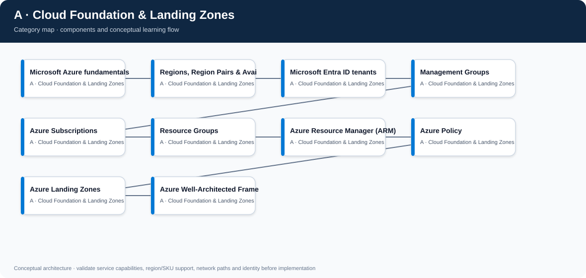
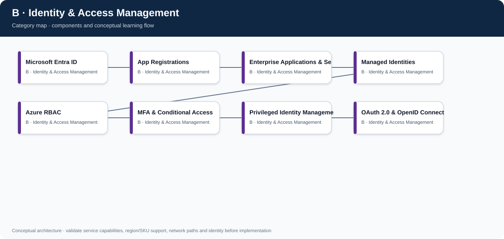
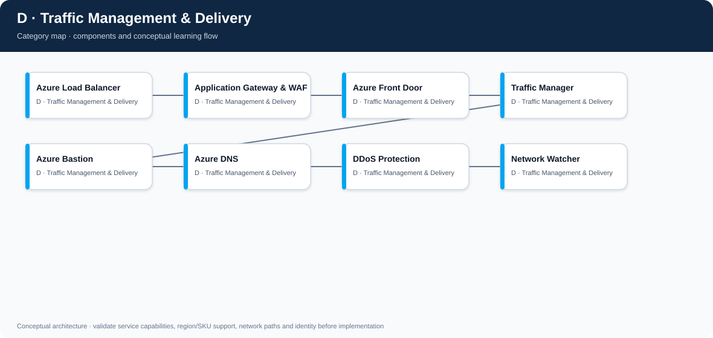
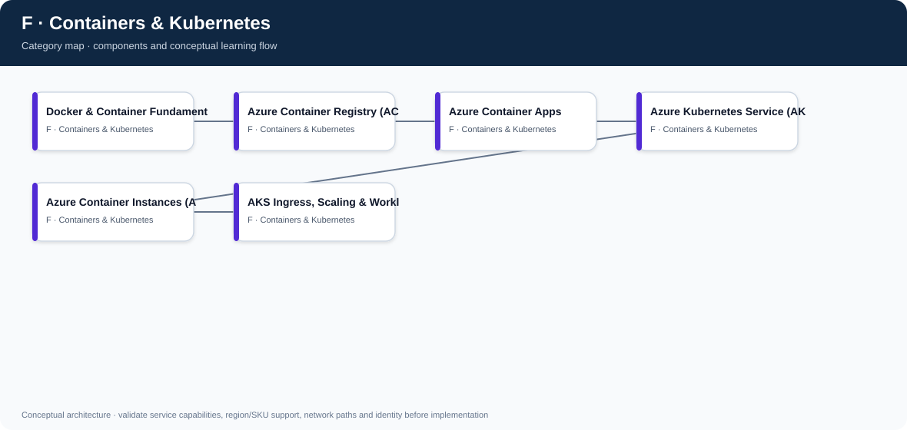
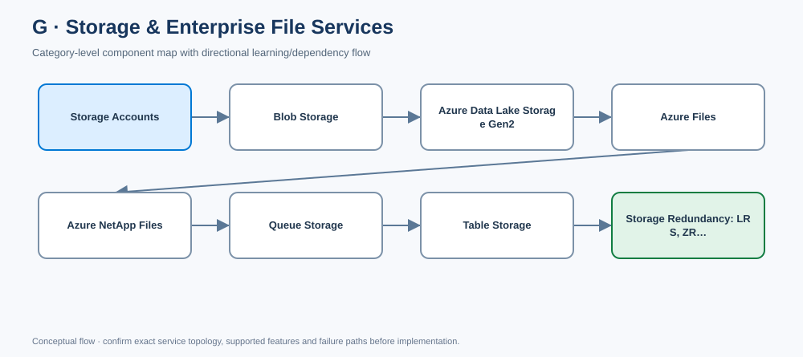
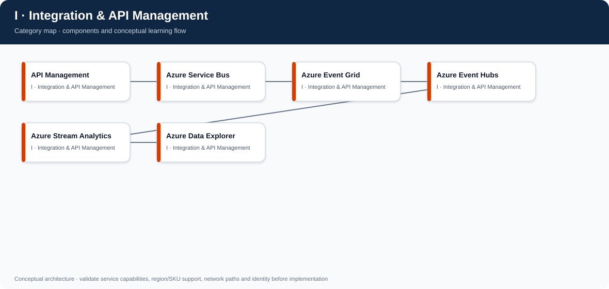
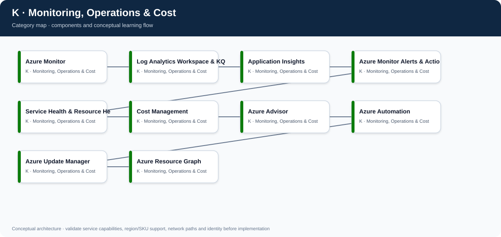
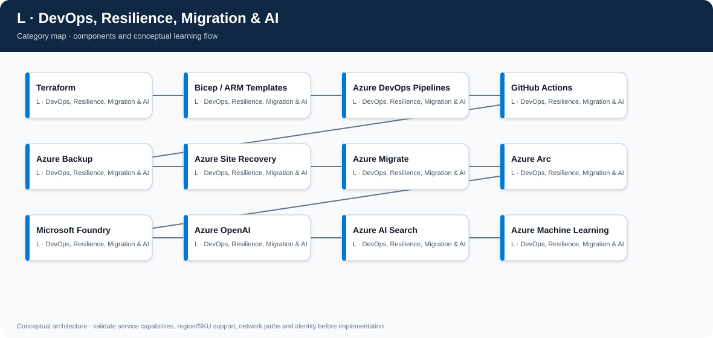

# Azure Master Vault — Visual Architecture Library

This page is the visual index for the repository. Every category has a rendered SVG, editable diagrams.net/draw.io source, and Mermaid source. Component folders also contain their own SVG and editable draw.io files.

## Master architecture

- [Open/edit master diagram in draw.io](architecture.drawio)
- [Mermaid source](architecture.mmd)

## Category maps

### A — Cloud Foundation & Landing Zones

- [Editable draw.io diagram](A-cloud-foundation-landing-zones/architecture.drawio)
- [Mermaid source](A-cloud-foundation-landing-zones/architecture.mmd)
- [Category tracker and design notes](A-cloud-foundation-landing-zones/README.md)

Components (10):
- [Microsoft Azure fundamentals](A-cloud-foundation-landing-zones/microsoft-azure-fundamentals/README.md) · [SVG](A-cloud-foundation-landing-zones/microsoft-azure-fundamentals/architecture.svg) · [editable draw.io](A-cloud-foundation-landing-zones/microsoft-azure-fundamentals/architecture.drawio)
- [Regions, Region Pairs & Availability Zones](A-cloud-foundation-landing-zones/regions-region-pairs-and-availability-zones/README.md) · [SVG](A-cloud-foundation-landing-zones/regions-region-pairs-and-availability-zones/architecture.svg) · [editable draw.io](A-cloud-foundation-landing-zones/regions-region-pairs-and-availability-zones/architecture.drawio)
- [Microsoft Entra ID tenants](A-cloud-foundation-landing-zones/microsoft-entra-id-tenants/README.md) · [SVG](A-cloud-foundation-landing-zones/microsoft-entra-id-tenants/architecture.svg) · [editable draw.io](A-cloud-foundation-landing-zones/microsoft-entra-id-tenants/architecture.drawio)
- [Management Groups](A-cloud-foundation-landing-zones/management-groups/README.md) · [SVG](A-cloud-foundation-landing-zones/management-groups/architecture.svg) · [editable draw.io](A-cloud-foundation-landing-zones/management-groups/architecture.drawio)
- [Azure Subscriptions](A-cloud-foundation-landing-zones/azure-subscriptions/README.md) · [SVG](A-cloud-foundation-landing-zones/azure-subscriptions/architecture.svg) · [editable draw.io](A-cloud-foundation-landing-zones/azure-subscriptions/architecture.drawio)
- [Resource Groups](A-cloud-foundation-landing-zones/resource-groups/README.md) · [SVG](A-cloud-foundation-landing-zones/resource-groups/architecture.svg) · [editable draw.io](A-cloud-foundation-landing-zones/resource-groups/architecture.drawio)
- [Azure Resource Manager (ARM)](A-cloud-foundation-landing-zones/azure-resource-manager-arm/README.md) · [SVG](A-cloud-foundation-landing-zones/azure-resource-manager-arm/architecture.svg) · [editable draw.io](A-cloud-foundation-landing-zones/azure-resource-manager-arm/architecture.drawio)
- [Azure Policy](A-cloud-foundation-landing-zones/azure-policy/README.md) · [SVG](A-cloud-foundation-landing-zones/azure-policy/architecture.svg) · [editable draw.io](A-cloud-foundation-landing-zones/azure-policy/architecture.drawio)
- [Azure Landing Zones](A-cloud-foundation-landing-zones/azure-landing-zones/README.md) · [SVG](A-cloud-foundation-landing-zones/azure-landing-zones/architecture.svg) · [editable draw.io](A-cloud-foundation-landing-zones/azure-landing-zones/architecture.drawio)
- [Azure Well-Architected Framework](A-cloud-foundation-landing-zones/azure-well-architected-framework/README.md) · [SVG](A-cloud-foundation-landing-zones/azure-well-architected-framework/architecture.svg) · [editable draw.io](A-cloud-foundation-landing-zones/azure-well-architected-framework/architecture.drawio)

### B — Identity & Access Management

- [Editable draw.io diagram](B-identity-access-management/architecture.drawio)
- [Mermaid source](B-identity-access-management/architecture.mmd)
- [Category tracker and design notes](B-identity-access-management/README.md)

Components (8):
- [Microsoft Entra ID](B-identity-access-management/microsoft-entra-id/README.md) · [SVG](B-identity-access-management/microsoft-entra-id/architecture.svg) · [editable draw.io](B-identity-access-management/microsoft-entra-id/architecture.drawio)
- [App Registrations](B-identity-access-management/app-registrations/README.md) · [SVG](B-identity-access-management/app-registrations/architecture.svg) · [editable draw.io](B-identity-access-management/app-registrations/architecture.drawio)
- [Enterprise Applications & Service Principals](B-identity-access-management/enterprise-applications-and-service-principals/README.md) · [SVG](B-identity-access-management/enterprise-applications-and-service-principals/architecture.svg) · [editable draw.io](B-identity-access-management/enterprise-applications-and-service-principals/architecture.drawio)
- [Managed Identities](B-identity-access-management/managed-identities/README.md) · [SVG](B-identity-access-management/managed-identities/architecture.svg) · [editable draw.io](B-identity-access-management/managed-identities/architecture.drawio)
- [Azure RBAC](B-identity-access-management/azure-rbac/README.md) · [SVG](B-identity-access-management/azure-rbac/architecture.svg) · [editable draw.io](B-identity-access-management/azure-rbac/architecture.drawio)
- [MFA & Conditional Access](B-identity-access-management/mfa-and-conditional-access/README.md) · [SVG](B-identity-access-management/mfa-and-conditional-access/architecture.svg) · [editable draw.io](B-identity-access-management/mfa-and-conditional-access/architecture.drawio)
- [Privileged Identity Management (PIM)](B-identity-access-management/privileged-identity-management-pim/README.md) · [SVG](B-identity-access-management/privileged-identity-management-pim/architecture.svg) · [editable draw.io](B-identity-access-management/privileged-identity-management-pim/architecture.drawio)
- [OAuth 2.0 & OpenID Connect](B-identity-access-management/oauth-2-0-and-openid-connect/README.md) · [SVG](B-identity-access-management/oauth-2-0-and-openid-connect/architecture.svg) · [editable draw.io](B-identity-access-management/oauth-2-0-and-openid-connect/architecture.drawio)

### C — Networking & Private Connectivity

- [Editable draw.io diagram](C-networking-private-connectivity/architecture.drawio)
- [Mermaid source](C-networking-private-connectivity/architecture.mmd)
- [Category tracker and design notes](C-networking-private-connectivity/README.md)

Components (12):
- [Virtual Networks (VNet)](C-networking-private-connectivity/virtual-networks-vnet/README.md) · [SVG](C-networking-private-connectivity/virtual-networks-vnet/architecture.svg) · [editable draw.io](C-networking-private-connectivity/virtual-networks-vnet/architecture.drawio)
- [Subnets & CIDR Planning](C-networking-private-connectivity/subnets-and-cidr-planning/README.md) · [SVG](C-networking-private-connectivity/subnets-and-cidr-planning/architecture.svg) · [editable draw.io](C-networking-private-connectivity/subnets-and-cidr-planning/architecture.drawio)
- [Network Security Groups (NSGs)](C-networking-private-connectivity/network-security-groups-nsgs/README.md) · [SVG](C-networking-private-connectivity/network-security-groups-nsgs/architecture.svg) · [editable draw.io](C-networking-private-connectivity/network-security-groups-nsgs/architecture.drawio)
- [Application Security Groups (ASGs)](C-networking-private-connectivity/application-security-groups-asgs/README.md) · [SVG](C-networking-private-connectivity/application-security-groups-asgs/architecture.svg) · [editable draw.io](C-networking-private-connectivity/application-security-groups-asgs/architecture.drawio)
- [VNet Peering](C-networking-private-connectivity/vnet-peering/README.md) · [SVG](C-networking-private-connectivity/vnet-peering/architecture.svg) · [editable draw.io](C-networking-private-connectivity/vnet-peering/architecture.drawio)
- [User-Defined Routes (UDRs)](C-networking-private-connectivity/user-defined-routes-udrs/README.md) · [SVG](C-networking-private-connectivity/user-defined-routes-udrs/architecture.svg) · [editable draw.io](C-networking-private-connectivity/user-defined-routes-udrs/architecture.drawio)
- [Azure Firewall](C-networking-private-connectivity/azure-firewall/README.md) · [SVG](C-networking-private-connectivity/azure-firewall/architecture.svg) · [editable draw.io](C-networking-private-connectivity/azure-firewall/architecture.drawio)
- [VPN Gateway](C-networking-private-connectivity/vpn-gateway/README.md) · [SVG](C-networking-private-connectivity/vpn-gateway/architecture.svg) · [editable draw.io](C-networking-private-connectivity/vpn-gateway/architecture.drawio)
- [ExpressRoute](C-networking-private-connectivity/expressroute/README.md) · [SVG](C-networking-private-connectivity/expressroute/architecture.svg) · [editable draw.io](C-networking-private-connectivity/expressroute/architecture.drawio)
- [Private Link & Private Endpoints](C-networking-private-connectivity/private-link-and-private-endpoints/README.md) · [SVG](C-networking-private-connectivity/private-link-and-private-endpoints/architecture.svg) · [editable draw.io](C-networking-private-connectivity/private-link-and-private-endpoints/architecture.drawio)
- [Private DNS Zones](C-networking-private-connectivity/private-dns-zones/README.md) · [SVG](C-networking-private-connectivity/private-dns-zones/architecture.svg) · [editable draw.io](C-networking-private-connectivity/private-dns-zones/architecture.drawio)
- [NAT Gateway](C-networking-private-connectivity/nat-gateway/README.md) · [SVG](C-networking-private-connectivity/nat-gateway/architecture.svg) · [editable draw.io](C-networking-private-connectivity/nat-gateway/architecture.drawio)

### D — Traffic Management & Delivery

- [Editable draw.io diagram](D-traffic-management-delivery/architecture.drawio)
- [Mermaid source](D-traffic-management-delivery/architecture.mmd)
- [Category tracker and design notes](D-traffic-management-delivery/README.md)

Components (8):
- [Azure Load Balancer](D-traffic-management-delivery/azure-load-balancer/README.md) · [SVG](D-traffic-management-delivery/azure-load-balancer/architecture.svg) · [editable draw.io](D-traffic-management-delivery/azure-load-balancer/architecture.drawio)
- [Application Gateway & WAF](D-traffic-management-delivery/application-gateway-and-waf/README.md) · [SVG](D-traffic-management-delivery/application-gateway-and-waf/architecture.svg) · [editable draw.io](D-traffic-management-delivery/application-gateway-and-waf/architecture.drawio)
- [Azure Front Door](D-traffic-management-delivery/azure-front-door/README.md) · [SVG](D-traffic-management-delivery/azure-front-door/architecture.svg) · [editable draw.io](D-traffic-management-delivery/azure-front-door/architecture.drawio)
- [Traffic Manager](D-traffic-management-delivery/traffic-manager/README.md) · [SVG](D-traffic-management-delivery/traffic-manager/architecture.svg) · [editable draw.io](D-traffic-management-delivery/traffic-manager/architecture.drawio)
- [Azure Bastion](D-traffic-management-delivery/azure-bastion/README.md) · [SVG](D-traffic-management-delivery/azure-bastion/architecture.svg) · [editable draw.io](D-traffic-management-delivery/azure-bastion/architecture.drawio)
- [Azure DNS](D-traffic-management-delivery/azure-dns/README.md) · [SVG](D-traffic-management-delivery/azure-dns/architecture.svg) · [editable draw.io](D-traffic-management-delivery/azure-dns/architecture.drawio)
- [DDoS Protection](D-traffic-management-delivery/ddos-protection/README.md) · [SVG](D-traffic-management-delivery/ddos-protection/architecture.svg) · [editable draw.io](D-traffic-management-delivery/ddos-protection/architecture.drawio)
- [Network Watcher](D-traffic-management-delivery/network-watcher/README.md) · [SVG](D-traffic-management-delivery/network-watcher/architecture.svg) · [editable draw.io](D-traffic-management-delivery/network-watcher/architecture.drawio)

### E — Compute & Application Hosting

- [Editable draw.io diagram](E-compute-application-hosting/architecture.drawio)
- [Mermaid source](E-compute-application-hosting/architecture.mmd)
- [Category tracker and design notes](E-compute-application-hosting/README.md)

Components (8):
- [Virtual Machines](E-compute-application-hosting/virtual-machines/README.md) · [SVG](E-compute-application-hosting/virtual-machines/architecture.svg) · [editable draw.io](E-compute-application-hosting/virtual-machines/architecture.drawio)
- [Managed Disks](E-compute-application-hosting/managed-disks/README.md) · [SVG](E-compute-application-hosting/managed-disks/architecture.svg) · [editable draw.io](E-compute-application-hosting/managed-disks/architecture.drawio)
- [Availability Sets & Zones](E-compute-application-hosting/availability-sets-and-zones/README.md) · [SVG](E-compute-application-hosting/availability-sets-and-zones/architecture.svg) · [editable draw.io](E-compute-application-hosting/availability-sets-and-zones/architecture.drawio)
- [Virtual Machine Scale Sets](E-compute-application-hosting/virtual-machine-scale-sets/README.md) · [SVG](E-compute-application-hosting/virtual-machine-scale-sets/architecture.svg) · [editable draw.io](E-compute-application-hosting/virtual-machine-scale-sets/architecture.drawio)
- [Azure App Service](E-compute-application-hosting/azure-app-service/README.md) · [SVG](E-compute-application-hosting/azure-app-service/architecture.svg) · [editable draw.io](E-compute-application-hosting/azure-app-service/architecture.drawio)
- [Azure Functions](E-compute-application-hosting/azure-functions/README.md) · [SVG](E-compute-application-hosting/azure-functions/architecture.svg) · [editable draw.io](E-compute-application-hosting/azure-functions/architecture.drawio)
- [Logic Apps](E-compute-application-hosting/logic-apps/README.md) · [SVG](E-compute-application-hosting/logic-apps/architecture.svg) · [editable draw.io](E-compute-application-hosting/logic-apps/architecture.drawio)
- [Azure Batch](E-compute-application-hosting/azure-batch/README.md) · [SVG](E-compute-application-hosting/azure-batch/architecture.svg) · [editable draw.io](E-compute-application-hosting/azure-batch/architecture.drawio)

### F — Containers & Kubernetes

- [Editable draw.io diagram](F-containers-kubernetes/architecture.drawio)
- [Mermaid source](F-containers-kubernetes/architecture.mmd)
- [Category tracker and design notes](F-containers-kubernetes/README.md)

Components (6):
- [Docker & Container Fundamentals](F-containers-kubernetes/docker-and-container-fundamentals/README.md) · [SVG](F-containers-kubernetes/docker-and-container-fundamentals/architecture.svg) · [editable draw.io](F-containers-kubernetes/docker-and-container-fundamentals/architecture.drawio)
- [Azure Container Registry (ACR)](F-containers-kubernetes/azure-container-registry-acr/README.md) · [SVG](F-containers-kubernetes/azure-container-registry-acr/architecture.svg) · [editable draw.io](F-containers-kubernetes/azure-container-registry-acr/architecture.drawio)
- [Azure Container Apps](F-containers-kubernetes/azure-container-apps/README.md) · [SVG](F-containers-kubernetes/azure-container-apps/architecture.svg) · [editable draw.io](F-containers-kubernetes/azure-container-apps/architecture.drawio)
- [Azure Kubernetes Service (AKS)](F-containers-kubernetes/azure-kubernetes-service-aks/README.md) · [SVG](F-containers-kubernetes/azure-kubernetes-service-aks/architecture.svg) · [editable draw.io](F-containers-kubernetes/azure-kubernetes-service-aks/architecture.drawio)
- [Azure Container Instances (ACI)](F-containers-kubernetes/azure-container-instances-aci/README.md) · [SVG](F-containers-kubernetes/azure-container-instances-aci/architecture.svg) · [editable draw.io](F-containers-kubernetes/azure-container-instances-aci/architecture.drawio)
- [AKS Ingress, Scaling & Workload Identity](F-containers-kubernetes/aks-ingress-scaling-and-workload-identity/README.md) · [SVG](F-containers-kubernetes/aks-ingress-scaling-and-workload-identity/architecture.svg) · [editable draw.io](F-containers-kubernetes/aks-ingress-scaling-and-workload-identity/architecture.drawio)

### G — Storage & Enterprise File Services

- [Editable draw.io diagram](G-storage-enterprise-file-services/architecture.drawio)
- [Mermaid source](G-storage-enterprise-file-services/architecture.mmd)
- [Category tracker and design notes](G-storage-enterprise-file-services/README.md)

Components (8):
- [Storage Accounts](G-storage-enterprise-file-services/storage-accounts/README.md) · [SVG](G-storage-enterprise-file-services/storage-accounts/architecture.svg) · [editable draw.io](G-storage-enterprise-file-services/storage-accounts/architecture.drawio)
- [Blob Storage](G-storage-enterprise-file-services/blob-storage/README.md) · [SVG](G-storage-enterprise-file-services/blob-storage/architecture.svg) · [editable draw.io](G-storage-enterprise-file-services/blob-storage/architecture.drawio)
- [Azure Data Lake Storage Gen2](G-storage-enterprise-file-services/azure-data-lake-storage-gen2/README.md) · [SVG](G-storage-enterprise-file-services/azure-data-lake-storage-gen2/architecture.svg) · [editable draw.io](G-storage-enterprise-file-services/azure-data-lake-storage-gen2/architecture.drawio)
- [Azure Files](G-storage-enterprise-file-services/azure-files/README.md) · [SVG](G-storage-enterprise-file-services/azure-files/architecture.svg) · [editable draw.io](G-storage-enterprise-file-services/azure-files/architecture.drawio)
- [Azure NetApp Files](G-storage-enterprise-file-services/azure-netapp-files/README.md) · [SVG](G-storage-enterprise-file-services/azure-netapp-files/architecture.svg) · [editable draw.io](G-storage-enterprise-file-services/azure-netapp-files/architecture.drawio)
- [Queue Storage](G-storage-enterprise-file-services/queue-storage/README.md) · [SVG](G-storage-enterprise-file-services/queue-storage/architecture.svg) · [editable draw.io](G-storage-enterprise-file-services/queue-storage/architecture.drawio)
- [Table Storage](G-storage-enterprise-file-services/table-storage/README.md) · [SVG](G-storage-enterprise-file-services/table-storage/architecture.svg) · [editable draw.io](G-storage-enterprise-file-services/table-storage/architecture.drawio)
- [Storage Redundancy: LRS, ZRS, GRS & GZRS](G-storage-enterprise-file-services/storage-redundancy-lrs-zrs-grs-and-gzrs/README.md) · [SVG](G-storage-enterprise-file-services/storage-redundancy-lrs-zrs-grs-and-gzrs/architecture.svg) · [editable draw.io](G-storage-enterprise-file-services/storage-redundancy-lrs-zrs-grs-and-gzrs/architecture.drawio)

### H — Databases & Data Platforms

- [Editable draw.io diagram](H-databases-data-platforms/architecture.drawio)
- [Mermaid source](H-databases-data-platforms/architecture.mmd)
- [Category tracker and design notes](H-databases-data-platforms/README.md)

Components (10):
- [Azure SQL Database](H-databases-data-platforms/azure-sql-database/README.md) · [SVG](H-databases-data-platforms/azure-sql-database/architecture.svg) · [editable draw.io](H-databases-data-platforms/azure-sql-database/architecture.drawio)
- [Azure SQL Managed Instance](H-databases-data-platforms/azure-sql-managed-instance/README.md) · [SVG](H-databases-data-platforms/azure-sql-managed-instance/architecture.svg) · [editable draw.io](H-databases-data-platforms/azure-sql-managed-instance/architecture.drawio)
- [SQL Server on Azure VMs](H-databases-data-platforms/sql-server-on-azure-vms/README.md) · [SVG](H-databases-data-platforms/sql-server-on-azure-vms/architecture.svg) · [editable draw.io](H-databases-data-platforms/sql-server-on-azure-vms/architecture.drawio)
- [Azure Cosmos DB](H-databases-data-platforms/azure-cosmos-db/README.md) · [SVG](H-databases-data-platforms/azure-cosmos-db/architecture.svg) · [editable draw.io](H-databases-data-platforms/azure-cosmos-db/architecture.drawio)
- [Azure Database for PostgreSQL](H-databases-data-platforms/azure-database-for-postgresql/README.md) · [SVG](H-databases-data-platforms/azure-database-for-postgresql/architecture.svg) · [editable draw.io](H-databases-data-platforms/azure-database-for-postgresql/architecture.drawio)
- [Azure Database for MySQL](H-databases-data-platforms/azure-database-for-mysql/README.md) · [SVG](H-databases-data-platforms/azure-database-for-mysql/architecture.svg) · [editable draw.io](H-databases-data-platforms/azure-database-for-mysql/architecture.drawio)
- [Azure Managed Redis](H-databases-data-platforms/azure-managed-redis/README.md) · [SVG](H-databases-data-platforms/azure-managed-redis/architecture.svg) · [editable draw.io](H-databases-data-platforms/azure-managed-redis/architecture.drawio)
- [Azure Data Factory](H-databases-data-platforms/azure-data-factory/README.md) · [SVG](H-databases-data-platforms/azure-data-factory/architecture.svg) · [editable draw.io](H-databases-data-platforms/azure-data-factory/architecture.drawio)
- [Azure Databricks](H-databases-data-platforms/azure-databricks/README.md) · [SVG](H-databases-data-platforms/azure-databricks/architecture.svg) · [editable draw.io](H-databases-data-platforms/azure-databricks/architecture.drawio)
- [Microsoft Fabric / OneLake](H-databases-data-platforms/microsoft-fabric-onelake/README.md) · [SVG](H-databases-data-platforms/microsoft-fabric-onelake/architecture.svg) · [editable draw.io](H-databases-data-platforms/microsoft-fabric-onelake/architecture.drawio)

### I — Integration & API Management

- [Editable draw.io diagram](I-integration-api-management/architecture.drawio)
- [Mermaid source](I-integration-api-management/architecture.mmd)
- [Category tracker and design notes](I-integration-api-management/README.md)

Components (6):
- [API Management](I-integration-api-management/api-management/README.md) · [SVG](I-integration-api-management/api-management/architecture.svg) · [editable draw.io](I-integration-api-management/api-management/architecture.drawio)
- [Azure Service Bus](I-integration-api-management/azure-service-bus/README.md) · [SVG](I-integration-api-management/azure-service-bus/architecture.svg) · [editable draw.io](I-integration-api-management/azure-service-bus/architecture.drawio)
- [Azure Event Grid](I-integration-api-management/azure-event-grid/README.md) · [SVG](I-integration-api-management/azure-event-grid/architecture.svg) · [editable draw.io](I-integration-api-management/azure-event-grid/architecture.drawio)
- [Azure Event Hubs](I-integration-api-management/azure-event-hubs/README.md) · [SVG](I-integration-api-management/azure-event-hubs/architecture.svg) · [editable draw.io](I-integration-api-management/azure-event-hubs/architecture.drawio)
- [Azure Stream Analytics](I-integration-api-management/azure-stream-analytics/README.md) · [SVG](I-integration-api-management/azure-stream-analytics/architecture.svg) · [editable draw.io](I-integration-api-management/azure-stream-analytics/architecture.drawio)
- [Azure Data Explorer](I-integration-api-management/azure-data-explorer/README.md) · [SVG](I-integration-api-management/azure-data-explorer/architecture.svg) · [editable draw.io](I-integration-api-management/azure-data-explorer/architecture.drawio)

### J — Security, Secrets & Governance

- [Editable draw.io diagram](J-security-secrets-governance/architecture.drawio)
- [Mermaid source](J-security-secrets-governance/architecture.mmd)
- [Category tracker and design notes](J-security-secrets-governance/README.md)

Components (8):
- [Azure Key Vault](J-security-secrets-governance/azure-key-vault/README.md) · [SVG](J-security-secrets-governance/azure-key-vault/architecture.svg) · [editable draw.io](J-security-secrets-governance/azure-key-vault/architecture.drawio)
- [Key Vault Access Policies & RBAC](J-security-secrets-governance/key-vault-access-policies-and-rbac/README.md) · [SVG](J-security-secrets-governance/key-vault-access-policies-and-rbac/architecture.svg) · [editable draw.io](J-security-secrets-governance/key-vault-access-policies-and-rbac/architecture.drawio)
- [Microsoft Defender for Cloud](J-security-secrets-governance/microsoft-defender-for-cloud/README.md) · [SVG](J-security-secrets-governance/microsoft-defender-for-cloud/architecture.svg) · [editable draw.io](J-security-secrets-governance/microsoft-defender-for-cloud/architecture.drawio)
- [Microsoft Sentinel](J-security-secrets-governance/microsoft-sentinel/README.md) · [SVG](J-security-secrets-governance/microsoft-sentinel/architecture.svg) · [editable draw.io](J-security-secrets-governance/microsoft-sentinel/architecture.drawio)
- [Microsoft Purview](J-security-secrets-governance/microsoft-purview/README.md) · [SVG](J-security-secrets-governance/microsoft-purview/architecture.svg) · [editable draw.io](J-security-secrets-governance/microsoft-purview/architecture.drawio)
- [Azure Resource Locks](J-security-secrets-governance/azure-resource-locks/README.md) · [SVG](J-security-secrets-governance/azure-resource-locks/architecture.svg) · [editable draw.io](J-security-secrets-governance/azure-resource-locks/architecture.drawio)
- [Tagging & Naming Standards](J-security-secrets-governance/tagging-and-naming-standards/README.md) · [SVG](J-security-secrets-governance/tagging-and-naming-standards/architecture.svg) · [editable draw.io](J-security-secrets-governance/tagging-and-naming-standards/architecture.drawio)
- [Zero Trust Architecture](J-security-secrets-governance/zero-trust-architecture/README.md) · [SVG](J-security-secrets-governance/zero-trust-architecture/architecture.svg) · [editable draw.io](J-security-secrets-governance/zero-trust-architecture/architecture.drawio)

### K — Monitoring, Operations & Cost

- [Editable draw.io diagram](K-monitoring-operations-cost/architecture.drawio)
- [Mermaid source](K-monitoring-operations-cost/architecture.mmd)
- [Category tracker and design notes](K-monitoring-operations-cost/README.md)

Components (10):
- [Azure Monitor](K-monitoring-operations-cost/azure-monitor/README.md) · [SVG](K-monitoring-operations-cost/azure-monitor/architecture.svg) · [editable draw.io](K-monitoring-operations-cost/azure-monitor/architecture.drawio)
- [Log Analytics Workspace & KQL](K-monitoring-operations-cost/log-analytics-workspace-and-kql/README.md) · [SVG](K-monitoring-operations-cost/log-analytics-workspace-and-kql/architecture.svg) · [editable draw.io](K-monitoring-operations-cost/log-analytics-workspace-and-kql/architecture.drawio)
- [Application Insights](K-monitoring-operations-cost/application-insights/README.md) · [SVG](K-monitoring-operations-cost/application-insights/architecture.svg) · [editable draw.io](K-monitoring-operations-cost/application-insights/architecture.drawio)
- [Azure Monitor Alerts & Action Groups](K-monitoring-operations-cost/azure-monitor-alerts-and-action-groups/README.md) · [SVG](K-monitoring-operations-cost/azure-monitor-alerts-and-action-groups/architecture.svg) · [editable draw.io](K-monitoring-operations-cost/azure-monitor-alerts-and-action-groups/architecture.drawio)
- [Service Health & Resource Health](K-monitoring-operations-cost/service-health-and-resource-health/README.md) · [SVG](K-monitoring-operations-cost/service-health-and-resource-health/architecture.svg) · [editable draw.io](K-monitoring-operations-cost/service-health-and-resource-health/architecture.drawio)
- [Cost Management](K-monitoring-operations-cost/cost-management/README.md) · [SVG](K-monitoring-operations-cost/cost-management/architecture.svg) · [editable draw.io](K-monitoring-operations-cost/cost-management/architecture.drawio)
- [Azure Advisor](K-monitoring-operations-cost/azure-advisor/README.md) · [SVG](K-monitoring-operations-cost/azure-advisor/architecture.svg) · [editable draw.io](K-monitoring-operations-cost/azure-advisor/architecture.drawio)
- [Azure Automation](K-monitoring-operations-cost/azure-automation/README.md) · [SVG](K-monitoring-operations-cost/azure-automation/architecture.svg) · [editable draw.io](K-monitoring-operations-cost/azure-automation/architecture.drawio)
- [Azure Update Manager](K-monitoring-operations-cost/azure-update-manager/README.md) · [SVG](K-monitoring-operations-cost/azure-update-manager/architecture.svg) · [editable draw.io](K-monitoring-operations-cost/azure-update-manager/architecture.drawio)
- [Azure Resource Graph](K-monitoring-operations-cost/azure-resource-graph/README.md) · [SVG](K-monitoring-operations-cost/azure-resource-graph/architecture.svg) · [editable draw.io](K-monitoring-operations-cost/azure-resource-graph/architecture.drawio)

### L — DevOps, Resilience, Migration & AI

- [Editable draw.io diagram](L-devops-resilience-migration-ai/architecture.drawio)
- [Mermaid source](L-devops-resilience-migration-ai/architecture.mmd)
- [Category tracker and design notes](L-devops-resilience-migration-ai/README.md)

Components (12):
- [Terraform](L-devops-resilience-migration-ai/terraform/README.md) · [SVG](L-devops-resilience-migration-ai/terraform/architecture.svg) · [editable draw.io](L-devops-resilience-migration-ai/terraform/architecture.drawio)
- [Bicep / ARM Templates](L-devops-resilience-migration-ai/bicep-arm-templates/README.md) · [SVG](L-devops-resilience-migration-ai/bicep-arm-templates/architecture.svg) · [editable draw.io](L-devops-resilience-migration-ai/bicep-arm-templates/architecture.drawio)
- [Azure DevOps Pipelines](L-devops-resilience-migration-ai/azure-devops-pipelines/README.md) · [SVG](L-devops-resilience-migration-ai/azure-devops-pipelines/architecture.svg) · [editable draw.io](L-devops-resilience-migration-ai/azure-devops-pipelines/architecture.drawio)
- [GitHub Actions](L-devops-resilience-migration-ai/github-actions/README.md) · [SVG](L-devops-resilience-migration-ai/github-actions/architecture.svg) · [editable draw.io](L-devops-resilience-migration-ai/github-actions/architecture.drawio)
- [Azure Backup](L-devops-resilience-migration-ai/azure-backup/README.md) · [SVG](L-devops-resilience-migration-ai/azure-backup/architecture.svg) · [editable draw.io](L-devops-resilience-migration-ai/azure-backup/architecture.drawio)
- [Azure Site Recovery](L-devops-resilience-migration-ai/azure-site-recovery/README.md) · [SVG](L-devops-resilience-migration-ai/azure-site-recovery/architecture.svg) · [editable draw.io](L-devops-resilience-migration-ai/azure-site-recovery/architecture.drawio)
- [Azure Migrate](L-devops-resilience-migration-ai/azure-migrate/README.md) · [SVG](L-devops-resilience-migration-ai/azure-migrate/architecture.svg) · [editable draw.io](L-devops-resilience-migration-ai/azure-migrate/architecture.drawio)
- [Azure Arc](L-devops-resilience-migration-ai/azure-arc/README.md) · [SVG](L-devops-resilience-migration-ai/azure-arc/architecture.svg) · [editable draw.io](L-devops-resilience-migration-ai/azure-arc/architecture.drawio)
- [Microsoft Foundry](L-devops-resilience-migration-ai/microsoft-foundry/README.md) · [SVG](L-devops-resilience-migration-ai/microsoft-foundry/architecture.svg) · [editable draw.io](L-devops-resilience-migration-ai/microsoft-foundry/architecture.drawio)
- [Azure OpenAI](L-devops-resilience-migration-ai/azure-openai/README.md) · [SVG](L-devops-resilience-migration-ai/azure-openai/architecture.svg) · [editable draw.io](L-devops-resilience-migration-ai/azure-openai/architecture.drawio)
- [Azure AI Search](L-devops-resilience-migration-ai/azure-ai-search/README.md) · [SVG](L-devops-resilience-migration-ai/azure-ai-search/architecture.svg) · [editable draw.io](L-devops-resilience-migration-ai/azure-ai-search/architecture.drawio)
- [Azure Machine Learning](L-devops-resilience-migration-ai/azure-machine-learning/README.md) · [SVG](L-devops-resilience-migration-ai/azure-machine-learning/architecture.svg) · [editable draw.io](L-devops-resilience-migration-ai/azure-machine-learning/architecture.drawio)

### 12 — Automation, Backup and Disaster Recovery

- [Editable draw.io diagram](12-automation-backup-disaster-recovery/architecture.drawio)
- [Mermaid source](12-automation-backup-disaster-recovery/architecture.mmd)
- [Category tracker and design notes](12-automation-backup-disaster-recovery/README.md)

Components (5):
- [Terraform — Infrastructure as Code](12-automation-backup-disaster-recovery/72-terraform/README.md) · [SVG](12-automation-backup-disaster-recovery/72-terraform/architecture.svg) · [editable draw.io](12-automation-backup-disaster-recovery/72-terraform/architecture.drawio)
- [Bicep and ARM Templates](12-automation-backup-disaster-recovery/73-bicep-arm-templates/README.md) · [SVG](12-automation-backup-disaster-recovery/73-bicep-arm-templates/architecture.svg) · [editable draw.io](12-automation-backup-disaster-recovery/73-bicep-arm-templates/architecture.drawio)
- [Azure DevOps Pipelines and GitHub Actions](12-automation-backup-disaster-recovery/74-ci-cd-azure-devops-github-actions/README.md) · [SVG](12-automation-backup-disaster-recovery/74-ci-cd-azure-devops-github-actions/architecture.svg) · [editable draw.io](12-automation-backup-disaster-recovery/74-ci-cd-azure-devops-github-actions/architecture.drawio)
- [Azure Backup](12-automation-backup-disaster-recovery/75-azure-backup/README.md) · [SVG](12-automation-backup-disaster-recovery/75-azure-backup/architecture.svg) · [editable draw.io](12-automation-backup-disaster-recovery/75-azure-backup/architecture.drawio)
- [Azure Site Recovery (ASR)](12-automation-backup-disaster-recovery/76-azure-site-recovery-asr/README.md) · [SVG](12-automation-backup-disaster-recovery/76-azure-site-recovery-asr/architecture.svg) · [editable draw.io](12-automation-backup-disaster-recovery/76-azure-site-recovery-asr/architecture.drawio)

## Diagram conventions

- **Solid arrows** represent conceptual flow or dependency.
- **Dashed arrows** in Mermaid sources represent cross-cutting controls such as identity, governance, networking, monitoring or recovery.
- SVG files are for quick viewing in GitHub; `.drawio` files are editable in [diagrams.net](https://app.diagrams.net/).
- These are architecture learning diagrams, not a live Azure topology. Validate SKU/region support, exact network paths, security configuration and failure behavior against workload requirements and current Microsoft Learn before production use.

## Design references

- [Microsoft Azure Architecture Icons](https://learn.microsoft.com/en-us/azure/architecture/icons/)
- [draw.io Azure architecture diagrams](https://www.drawio.com/docs/diagram-types/azure-diagrams/)