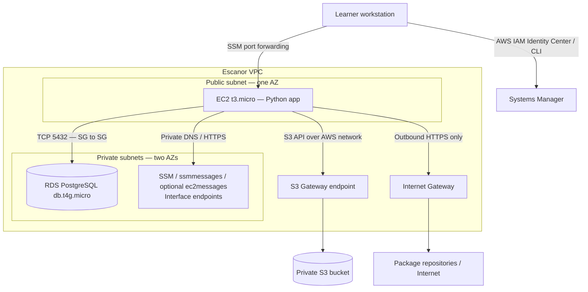

# Escanor — AWS Learning Workload

**Document status:** Runnable low-footprint AWS learning lab plus a larger architecture roadmap  
**Version:** 0.2  
**Deployment status:** Code is provided for readers to deploy in their own disposable AWS account; this repository has not deployed AWS resources  
**Primary Region default:** `ap-south-1`

## 1. Purpose

Escanor is the first hands-on workload inside the AWS Master Reference. It gives a reader a repeatable way to learn AWS networking, compute, identity, storage, databases, private connectivity, Terraform and CI validation without starting with a large EKS platform.

The **learning lab profile** uses:
- One small Amazon Linux 2023 EC2 instance (`t3.micro` by default).
- One small PostgreSQL RDS instance (`db.t4g.micro` by default) in private subnets.
- One private, encrypted, versioned S3 bucket.
- An S3 Gateway VPC Endpoint.
- AWS Systems Manager interface VPC endpoints powered by AWS PrivateLink.
- A sample Python application that writes notes to RDS and uploads/list objects in S3.
- IAM instance role, RDS IAM database authentication, Terraform and GitHub Actions CI.

The lab has an outbound Internet path for package installation, but no inbound EC2 security-group rules and no SSH exposure. Operators connect with Systems Manager Session Manager.

## 2. How this relates to the Escanor source architecture

The source Escanor design describes a much larger AIOps and cloud-economics control plane with EKS, Argo CD, multi-plane drift collection, observability, CUR 2.0, Athena and an AI-agent layer. That remains the **future architecture / learning roadmap**.

This low-footprint code profile deliberately starts with core AWS building blocks. It does not claim to implement the four drift collectors, EKS, Argo CD, CUR analytics or Bedrock AgentCore yet. Those are later modules; their requirements and intended architecture remain documented in the LLD.

## 3. Architecture — learning lab

The diagram is logical. Terraform is the source of truth for subnet CIDRs, routes, security groups, endpoint policy, IAM role, RDS settings and S3 controls.

## 4. Network and security decisions

- EC2 is in a public subnet with a public IPv4 only to provide outbound Internet egress without a NAT Gateway. Its security group has **no inbound rules**. The app is accessed through an SSM port-forwarding session, not by opening port 8080 on the Internet.
- RDS is not publicly accessible. Its subnet group spans two private subnets in separate Availability Zones. RDS is Single-AZ in this low-cost lab profile.
- EC2-to-RDS traffic is TCP 5432 and is allowed by referencing the EC2 security group from the RDS security group.
- EC2 management uses Systems Manager. Interface endpoints for `ssm`, `ssmmessages` and (for compatible Regions/agents) `ec2messages` keep the management path on private IPs. Interface endpoints have hourly and data-processing charges.
- EC2-to-S3 uses an S3 Gateway Endpoint. Gateway endpoints do not have an hourly endpoint charge. The endpoint policy limits the route to the Escanor uploads prefix.
- RDS master credentials are managed by RDS in Secrets Manager. The instance does not receive the master password. The application database role uses short-lived RDS IAM authentication tokens and a narrowly scoped `rds-db:connect` permission.
- The instance profile provides SSM core permissions, scoped S3 access and the RDS database-connect permission. No static AWS access keys are stored in the application or on EC2.
- IMDSv2 is required and the root EBS volume is encrypted.
- The S3 bucket blocks public access, enforces bucket-owner object ownership, uses server-side encryption and has versioning enabled.

**Important endpoint distinction:** the S3 Gateway Endpoint is for traffic originating in the VPC and routed through its associated route tables. It is not a general endpoint for on-premises networks, VPC peering or Transit Gateway. For those scenarios, AWS offers an S3 Interface Endpoint (AWS PrivateLink) with additional charges. VPC peering / Transit Gateway are not part of the default lab.

## 5. Getting started

Follow the full [clone, login, build, test and cleanup guide](docs/getting-started.md). It covers:
1. Clone the AWS Vault repository.
2. Install AWS CLI v2, Terraform and Python.
3. Sign in with AWS IAM Identity Center and verify the account with STS.
4. Bootstrap a separate S3 Terraform state bucket.
5. Run Terraform format, validate and plan; review the plan before apply.
6. Create the learning lab in the reader's AWS account.
7. Use Session Manager to bootstrap the database role and open the sample app locally.
8. Test RDS, S3, VPC endpoints, IAM and S3 object versioning.
9. Destroy the lab and review retained resources and billing.

## 6. Project map

| Path | Purpose |
|---|---|
| `app/` | Python Flask sample application and unit tests |
| `infra/terraform/` | VPC, EC2, RDS, S3, endpoints, IAM and outputs |
| `scripts/` | Preflight, state bootstrap, Session Manager port forwarding and DB role bootstrap |
| `docs/getting-started.md` | Full learner walkthrough |
| `buildspec.yml` | AWS CodeBuild build specification (no AWS deploy permissions required) |
| `docs/codebuild.md` | Configure CodeBuild and optional CodePipeline build-only path |
| `docs/validation.md` | Acceptance tests and evidence checklist |
| `lld/` | Design, security, FinOps, DR and future Escanor roadmap |

## 7. Build pipeline

[`.github/workflows/aws-escanor-ci.yml`](../../../.github/workflows/aws-escanor-ci.yml) runs on relevant pull requests and pushes to `main`. It compiles and tests the Python application and runs Terraform format / init / validate. It does not use AWS credentials and does not create or modify AWS resources.

A successful pipeline proves static checks passed for that commit. It does not prove an AWS deployment, quota availability, IAM permissions, live endpoint connectivity or cost.

## 8. Limitations

This is a learning lab, not a production landing zone or production Escanor service. It uses one small EC2 host, a Single-AZ RDS instance, a single-AZ location for the Systems Manager interface endpoints, synthetic data and a simple sample application. The database uses a small instance class; RDS failover and high availability are not demonstrated. No public application ingress, ALB, WAF, EKS, Argo CD or AI agent is deployed by this profile.

All AWS resources are created only when the reader deliberately runs Terraform. Costs depend on Region, account eligibility, runtime hours, public IPv4, RDS, EBS, interface endpoint usage, data transfer and storage. The lab is not guaranteed to be free.
