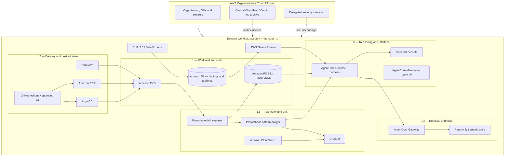

# 02 — Detailed Solution Design

## Learning-lab implementation profile

The code currently present in this repository implements a smaller AWS service-learning stack:

| Component | Lab implementation | Purpose |
|---|---|---|
| Compute | Amazon Linux 2023 EC2 `t3.micro` | Hosts a Flask / Gunicorn learning app |
| Database | RDS PostgreSQL `db.t4g.micro`, Single-AZ, 20 GiB gp3 | Stores notes and demonstrates private DB connectivity |
| Object storage | Private S3 bucket, Block Public Access, SSE-S3 and versioning | Upload, read, list and inspect object versions |
| Private connectivity | S3 Gateway Endpoint; SSM / ssmmessages Interface Endpoints | Demonstrates gateway endpoint routing and AWS PrivateLink |
| Workload identity | EC2 instance profile | S3 prefix actions and scoped `rds-db:connect` |
| Database authentication | RDS IAM DB authentication | Short-lived token on each app DB connection |
| Operator access | Systems Manager Session Manager | No SSH and no inbound EC2 security-group rules |
| Infrastructure | Terraform with S3 backend and lock file | Repeatable account-local provisioning |
| CI | GitHub Actions | Python tests and Terraform static validation only |

The lab EC2 instance has a public IPv4 for outbound OS / Python package installation, but its security group has no inbound rules. The application is accessed through Session Manager port forwarding. RDS remains in private subnets and has no public endpoint. Private RDS subnets have no NAT route. Interface endpoint hourly / data-processing charges and public IPv4 charges must be included in cost review.

## 1. Logical architecture

Escanor is organised into five logical layers. The AWS landing zone provides the account and governance boundary; Escanor itself is deployed into a dedicated workload account.

The diagram is conceptual. The final design must document VPCs, subnets, AZs, security groups, endpoint policies, cluster add-ons, data retention, IAM trust policies and service quotas.

## 2. Layer responsibilities

| Layer | Responsibility | Main AWS / open-source components |
|---|---|---|
| L1 — Workload and state | Host the services and persist findings / metadata | Amazon EKS, RDS for PostgreSQL, S3 |
| L2 — Delivery and desired state | Reproducible infrastructure and application delivery | Terraform, GitHub Actions OIDC, ECR, Argo CD |
| L3 — Telemetry and drift | Collect, normalise and alert on observed state | Prometheus, Grafana, Alertmanager, Fluent Bit, CloudWatch, AWS Config |
| L4 — Retrieval and tools | Expose controlled, auditable evidence and operations | AgentCore Gateway, Lambda tools, scoped IAM roles |
| L5 — Reasoning and interface | Correlate evidence and present recommendations | AgentCore Runtime / harness, optional Memory, Streamlit console |

### 2.1 Infrastructure plane

Terraform is the declarative source for resources in scope. Drift detection should compare:
- Version-controlled Terraform configuration.
- Terraform state snapshot.
- Current AWS resource configuration / inventory.
- AWS Config findings where applicable.

A mismatch is not automatically a reason to overwrite live state. The system must show whether the change is intentional, manually applied, caused by a service-managed resource or caused by a failed deployment.

### 2.2 GitOps plane

Argo CD compares the Git-declared state with cluster state and reports sync and health. Escanor should consume application / resource status, not become a second reconciliation controller. Argo CD remains responsible for convergence.

### 2.3 Runtime plane

Kubernetes API observations are compared against GitOps expectations. Capture cluster, namespace, workload UID, generation, observed generation, desired replicas, ready replicas, node placement and relevant events. Avoid labels that create unbounded Prometheus cardinality.

### 2.4 Economic plane

Use AWS billing and utilisation evidence:
- CUR 2.0 / AWS Data Exports for billed usage.
- S3 as the controlled raw-data archive.
- Glue catalog and Athena for query and aggregation.
- CloudWatch / Prometheus and resource inventory for utilisation signals.
- Cost Explorer, Budgets and Cost Anomaly Detection for operational cross-checks.

Do not infer monthly savings directly from CPU alone. Record resource age, utilisation window, percentile, demand pattern, ownership and workload criticality before recommending rightsizing.

## 3. AWS deployment topology

### 3.1 Account and Region

- Run Escanor in a dedicated `Escanor-NonProd` member account for the lab.
- The account must be enrolled in / governed by the approved AWS landing zone.
- Use `ap-south-1` as the proposed primary Region.
- Use `us-east-1` as a proposed recovery Region only after service, model, data transfer and recovery dependencies are verified.
- Keep the Organizations management, Audit and Log Archive accounts outside the workload deployment target.

### 3.2 VPC and EKS

Production-oriented profile:
- Dedicated workload VPC.
- Private subnets across at least two AZs for EKS nodes and internal services.
- Isolated database subnets for RDS.
- Private EKS Kubernetes API endpoint.
- Security groups with explicit source and destination rules.
- VPC endpoints for required AWS APIs where supported and economically justified.
- Controlled egress through selected VPC endpoints and NAT / firewall paths.
- Route 53 private DNS where service discovery or private endpoints require it.

Lab profile may reduce redundancy to limit cost, but each reduction must be marked as a lab-only trade-off. It must not be presented as production availability.

### 3.3 EKS version and cluster access

The source LLD specifies EKS 1.31. Do not pin a new cluster to that version. At implementation time:
1. Select a Kubernetes minor version currently in EKS standard support.
2. Confirm managed node group, CNI, CoreDNS, kube-proxy, EBS CSI, observability and security add-on compatibility.
3. Define upgrade policy, maintenance window and rollback limitations.
4. Use private cluster access in the production profile.
5. Use EKS Pod Identity where appropriate; retain IRSA where required by the integration.

EKS extended support carries additional cost. Version support status must be checked again immediately before deployment.

## 4. Agent and tool architecture

The source PDF uses Amazon Bedrock Agents. This service is now Agents Classic and is no longer open to new customers as of 30 July 2026. New Escanor implementation should use Amazon Bedrock AgentCore.

Proposed responsibility split:
- **AgentCore Runtime / managed harness:** execute the agent and orchestration logic.
- **AgentCore Gateway:** expose approved APIs and Lambda tools through controlled interfaces.
- **AgentCore Identity:** integrate identity and authentication for agent interactions where required.
- **AgentCore Memory:** optional; enable only when a defined user / workflow memory requirement exists.
- **AgentCore Observability:** collect service and agent traces / metrics, alongside CloudWatch and existing telemetry.

Do not enable every AgentCore capability by default. Confirm feature-specific regional support, AZ support for VPC connectivity, supported model, quotas and costs. Mumbai is listed in the current AgentCore regional support material; individual feature availability still needs checking.

## 5. Key data flows

### 5.1 Drift observation

1. Scheduled or event-driven collectors inspect Terraform, Argo CD, Kubernetes, AWS Config and billing / utilisation sources.
2. Each collector emits a versioned finding with a source identifier and observation timestamp.
3. The normaliser validates the schema, resource identity, account, Region, severity and evidence references.
4. Duplicate findings are deduplicated using a stable identity and lifecycle state.
5. Findings are persisted in RDS / S3 according to retention and query needs.
6. Metrics are exposed to Prometheus; alerts are evaluated independently of the agent.
7. AgentCore queries approved evidence through Gateway tools and returns a recommendation with source references.

### 5.2 FinOps analysis

1. CUR 2.0 exports arrive in the designated S3 location.
2. Glue catalogues the billing data.
3. Athena queries aggregate cost by account, Region, service, resource and tag where attribution is available.
4. Historical utilisation is correlated with resource and cost records.
5. A candidate is labelled **identified**.
6. A human reviews the evidence and can mark it **approved**.
7. After a later billing period, Escanor verifies that the expected line item / cost has reduced or disappeared before labelling it **realised**.

These states must never be collapsed into a single savings number.

### 5.3 Cross-cloud executive view (optional)

The source design includes an Azure-hosted executive view. Keep it optional:
- Azure Web App uses Microsoft Entra managed identity to obtain an OIDC token.
- AWS IAM OIDC federation / STS `AssumeRoleWithWebIdentity` validates the issuer, audience and exact subject.
- The assumed role can read only the required Escanor publication prefix in S3.
- No static AWS access key is stored in Azure.
- The feed is read-only and must not expose internal credentials, raw logs or customer data.

Validate token claims, role trust and S3 resource policies with negative tests before enabling the integration.

## 6. Availability and scale design

- Keep monitoring and alerting outside the agent request path.
- Bound exporter concurrency and metric cardinality.
- Use pagination, retry and backoff for AWS APIs.
- Use idempotent processing for event-driven tools.
- Apply backpressure to billing ingestion and evidence enrichment.
- Separate hot operational findings from long-term billing and evidence archives.
- Set explicit data retention and deletion policies for each store.
- Use multi-AZ service configurations in production profile; the lab may reduce them but must document the resulting failure domain.

## 7. Design decisions to close before code

| ID | Decision | Required closure |
|---|---|---|
| D-01 | Managed versus self-managed Prometheus / Grafana | Compare operational overhead, ingestion, retention, cost and desired integrations |
| D-02 | AgentCore runtime / harness and model | Confirm model support, region, quota, latency, tool contract and evaluation |
| D-03 | Console hosting and authentication | Select EKS / ECS / other hosting and Cognito / enterprise identity pattern |
| D-04 | RDS deployment profile | Define engine version, Multi-AZ, backup, encryption, subnet group and cost |
| D-05 | EKS version and add-ons | Select current standard-supported version and compatible add-ons |
| D-06 | Evidence schema and retention | Version contract, deduplication key, lifecycle and data classification |
| D-07 | Cross-cloud OIDC | Decide whether Azure executive view remains in the first release or later extension |

## 8. AWS service references

- [Amazon EKS Kubernetes version lifecycle](https://docs.aws.amazon.com/eks/latest/userguide/kubernetes-versions.html)
- [Amazon Bedrock AgentCore Developer Guide](https://docs.aws.amazon.com/bedrock-agentcore/latest/devguide/)
- [AgentCore supported Regions](https://docs.aws.amazon.com/bedrock-agentcore/latest/devguide/agentcore-regions.html)
- [AgentCore VPC connectivity](https://docs.aws.amazon.com/bedrock-agentcore/latest/devguide/agentcore-vpc.html)
- [AWS Cost and Usage Reports](https://docs.aws.amazon.com/cur/latest/userguide/what-is-cur.html)
