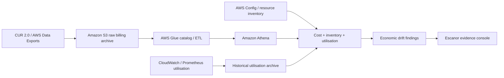

# 04 — Monitoring, Operations and FinOps

## Current lab telemetry boundary

The runnable lab has basic operational visibility through:
- EC2 / RDS standard CloudWatch service metrics.
- SSM managed-node state and Session Manager session logs only if the reader enables the relevant account / session logging configuration.
- Application stdout / stderr and bootstrap logs through systemd journal and the EC2 system log.
- The application health endpoint and diagnostics check for RDS and S3 connectivity.

This Terraform profile does **not** create CloudWatch Log Groups, CloudWatch Agent configuration, dashboards, alarms, SNS notifications, AWS Budgets or a FinOps CUR pipeline. The full Escanor monitoring / savings architecture below is the target design and future implementation roadmap. Add those resources as a distinct increment after the base lab has been validated.

## 1. Operational objectives

Escanor has two distinct responsibilities:
1. Operate its own services reliably.
2. Observe other AWS resources and report drift / cost evidence.

It must not make itself a single point of failure for the monitoring and alerting of the environment it observes.

## 2. Telemetry architecture

Use the appropriate signal source for each layer.

| Source | Signal | Consumer |
|---|---|---|
| Amazon EKS / Kubernetes API | Node, pod, deployment, event and resource status | Runtime drift collector |
| Argo CD | Application health, sync status and desired revision | GitOps drift collector |
| Terraform | Configuration, state and plan differences | Infrastructure drift collector |
| AWS Config | Resource configuration history and compliance findings | Infrastructure evidence enrichment |
| AWS CloudTrail | API activity and change attribution | Audit and security investigation |
| Amazon CloudWatch | AWS service metrics, logs, alarms and events | Platform operations and service health |
| Prometheus | Workload / exporter metrics and alert rules | Drift metrics and Alertmanager |
| Fluent Bit | Container and node log forwarding | Central log pipeline |
| CUR 2.0 | Billed usage and cost line items | FinOps pipeline |
| CloudWatch / Prometheus history | Utilisation and demand signals | Rightsizing analysis |

The source architecture includes Prometheus, Grafana, Alertmanager and Fluent Bit. A later design review must decide which components remain self-managed and which should use Amazon Managed Service for Prometheus / Amazon Managed Grafana. Compare operational burden, integration, retention and cost; do not assume managed services are automatically cheaper.

## 3. Alerting independence

Prometheus / Alertmanager and AWS-native monitoring must detect and deliver alerts without depending on AgentCore, the console or an LLM response.

Recommended flow:
- Collectors export validated findings and metrics.
- Alert rules evaluate thresholds and state transitions.
- Alertmanager / approved notification integration routes alerts to operators.
- AgentCore may enrich an alert with evidence and recommendations.
- Agent failure, throttling or model unavailability does not suppress the original alert.

## 4. Drift exporter operations

### 4.1 Required finding envelope

Each finding should contain:
- Schema version.
- Drift plane.
- Stable finding ID / deduplication key.
- AWS account ID and Region.
- Resource ARN / Kubernetes object identity.
- Owner / application / environment where known.
- Expected state and observed state.
- Severity and confidence.
- First-seen and last-seen timestamps.
- Collector name and version.
- Source evidence references and query time.
- Lifecycle state: open, acknowledged, resolved or suppressed.
- Related change / ticket identifier where available.

Do not use high-cardinality values (such as full pod UIDs or arbitrary exception strings) as Prometheus labels. Store detailed data in RDS / S3 and export bounded dimensions as metrics.

### 4.2 Lifecycle and concurrency

- Make collection idempotent.
- Deduplicate repeated observations.
- Handle stale findings and series deletion / staleness.
- Bound worker concurrency and AWS API calls.
- Use pagination, rate-limit handling, retry with backoff and dead-letter handling where applicable.
- Ensure that a resource deleted during collection is represented as a collection race / not-found event, not silently converted into an unverified remediation.
- Version the schema and test forward/backward compatibility.

## 5. Operations runbooks

### 5.1 EKS or Argo CD drift

1. Check EKS cluster health and API availability.
2. Check Argo CD application health, sync status and target Git revision.
3. Compare live resource generation and desired manifest.
4. Inspect recent CloudTrail / deployment changes.
5. Identify whether drift is intentional, emergency change or failed reconciliation.
6. Do not run a forced sync or revert a change until ownership and impact are known.

### 5.2 Drift exporter not reporting

1. Check collector health and last successful scrape.
2. Check IAM role / permission errors and STS session details.
3. Check Kubernetes service account identity and API permissions.
4. Check rate-limiting, pagination and timeout errors.
5. Compare source API result with exporter output.
6. Confirm the Prometheus target and scrape configuration.
7. Restore collection before closing any alert.

### 5.3 AgentCore unavailable

1. Confirm independent Alertmanager / CloudWatch alerting remains active.
2. Check AgentCore Runtime and Gateway health, service quotas and model availability.
3. Check IAM access, network egress and service endpoints.
4. Disable AI enrichment if the agent is throttled or returning invalid output.
5. Continue manual investigation with the original evidence links.
6. Re-enable enrichment only after contract and evaluation tests pass.

### 5.4 FinOps data delayed

1. Check the CUR 2.0 / Data Exports delivery state.
2. Verify S3 object arrivals and permissions.
3. Check Glue crawler / catalog state and Athena query errors.
4. Identify late or partial billing periods.
5. Mark the analysis as incomplete; do not publish estimated savings as realised.
6. Re-run aggregation when the period is complete.

## 6. FinOps data pipeline

### 6.1 Cost-state definitions

| State | Meaning | Evidence needed |
|---|---|---|
| Identified | Potential waste or optimisation opportunity found | Resource, cost, usage window, rule and evidence |
| Approved | Owner / approver agrees to the proposed change | Approver, ticket, action and planned date |
| Implemented | Change was performed | CloudTrail / deployment record and resource state |
| Realised | Billing data confirms the expected cost reduction | Subsequent complete CUR period and comparable baseline |

Keep the following values distinct:
- Cost to date.
- Forecast month-end cost.
- Forward monthly run-rate.
- Annualised run-rate opportunity.
- Identified opportunity.
- Approved opportunity.
- Realised savings.

Do not add forward annualised savings to cash savings or claim savings based solely on a recommendation.

### 6.2 Rightsizing evidence

Use:
- Historical CPU and memory percentiles, including p95 / p99 where relevant.
- Workload seasonality and burst patterns.
- Request / limit configuration and throttling.
- Pod disruption, autoscaling and availability requirements.
- Instance family / generation and purchase option.
- Storage throughput, IOPS and latency requirements.
- Resource ownership and service criticality.

A low average CPU reading is not sufficient evidence to downsize a production resource.

## 7. Cost governance

The source PDF contains illustrative lab and production cost figures. Treat those as historical estimates only. Recalculate each estimate against:
- Current AWS pricing for the selected Region.
- EKS control-plane and worker-node hours.
- NAT Gateway, data processing and public IPv4 charges.
- EBS, EFS, snapshots and load balancers.
- RDS instance, storage, backup and Multi-AZ charges.
- CloudWatch ingestion / retention, Prometheus storage and query.
- CUR, S3, Glue and Athena data volumes.
- AgentCore Runtime, Gateway, Memory, model inference and observability.
- Cross-region replication and data transfer.
- Idle resources and resources left behind by Kubernetes controllers.

Use separate cost profiles:
- **Lab profile:** disposable, single-session / bounded-hours deployment with explicit teardown.
- **Production profile:** multi-AZ, monitored, backed up and sized to an agreed service objective.

A lab profile is not a low-cost way to claim production availability.

## 8. Operational cadence

| When | Activity |
|---|---|
| Before deployment | Review Terraform plan, regional support, quota, pricing and budget |
| During deployment | Confirm resource creation, identity and network paths |
| After deployment | Run acceptance tests and capture evidence |
| Daily while lab is active | Review cost, alerts, collector health and teardown deadline |
| Weekly (shared lab) | Review drift backlog, failed tools, resource age and cost anomalies |
| Monthly | Review rightsizing evidence, CUR completeness, access and retained resources |
| Quarterly (production profile) | Run recovery exercise, access review and Well-Architected review |

## 9. Operational acceptance checklist

- [ ] CloudWatch and Prometheus signals are available for required components.
- [ ] Alerts can be delivered while AgentCore is disabled.
- [ ] Collector health, freshness and last-success timestamps are visible.
- [ ] Findings are deduplicated and have stable lifecycle transitions.
- [ ] Metric cardinality is bounded.
- [ ] CloudTrail attribution is available for infrastructure changes.
- [ ] CUR 2.0 pipeline handles incomplete and delayed periods.
- [ ] Savings state transitions are supported by billing evidence.
- [ ] Budget and cost-anomaly notifications have named recipients.
- [ ] Teardown detects Kubernetes-created load balancers, EBS volumes and other resources not removed by Terraform.
