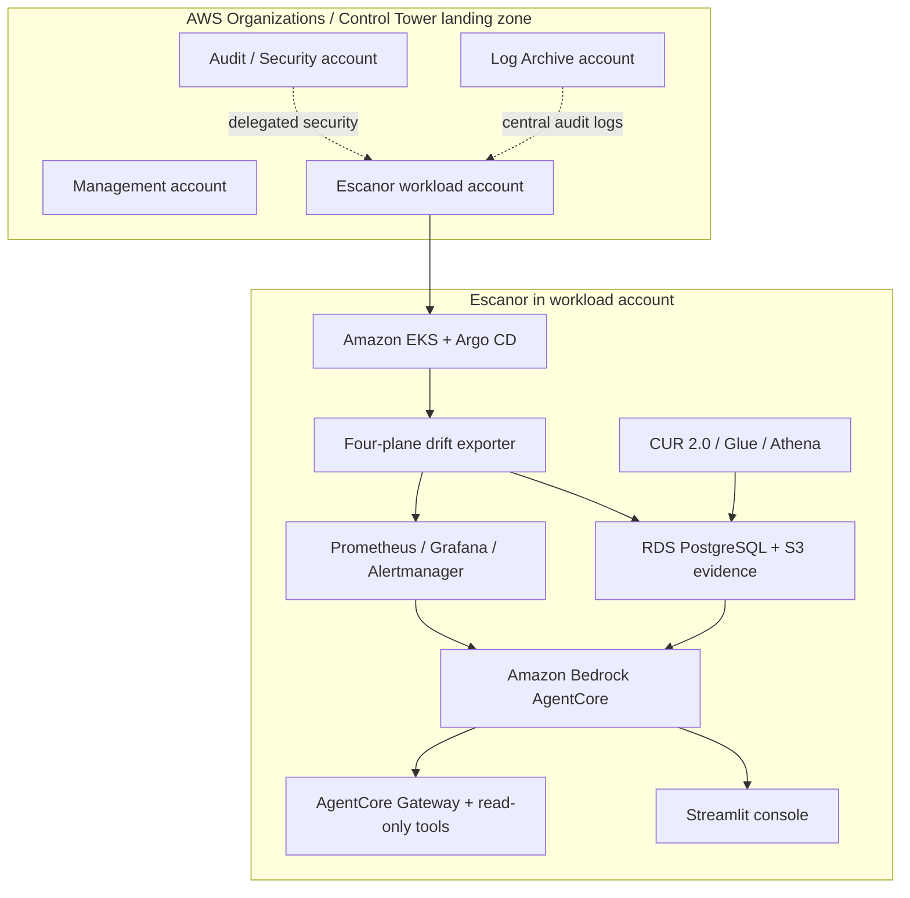

# Escanor AWS — Low-Level Design

**Document status:** Full target design plus low-footprint runnable learning profile; AWS deployment validation is reader-owned  
**Version:** 0.1  
**Audience:** Cloud architects, platform engineers, SRE, security reviewers, FinOps and AI engineering teams

This LLD has two deliberate views. The **learning-lab profile** is implemented as Terraform and a sample Python app for EC2, private RDS PostgreSQL, S3, S3 Gateway Endpoint and Systems Manager PrivateLink endpoints. The **full Escanor target** preserves the four drift planes and evidence-driven AIOps / FinOps design from the source document, updated for current AWS architecture guidance. The larger EKS / Argo CD / telemetry / CUR 2.0 / AgentCore platform is a roadmap, not a claim about the current code.

## Document map

| Document | Contents |
|---|---|
| [01 — Vision, scope and requirements](01-vision-scope-requirements.md) | Business goals, boundaries, assumptions, functional and non-functional requirements |
| [02 — Detailed solution design](02-detailed-solution-design.md) | AWS topology, four drift planes, five layers, service responsibilities and data flows |
| [03 — Identity and security](03-identity-security.md) | Accounts, IAM, EKS workload identity, AgentCore, cross-cloud federation and safety model |
| [04 — Monitoring, operations and FinOps](04-monitoring-operations-finops.md) | Telemetry, alerting, runbooks, cost data pipeline and savings evidence |
| [05 — Resilience and disaster recovery](05-resilience-disaster-recovery.md) | Failure domains, backup, restore, regional recovery and RTO/RPO |
| [06 — Implementation and validation](06-implementation-validation.md) | Build stages, quality gates, security tests and acceptance evidence |

## Architecture at a glance

This is a logical view. The final VPC layout, endpoint list, cluster add-ons, IAM trust policies, database sizing and AgentCore feature configuration must be defined in Terraform and validated in the selected Regions.

## Status vocabulary

- **Design baseline:** documented target architecture, not yet provisioned.
- **Planned implementation:** expected to be delivered in Terraform or application code in a later change.
- **Operational procedure:** human activity required to operate or verify the system.
- **Recommended extension:** future capability, not included in the current implementation.
- **Validated:** only after an executable test has run and its evidence has been retained.

## Design principles

1. AWS Organizations account boundaries isolate platform, security, logging and workload blast radius.
2. The Escanor workload runs in a dedicated member account, not the organization management account.
3. Terraform, Argo CD and Kubernetes each retain a clearly defined source of truth.
4. Drift findings include resource identity, observed state, expected state, timestamp, source and evidence.
5. Independent monitoring and alerting continue to function if the AI agent is unavailable.
6. The AI agent is advisory by default. IAM policies and tool contracts enforce its actual authority.
7. Destructive actions require a named human approver, change record and verified recovery point.
8. Cost is derived from CUR 2.0 and utilisation history; identified, approved and realised savings remain separate metrics.
9. Every service, version, model, quota and regional dependency is checked before implementation.
10. The AWS Well-Architected six pillars are used as a review framework; a completed checklist is not a certification or production-readiness claim.

## Related material

- [Escanor project README](../README.md)
- [AWS landing-zone reference](../../../landing-zone/README.md)
- [Infrastructure implementation plan](../infra/README.md)
- [Validation plan](../docs/validation.md)
