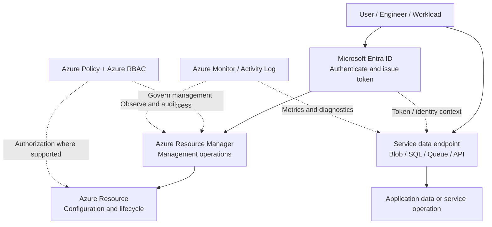

# Chapter A1 — Microsoft Azure Fundamentals

> **Azure Master Vault · Category A: Cloud Foundation & Landing Zones**  
> Notebook lesson · Foundation level · Suggested study time: 45–60 minutes

## 1. The big idea

Microsoft Azure is a cloud computing platform. Instead of buying and operating every server, storage array, network device and data platform yourself, an organization can consume these capabilities as services from Microsoft's global cloud infrastructure.

Think of Azure as a large, programmable technology estate. You choose the services, configure their boundaries, connect them, control who can use them, and pay according to the selected service and consumption model.

**Remember:** Azure does not remove architecture responsibility. It changes what Microsoft operates and what the customer must design, configure, secure and monitor.

## 2. What problems does Azure solve?

A business may need to host an application, store documents, process transactions, connect offices, analyze data, or build AI capabilities. Azure provides building blocks for these needs.

| Business need | Azure capability examples |
|---|---|
| Run an application | Virtual Machines, App Service, Azure Functions, containers |
| Connect systems | Virtual Network, VPN Gateway, ExpressRoute, API Management |
| Store files and objects | Storage Accounts, Blob Storage, Azure Files |
| Store application data | Azure SQL Database, Cosmos DB, managed open-source databases |
| Process events and messages | Service Bus, Event Grid, Event Hubs |
| Control access | Microsoft Entra ID, Azure RBAC, Managed Identities |
| Protect and govern | Azure Policy, Key Vault, Defender for Cloud |
| Observe and optimize | Azure Monitor, Log Analytics, Cost Management |
| Build AI solutions | Microsoft Foundry, Azure OpenAI, Azure AI Search |

A good architect starts with the business requirement and non-functional requirements—not with a favorite Azure service.

## 3. Understand the Azure service models

### Infrastructure as a Service (IaaS)

You rent infrastructure such as virtual machines, disks and virtual networks. You retain responsibility for the operating system, patching, runtime, application and data.

**Example:** A legacy application needs a specific Windows Server configuration and cannot yet move to a managed platform.

### Platform as a Service (PaaS)

Microsoft manages more of the underlying platform. You focus on application code, configuration, identity, data and service-level design.

**Example:** Host a web application on Azure App Service instead of managing a web server VM.

### Serverless

You focus on event-driven execution or managed application capabilities. Capacity management is abstracted to varying degrees, but limits, scaling behavior, networking, identity and cost still require design.

**Example:** An Azure Function processes an order message from a queue.

**Decision rule:** Choose the highest level of managed service that satisfies the workload's requirements for control, compatibility, performance, security, availability and cost.

## 4. The three planes you must distinguish

This is one of the most important Azure fundamentals.

1. **Identity plane** — Microsoft Entra ID authenticates users, applications and workloads and issues tokens.
2. **Management plane** — Azure Resource Manager (ARM) receives resource management operations such as create, update, delete and configuration changes.
3. **Data plane** — the service-specific endpoint performs workload operations, such as reading a blob, querying a database or sending a message.

A person who can create a Storage Account does not automatically have permission to read every blob inside it. Management permissions and data permissions are different authorization questions.

## 5. Architecture sketch — how a request reaches an Azure service



**Read the sketch carefully:**
- The engineer uses an identity to authenticate.
- ARM handles resource-management operations.
- The application uses a service endpoint for its data-plane operation.
- Azure RBAC, service-specific authorization and policy have different purposes. Do not assume one control replaces the others.
- Monitoring and audit evidence must be deliberately configured and reviewed.

## 6. Resource hierarchy — where resources live

A typical Azure organization is:

```text
Microsoft Entra tenant
└── Root management group
    ├── Platform management group
    │   ├── Identity subscription
    │   ├── Connectivity subscription
    │   └── Management subscription
    └── Landing zones management group
        ├── Production subscription
        │   └── Resource groups
        │       └── Azure resources
        └── Non-production subscription
            └── Resource groups
                └── Azure resources
```

Keep these terms distinct:

- **Tenant:** identity directory and trust boundary.
- **Management group:** organizes subscriptions for governance inheritance.
- **Subscription:** resource-management, billing and quota boundary.
- **Resource group:** logical lifecycle and management container for resources.
- **Resource:** an instance of an Azure service.

A resource group is not automatically a network-isolation boundary. A subscription is not a separate Microsoft Entra tenant. A management group does not contain application data directly.

## 7. Shared responsibility

Microsoft is responsible for the cloud infrastructure and the portions of a service it operates. The customer remains responsible for workload decisions and controls such as identity, access, data classification, application configuration, endpoint exposure and operational processes.

The exact division changes by service model:
- With IaaS, the customer manages more of the operating system and runtime.
- With PaaS, Microsoft manages more of the platform, while the customer still configures and secures the workload.
- With SaaS, the provider manages the application platform, but the customer still owns user access, data governance and configuration choices.

**Architect's note:** “Microsoft manages it” does not mean “the customer has no responsibility.”

## 8. Design checklist before selecting services

Ask these questions before drawing the solution:

1. What business capability must the solution deliver?
2. Who are the users, systems and data consumers?
3. What are the availability, latency, throughput and scalability requirements?
4. What are the data classification, residency and regulatory constraints?
5. Which identities need access, and at what scope?
6. Does the workload need public access, private access, hybrid connectivity or all three?
7. What are the RTO and RPO requirements?
8. Which logs, metrics, alerts and audit records are required?
9. What are the expected usage patterns and cost limits?
10. Who owns deployment, support, incident response and recovery?

## 9. Practical scenario — moving a business application to Azure

**Requirement:** A company wants to host an internal employee portal, store documents, and allow staff to access it securely from corporate locations.

**A possible high-level design:**
- Microsoft Entra ID for workforce authentication.
- Azure App Service for the web application, if its runtime and hosting requirements fit.
- Storage Account / Blob Storage for documents.
- Managed Identity for the application to access supported Azure services without storing a long-lived password in code.
- Private connectivity and DNS if the portal and storage must remain private.
- Azure Monitor and Application Insights for operational visibility.
- Azure Policy and Azure RBAC for governance and resource access.

This is a starting pattern, not a final design. Confirm application compatibility, network integration, private endpoint support, data access model, availability requirements, region/SKU support and expected cost before selecting the final topology.

## 10. Implementation lab — inspect an Azure environment

**Classification:** CONFIGURE / INSPECT — Azure CLI. This introductory exercise reads subscription and resource metadata; it does not create billable resources.

### Prerequisites
- An Azure subscription you are authorized to inspect.
- Azure CLI installed.
- A signed-in identity with read access to the relevant scope.

### Commands

```bash
az login
az account list --output table
az account show --output json
az group list --output table
```

To inspect the resource providers registered for the current subscription:

```bash
az provider list --query "[?registrationState=='Registered'].namespace" --output table
```

### What to verify
- The selected tenant and subscription are the intended ones.
- The subscription display name and ID match the environment you were asked to inspect.
- Resource groups reflect the expected ownership and environment boundaries.
- Provider registration is understood before attempting a deployment.

**Safety:** These commands are read-only. Do not switch subscription context or deploy resources in a production environment without authorization and change approval.

## 11. Common mistakes

- Treating authentication as authorization.
- Assuming Azure RBAC at the management plane automatically grants data-plane access.
- Selecting a region before checking service, feature, zone and SKU availability.
- Assuming a region pair automatically fails over an application.
- Choosing a VM when a managed platform would meet the requirement with less operational burden.
- Ignoring outbound connectivity, DNS, private access and data exfiltration paths.
- Deploying resources without ownership, tagging, monitoring, budget and cleanup plans.

## 12. Quick revision notes

- Azure is a service platform; architecture decisions remain the customer's responsibility.
- IaaS provides more control and more operating responsibility.
- PaaS reduces platform management but does not remove security and operational responsibilities.
- Microsoft Entra ID authenticates; authorization is enforced through Azure RBAC and service-specific data permissions.
- ARM is the Azure management plane.
- Resource service endpoints expose data-plane operations.
- Tenant, management group, subscription, resource group and resource are different scopes.
- Availability zones and multi-region designs address different failure domains.
- Shared responsibility changes with the service model.

## 13. Knowledge check

**Q1. What is the difference between the management plane and data plane?**  
The management plane controls resource lifecycle and configuration through ARM. The data plane performs service-specific operations such as reading a blob or querying a database.

**Q2. If an engineer can create a Storage Account, can they automatically read its blobs?**  
No. Resource-management permissions and blob data permissions are separate. The engineer needs an appropriate data-plane authorization path.

**Q3. Why might an architect choose App Service instead of a VM?**  
If the application's runtime and requirements fit App Service, it can reduce operating-system and web-server management. A VM may still be necessary when the workload needs OS-level control or compatibility not offered by the managed platform.

**Q4. Does selecting a paired region guarantee application disaster recovery?**  
No. The application needs explicit replication, data consistency, traffic routing, identity, dependency and failover/failback design and testing.

**Q5. What should be decided before selecting Azure services?**  
Business requirements, users, data classification, security boundaries, performance, availability, recovery, operations and cost constraints.

## 14. Official references

- [Azure fundamentals learning path](https://learn.microsoft.com/training/paths/azure-fundamentals-describe-cloud-concepts/)
- [What is Azure Resource Manager?](https://learn.microsoft.com/azure/azure-resource-manager/management/overview)
- [Shared responsibility in the cloud](https://learn.microsoft.com/azure/security/fundamentals/shared-responsibility)
- [Azure Well-Architected Framework](https://learn.microsoft.com/azure/well-architected/)
- [Azure Cloud Adoption Framework](https://learn.microsoft.com/azure/cloud-adoption-framework/)

---

**Chapter status:** Initial manuscript draft. Technical review, diagram styling and PDF layout review are required before publication.
