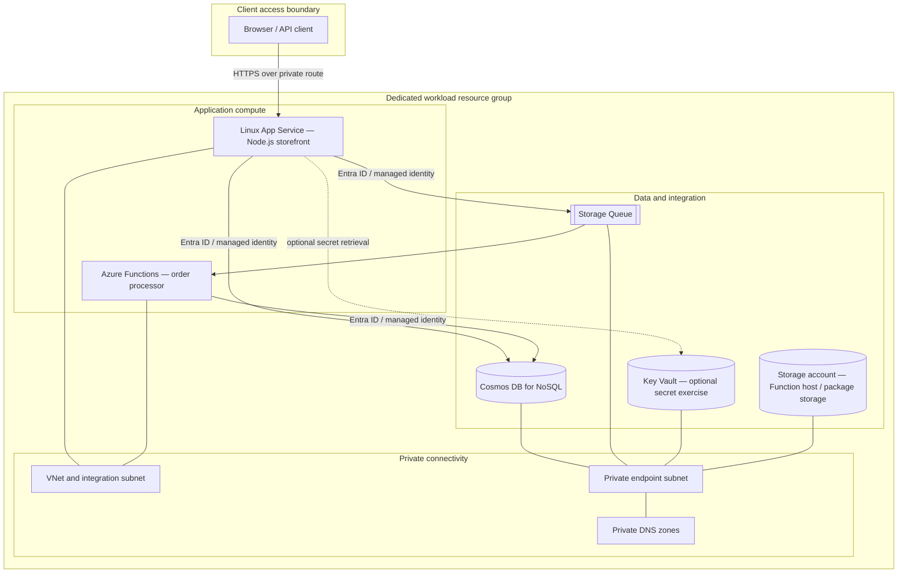
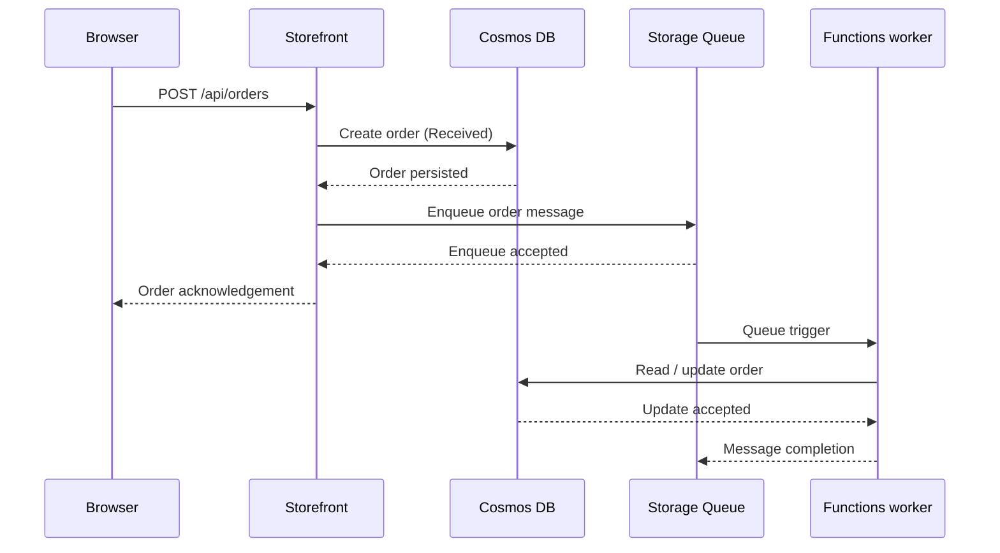

# 02 — Detailed Solution Design

## 1. Logical architecture

LittleNest is a three-part workload: a web experience, a persistence / messaging layer, and a background worker.

This is a logical view, not a substitute for the Terraform resource graph. Refer to `infra/` for exact resource properties, subnets, DNS zones, identity assignments and app settings.

## 2. Component design

| Component | Responsibility | Connectivity / authentication |
|---|---|---|
| App Service (Linux, B1) | Hosts the Node.js storefront and HTTP API | Private inbound endpoint; outbound VNet integration; system-assigned managed identity |
| Functions Flex Consumption | Processes order queue messages | Private inbound endpoint and VNet integration as configured; system-assigned managed identity |
| Cosmos DB for NoSQL | Stores catalogue and order documents | Private endpoint; Entra ID data-plane authorisation |
| Storage Queue | Decouples order submission from processing | Queue endpoint through private connectivity; Entra ID data-plane authorisation |
| Storage account | Supports Function host / package storage and related resources | Storage firewall allows the explicit Terraform runner bootstrap IP; workload access uses private endpoints and identity |
| Key Vault | Optional synthetic-secret exercise | Private endpoint; managed identity access |
| VNet | Provides private application integration and endpoint reachability | Subnets and route/DNS configuration are declared in Terraform |
| Private DNS | Resolves service FQDNs to private endpoint addresses | Linked to workload VNet |

### 2.1 Application responsibilities

**Storefront**
- Serves the LittleNest product browsing experience.
- Exposes health and product endpoints.
- Accepts demo order requests.
- Creates the initial order record and sends an order message to the queue.
- Uses managed identity for Azure service access in the hosted configuration.
- Uses local demo mode for a no-Azure learning experience.

**Order worker**
- Is triggered by the Storage Queue.
- Parses the order message.
- Applies the sample processing logic.
- Updates the order record to its completed processing state.
- Uses managed identity to access the required Azure data services.

The queue message is a work notification / payload for this demonstration. It is not a payment instruction. The project does not implement a payment gateway.

## 3. Key data flows

### 3.1 Catalogue read

1. Browser sends HTTPS request to the storefront.
2. App Service handles the request.
3. Application queries Cosmos DB using its managed identity.
4. Cosmos DB authorises the data-plane request using the assigned role.
5. The application returns the synthetic catalogue.

### 3.2 Order submission and processing

**Failure considerations**
- If Cosmos DB order creation fails, the API should return an error and must not acknowledge a successful order.
- If queue enqueue fails after the order record is created, the order may remain in Received state. This is a consistency gap in a simple demo architecture. A production design should use an outbox pattern, idempotent processing and reconciliation.
- If the worker fails, the Functions queue trigger retry / poison-message behaviour must be validated against the configured host settings and documented operationally. Do not assume a particular retry count without checking the deployed configuration.
- The worker should tolerate duplicate delivery. A production-grade idempotency key and concurrency strategy are future hardening items unless explicitly implemented in code.

### 3.3 Optional Key Vault secret read

The optional banner / secret exercise demonstrates retrieving a synthetic secret through the App Service managed identity. The secret value should not be placed in source control or app settings. This exercise is optional and does not make Key Vault a dependency for the core order flow.

## 4. Network design

- The workload is deployed into a dedicated VNet.
- Application outbound connectivity uses the configured VNet integration subnet.
- Private endpoints are placed in the dedicated private-endpoint subnet.
- Private DNS zones provide name resolution for the private service endpoints.
- The Azure-hosted App Service and Function App are not designed for public inbound access in this profile.
- A tester needs a private route into the VNet (for example, an organisation-provided VPN or connected runner). This project does not provision that VPN or hub network.
- Storage retains a controlled bootstrap exception: its public endpoint firewall is default-deny with the Terraform runner's explicitly supplied IPv4 rule. This is not the application data path. Do not describe Storage as having all public network access disabled.

### Required validation

From a client connected to the private network:
1. Resolve the App Service, Functions, Cosmos DB, Key Vault and Storage service FQDNs.
2. Confirm expected private IP resolution for private endpoint-backed services.
3. Test HTTPS reachability.
4. Test the actual SDK / data-plane operation with the workload identity.
5. Separate DNS success, network reachability and authorisation success; they are distinct checks.

See [validation.md](../docs/validation.md).

## 5. Data design

The application uses Cosmos DB for NoSQL. The data model is intentionally small and synthetic.

| Logical entity | Purpose | Example attributes (illustrative) |
|---|---|---|
| Product | Catalogue item | id, name, category, price, image reference |
| Order | Customer demo order | id, items, total, status, created timestamp |

The exact JSON schema, partition key and container names must be read from the application and Terraform source before changing the data model. This LLD intentionally does not invent a partition key or throughput setting.

**Data classification:** synthetic / demo. Do not load customer PII, payment-card data, credentials or production records.

## 6. Deployment and configuration design

1. Clone the repository and validate local tools.
2. Run the credential-free local demo first.
3. Authenticate to the intended non-production tenant and select the subscription by ID.
4. Run the read-only Azure context preflight.
5. Configure `terraform.tfvars` with the intended subscription, runner egress IPv4 and principal type.
6. Initialise Terraform, format, validate and inspect the plan.
7. Perform the documented Storage bootstrap and assign the required data-plane roles to the Terraform caller.
8. Create and review a fresh full plan; apply only after checking resources, network and estimated charges.
9. Publish the web app / Functions code using the project procedure.
10. Seed synthetic Cosmos data and validate the end-to-end order flow.
11. Inspect logs, network paths and role assignments.
12. Destroy the lab and verify residual resources.

The current lab uses local Terraform state. Do not share or commit state, plan files or variable files. For team / CI use, introduce a protected remote backend with locking, encryption, restricted access and a controlled deployment identity.

## 7. Resilience and future design options

| Concern | Current learning baseline | Production-oriented extension |
|---|---|---|
| Order / queue consistency | Simple create-then-enqueue flow | Transactional outbox and reconciliation |
| Duplicate delivery | Validate worker behaviour | Idempotency key and deduplication |
| Poison messages | Validate trigger / host behaviour | Explicit poison queue alert and replay runbook |
| Regional outage | No multi-region recovery commitment | Documented RTO/RPO and tested recovery |
| State collaboration | Local Terraform state | Remote state backend with locking |
| Private user access | Assumes existing private route | Approved VPN / hub connectivity and private DNS integration |
| Edge protection | No public edge in baseline | WAF / Front Door only if public ingress becomes a requirement |

## 8. Design traceability

| Design concern | Primary implementation location |
|---|---|
| Azure resource definitions | `infra/` |
| Storefront routes and Azure clients | `app/web/` |
| Queue worker and trigger | `app/functions/` |
| Azure subscription / region preflight | `scripts/Test-AzureContext.ps1` |
| Synthetic data seed | `scripts/seed-cosmos.mjs` |
| Network and application validation | `docs/validation.md` |
| Rendered architecture | `docs/architecture.svg` |
