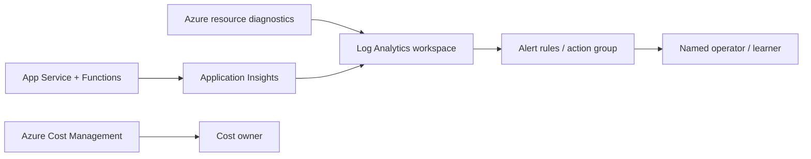

# 04 — Monitoring, Operations and FinOps

## 1. Operational model

The lab has a small operational surface: storefront, Function worker, Cosmos DB, Storage Queue, Storage, Key Vault and private connectivity. The operator must be able to answer four questions:

1. Is the user-facing application healthy?
2. Are orders being accepted and processed?
3. If processing fails, which dependency or identity boundary failed?
4. What resources are still running and what are they costing?

This document defines the minimum operational signals and procedures. It does not claim that a central Log Analytics workspace, Azure Monitor alert rules, Application Insights, dashboards or a budget resource are already deployed by the current Terraform baseline. Confirm the actual resources in `infra/` before relying on them.

## 2. Monitoring design

### 2.1 Signals and diagnostic questions

| Layer | Signal to collect / inspect | What it tells the operator |
|---|---|---|
| Storefront | HTTP availability, request rate, response time, 4xx / 5xx, process restarts | Whether users can reach and use the web tier |
| Application | `/healthz`, product API and order API outcomes | Whether core application functions work |
| Order workflow | Orders created, queue enqueue failures, Received-to-Processed duration, processing failures | Whether the asynchronous workflow is completing |
| Functions | Invocation count, failures, execution duration, restarts and host errors | Whether the worker is running correctly |
| Queue | Approximate message count, oldest-message age, dequeue / poison behaviour | Whether work is accumulating or failing |
| Cosmos DB | Availability, throttling / 429, request units, latency and connectivity errors | Whether the data store is healthy and sized appropriately |
| Storage | Availability, throttling, authorisation failures and network errors | Whether queue / host storage access is healthy |
| Key Vault | Access denied, throttling and secret retrieval failures | Whether the optional secret path is functioning |
| Network / DNS | Private DNS resolution, endpoint reachability and connection timeouts | Whether private connectivity is correctly configured |
| Cost | Daily / monthly spend, forecast, resource utilisation and idle resources | Whether the lab is within its intended cost envelope |

### 2.2 Recommended telemetry path

For a shared or longer-lived lab, use Azure Monitor and Application Insights with a Log Analytics workspace in the same governed environment, subject to cost and data residency requirements.

This is the recommended target, not a statement that all telemetry resources are provisioned today. Add diagnostic settings and alert rules deliberately, choose retention based on need, and validate that each service exposes the required diagnostic categories.

### 2.3 Minimum alerts for a longer-lived environment

| Alert | Suggested condition | Action |
|---|---|---|
| Storefront availability | Availability probe fails repeatedly from the approved private test path | Check App Service state, deployment, DNS and private route |
| HTTP server errors | Sustained increase above the lab's normal baseline | Inspect application exceptions and dependency failures |
| Function failures | Failed invocations or repeated host errors | Inspect Function logs, identity roles and trigger configuration |
| Queue backlog | Oldest message age or queue depth exceeds the expected processing window | Check worker health, permissions and poison-message handling |
| Cosmos throttling | Sustained 429 responses | Review RU consumption, query patterns and account limits |
| Key Vault access denied | Repeated 403 / forbidden events | Verify managed identity and secret permissions |
| Cost threshold | Actual or forecast spend reaches configured notification threshold | Stop optional resources and review Cost Analysis |

Thresholds should be set after observing a baseline. Avoid hard-coded production thresholds for a small lab with variable usage.

## 3. Operational runbooks

### 3.1 Order stuck in Received

1. Confirm the order document exists in Cosmos DB.
2. Check queue depth and oldest-message age.
3. Check Function App state, host startup and invocation failures.
4. Validate Function managed identity and Cosmos / Storage data roles.
5. Check private DNS and connectivity from the Function integration path.
6. Inspect poison-message / retry behaviour before replaying anything.
7. Confirm whether the worker processed the order already; avoid manual duplicate updates.

### 3.2 Storefront unavailable

1. Confirm the client is on a network with a route into the VNet.
2. Resolve the App Service hostname and verify the expected private IP.
3. Test HTTPS connectivity.
4. Check App Service state, deployment status, runtime configuration and logs.
5. Check Cosmos DB / Queue access failures and managed identity role assignments.
6. Do not make the service public as a troubleshooting shortcut.

### 3.3 Cosmos DB access denied or timeout

- 403: check principal object ID, native data-plane role and propagation delay.
- Timeout: check private endpoint approval, DNS, route and service network settings.
- 429: inspect request-unit consumption and query efficiency; do not immediately increase throughput without cost review.

### 3.4 Cleanup and residual resources

1. Review the Terraform destroy plan.
2. Run destroy from the same state and workspace used for deployment.
3. Inspect the resource group and any resources created manually outside Terraform.
4. Check soft-deleted Key Vaults, retained storage data, Log Analytics workspaces and other retained resources.
5. Review Cost Management after teardown for residual spend.
6. Preserve only the source code and documentation; do not publish state or plan artifacts.

## 4. FinOps design

### 4.1 Cost model

The lab is low-cost, not zero-cost. Exact prices depend on region, usage, currency, subscription agreement and current Azure pricing. Estimate in the Azure Pricing Calculator before applying.

| Cost driver | Why it costs money | FinOps action |
|---|---|---|
| App Service Basic B1 plan | Provisioned compute plan charge while allocated | Use only during exercises; evaluate whether the hosted app is needed |
| Functions Flex Consumption | Execution, memory / duration and related hosting behaviour | Keep workload volume low; inspect executions and configuration |
| Private endpoints | Hourly endpoint charge and data processing | Keep only endpoints required for the exercise; remove on teardown |
| Cosmos DB | Provisioned / consumed throughput and storage; Free Tier only when eligible | Confirm Free Tier eligibility, monitor RU use and storage |
| Storage | Capacity, transactions, queue operations and network transfer | Use LRS for the lab; remove unused blobs / queues |
| Key Vault | Operations and retained soft-deleted vault implications | Use only for the optional exercise; review retention and purge protection implications |
| Optional test VM | Compute and managed disk while allocated | Keep disabled by default; deallocate or destroy after use |
| Monitoring / Log Analytics | Ingestion, retention and queries may be billable | Enable only needed diagnostics; use short, deliberate retention for a lab |
| Network egress | Data transfer and connected network services | Avoid unnecessary cross-region traffic and repeated large transfers |

Cosmos DB Free Tier is conditional, limited to one eligible account per subscription, and does not make the rest of the solution free. Private endpoints, App Service and monitoring may generate charges.

### 4.2 Tagging and allocation

The Terraform local tags include application, environment, owner, cost center, managed-by, data classification and workload metadata. Use consistent values across resources and ensure the organisation's Cost Management views recognise the chosen tag keys.

Recommended minimum dimensions:
- `application = littlenest`
- `environment = nonprod`
- `owner = <team-or-owner>`
- `costCenter = <approved-cost-centre>`
- `managedBy = Terraform`
- `dataClassification = synthetic`

Do not put personal information in tag values.

### 4.3 Budget and guardrails

A budget is not currently implemented as a Terraform resource in the baseline. Before deploying a lab that may remain running:

1. Create an Azure Cost Management budget at the appropriate subscription or resource-group scope.
2. Configure notification thresholds (for example, 50%, 80% and 100% of the approved lab amount).
3. Route notifications to an actively monitored mailbox or action group.
4. Review actual and forecast spend during the lab.
5. Remember that budgets notify; they do not automatically stop resources or cap spend.

For a disposable exercise, the most reliable cost control is to avoid unnecessary resources and destroy the lab immediately after validation.

### 4.4 FinOps operating cadence

| When | Activity |
|---|---|
| Before deployment | Estimate resource costs; verify region, SKU, Free Tier eligibility and budget |
| After plan | Review every resource and recurring cost before apply |
| During lab | Check cost trend, usage and optional resources |
| At end of session | Destroy resources not needed for the next exercise |
| After destroy | Check residual resources, soft delete and Cost Analysis |
| Monthly (if shared) | Review allocation tags, utilisation, idle resources and budget forecast |

## 5. Recovery and continuity

Profile A has no formal production RTO or RPO and no multi-region design. It is expected to be recreated from Terraform and synthetic seed data.

For production consideration, define:
- Business impact and service criticality.
- RTO and RPO for storefront, orders and catalogue.
- Cosmos DB backup / restore and regional failover strategy.
- Queue retention, poison-message recovery and replay procedures.
- Terraform remote state backup and recovery.
- Application artifact retention and redeployment process.
- A tested recovery exercise with recorded results.

## 6. Operational readiness checklist

- [ ] Health endpoint returns expected status.
- [ ] Storefront product and order APIs work from the private test path.
- [ ] Function invocation succeeds and order state changes as expected.
- [ ] Queue backlog and failed messages are inspected.
- [ ] Managed identity and private DNS paths are validated.
- [ ] Relevant application and platform logs are accessible.
- [ ] Alerts have a named recipient in any environment that remains running.
- [ ] Budget notifications are configured outside the baseline if the lab will persist.
- [ ] Resource tags are present and meaningful.
- [ ] Terraform destroy and residual-resource review are completed.
