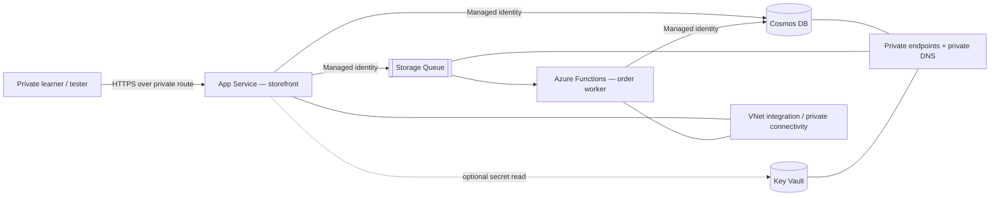

# LittleNest Kidswear — Low-Level Design

**Document status:** Design baseline for the Profile A non-production learning lab  
**Version:** 1.0  
**Audience:** Learners, cloud engineers, reviewers and solution architects

This LLD translates the LittleNest workload reference implementation into an operationally useful design. It describes the intended architecture, boundaries, requirements, trust relationships, security controls, observability and cost model. It distinguishes controls already represented in the Terraform/application code from recommendations that require additional implementation or Azure configuration.

## Document map

| Document | Contents |
|---|---|
| [01 — Vision, scope and requirements](01-vision-scope-requirements.md) | Business context, goals, boundaries, assumptions and functional / non-functional requirements |
| [02 — Detailed solution design](02-detailed-solution-design.md) | Component responsibilities, deployment topology, request and order flows, network and data design |
| [03 — Identity and security](03-identity-security.md) | Trust boundaries, identities, RBAC, secrets, network controls and threat considerations |
| [04 — Monitoring, operations and FinOps](04-monitoring-operations-finops.md) | Telemetry, alerting, support model, recovery, cost drivers and optimisation |

## Architecture at a glance

The diagram is conceptual. The actual resource names, subnet assignments, endpoint configuration and role assignments are defined by Terraform under `../infra/`. Consult [the rendered architecture](../docs/architecture.svg) and editable [Mermaid source](../docs/architecture.mmd) for the implementation view.

## How to read implementation status

- **Implemented baseline** means the project source / Terraform defines the control or capability.
- **Operational procedure** means a human must perform or validate it; it is not automatically enforced by Terraform.
- **Recommended extension** means it is a deliberate next step, not a claim about the current deployment.

The project is a low-cost, non-production workload lab. It is not a production commerce platform or a complete enterprise landing-zone implementation. A successful Terraform plan or local CI run is not proof of a live Azure deployment. Use the [validation checklist](../docs/validation.md) after deployment.

## Design decisions

1. Private access is the default for the Azure-hosted workload; public internet ingress is not part of Profile A.
2. Workload-to-service authentication uses Microsoft Entra ID and managed identities rather than embedded account keys.
3. The order workflow is asynchronous: the storefront persists an initial order and enqueues work; the Function worker processes the queue message and updates order state.
4. Terraform is the infrastructure source of truth for the resources in scope. The current project uses local Terraform state; remote state is a future team-use improvement.
5. The local demo is the first learning path. It uses synthetic data and does not need Azure credentials or create Azure resources.
6. Cost is constrained by lab sizing and teardown, not guaranteed to be zero. Private endpoints and compute incur charges.

## Related material

- [Project implementation README](../README.md)
- [Architecture diagram](../docs/architecture.svg)
- [Validation and troubleshooting](../docs/validation.md)
- [Terraform](../infra/)
- [Azure Master Vault](https://github.com/tripathies/azure-master-vault)
