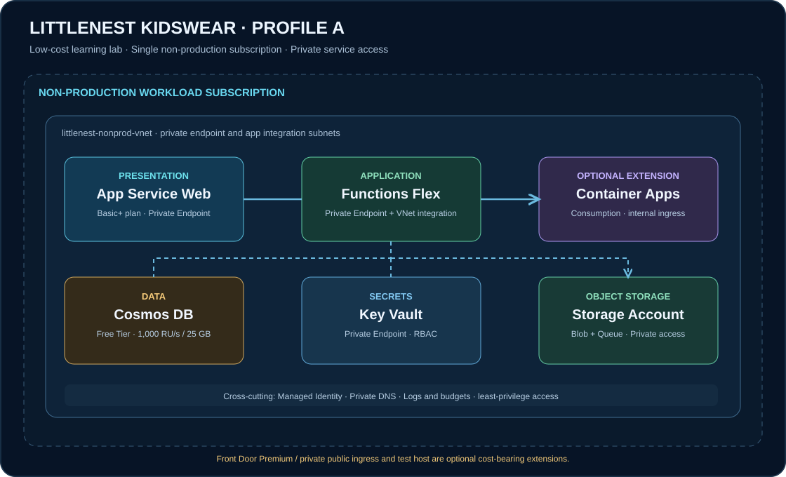

# LittleNest Kidswear — Profile A

> **Low-cost, non-production learning lab.** This blueprint teaches a realistic private Azure application pattern without claiming that the lab is a production-ready retail platform.

[← Solution blueprint catalogue](../../SOLUTION-BLUEPRINTS.md) · [← Azure Master Vault](../../README.md) · [Open SVG architecture](../../docs/assets/littlenest-profile-a.svg) · [Open Mermaid source](architecture.mmd)

## 1. Business scenario

LittleNest Kidswear is a sample online store for children's clothing. The lab demonstrates a small web experience, a private application backend, product data, image storage, secrets management and identity-based service access.

The sample application supports browsing a small product catalogue, viewing sizes and colours, adding items to a demo cart, submitting a simulated order, processing a background notification and storing product images.

**No real payment processing, customer PII or production inventory is in scope.** Use synthetic data only.

## 2. Profile A scope and guardrails

| Decision | Profile A |
|---|---|
| Environment | Non-production only |
| Subscription | One dedicated disposable lab subscription |
| Management group | Use an existing governed lab/landing-zone scope |
| Hub subscription | Not deployed by this lab |
| VNet | One workload VNet |
| Public customer ingress | Disabled in the default private lab |
| Private endpoints | Used for the app and supported data services in the private-network exercise |
| Database | Cosmos DB for NoSQL Free Tier, where eligible |
| Compute | App Service Basic+ for private web app; Functions Flex Consumption |
| Container Apps | Optional extension, not deployed by default |
| VM | Optional, short-lived private test host |
| Front Door Premium | Optional edge-to-private-origin extension; recurring cost |
| Production subscription | Documented as a future target, not provisioned by Profile A |

A low-cost lab is not a free lab. App Service Basic compute, Private Link endpoints, private DNS, Cosmos DB usage above its free grant, Storage transactions and monitoring ingestion can incur charges. Check the selected region and SKU in the Azure Pricing Calculator before deployment.

## 3. Enterprise target versus Profile A deployment

An enterprise design may use management groups to place platform subscriptions and workload subscriptions under governed branches. Production and non-production workloads can be placed in separate subscriptions when isolation, access, ownership, policy, billing or risk justify the boundary.

Illustrative target hierarchy:

~~~text
Tenant Root
└── LittleNest
    ├── Platform
    │   ├── Connectivity subscription
    │   ├── Management subscription
    │   └── Security subscription
    └── Landing Zones
        ├── Online
        │   ├── LittleNest Commerce Production subscription
        │   └── LittleNest Commerce Non-Production subscription
        └── AI (optional)
            └── LittleNest AI subscription
~~~

This target model is a design illustration. **Profile A deploys only to one non-production subscription** and does not create management groups, subscriptions or shared platform services. Those actions require higher-level permissions and should be handled by the organisation's landing-zone/subscription-vending process.

Related Azure Vault references:

- [Management Groups](../../A-cloud-foundation-landing-zones/management-groups/README.md)
- [Azure Subscriptions](../../A-cloud-foundation-landing-zones/azure-subscriptions/README.md)
- [Azure Landing Zones](../../A-cloud-foundation-landing-zones/azure-landing-zones/README.md)
- [Azure Policy](../../A-cloud-foundation-landing-zones/azure-policy/README.md)
- [Virtual Networks](../../C-networking-private-connectivity/virtual-networks-vnet/README.md)
- [Private Link and Private Endpoints](../../C-networking-private-connectivity/private-link-and-private-endpoints/README.md)
- [Private DNS Zones](../../C-networking-private-connectivity/private-dns-zones/README.md)
- [App Service](../../E-compute-application-hosting/azure-app-service/README.md)
- [Azure Functions](../../E-compute-application-hosting/azure-functions/README.md)
- [Container Apps](../../F-containers-kubernetes/azure-container-apps/README.md)
- [Cosmos DB](../../H-databases-data-platforms/azure-cosmos-db/README.md)
- [Managed Identities](../../B-identity-access-management/managed-identities/README.md)
- [Key Vault](../../J-security-secrets-governance/README.md)

## 4. Profile A architecture

The default lab uses one non-production VNet. It avoids a central hub, Azure Firewall, NAT Gateway and always-on Bastion because those services add ongoing cost and are not needed to learn the core application pattern.

| Layer | Service | Lab responsibility |
|---|---|---|
| Presentation | Azure App Service Web App | Demo UI, private inbound endpoint |
| Application | Azure Functions Flex Consumption | Order event handler and background processing |
| Application (optional) | Azure Container Apps | Containerised API alternative; enable only as a separate exercise |
| Data | Azure Cosmos DB for NoSQL | Small product catalogue, cart and demo order documents |
| Object storage | Azure Storage Blob | Product images and static assets |
| Messaging | Azure Storage Queue | Lightweight asynchronous order notification |
| Secrets | Azure Key Vault | Payment-provider sandbox secret or demo-only secret |
| Identity | Managed identities | Azure service-to-service authentication |
| Network | VNet, app integration subnet and private endpoint subnet | Private data-plane paths |
| DNS | Azure Private DNS zones | Resolve service FQDNs to private endpoint addresses |
| Operations | Azure Monitor and Log Analytics (optional) | Minimal logs, diagnostics and alerting |
| Test access | Short-lived private Linux VM (optional) | Run connectivity and DNS tests from inside the VNet |

### Compute decisions and limitations

- **App Service private endpoint:** supported on Basic, Standard and higher supported plans. Free and Shared tiers are not suitable for this private-origin design. App Service VNet integration is a separate outbound feature and also requires a supported dedicated plan.
- **Functions Flex Consumption:** supports inbound private endpoints and outbound VNet integration. It is Linux-based. The classic Consumption plan does not provide the same private networking features.
- **Container Apps:** optional in Profile A. Private endpoints for Container Apps environments require a workload-profiles environment and incur additional charges. Do not deploy it just to duplicate the Functions workload.
- **Front Door Premium:** add only when the lab needs an internet-facing entry point with a private origin. It adds recurring cost and is excluded from the default profile.

## 5. Network and private access

Suggested address plan (validate and adjust before deployment):

| Network | CIDR | Purpose |
|---|---|---|
| LittleNest non-prod VNet | 10.70.0.0/16 | Isolated workload network |
| App integration subnet | 10.70.1.0/24 | Delegated outbound integration for supported app plans |
| Private endpoint subnet | 10.70.2.0/24 | Private endpoints; not delegated |
| Optional Container Apps subnet | 10.70.4.0/23 | Workload-profiles environment if the optional extension is enabled |
| Optional test host subnet | 10.70.5.0/24 | Temporary private test VM |

Subnets must be sized and delegated according to each Azure service's current requirements. These illustrative CIDRs are not universal sizing recommendations.

### Inbound and outbound are different

- A **Private Endpoint** gives clients in a reachable private network an inbound private path to the service.
- **VNet Integration** lets supported App Service/Functions workloads make outbound connections into a VNet and to private endpoints.
- A private endpoint alone does not provide outbound VNet connectivity, DNS configuration or application authorisation.

### Access pattern

- App Service public network access is disabled in the private lab.
- Functions public network access is disabled when its private endpoint is enabled.
- Cosmos DB, Key Vault and Storage public network access are disabled for the private exercise.
- Private DNS zones are linked to the VNet and checked from a client in the VNet.
- A temporary test host may be created without a public IP. Use Azure VM Run Command to run DNS and HTTP connectivity checks from inside the VNet; remove the VM after testing.
- The default private lab is not directly reachable by anonymous users on the public internet. To demonstrate public customer ingress while keeping the origin private, add Front Door Premium with Private Link as a separately approved cost-bearing exercise.

## 6. Identity and authorisation

Use managed identities rather than storing account keys or service credentials in the application.

| Workload identity | Target | Minimum intended access |
|---|---|---|
| App Service identity | Key Vault | Key Vault Secrets User only when a secret is required |
| Functions identity | Cosmos DB | Narrow native data-plane role for demo order data |
| Functions identity | Storage Blob | Blob Data Reader/Contributor as required |
| Functions identity | Storage Queue | Queue Data Message Processor/Sender as required |
| Functions identity | Key Vault | Secrets User only for required sandbox configuration |

Azure RBAC control-plane roles and service-specific data-plane roles are not interchangeable. For Cosmos DB, configure the native data-plane role. Avoid subscription-level Contributor for application identities.

Prefer a system-assigned identity for a simple single-resource lifecycle. Use a user-assigned identity when identity continuity across resource replacement is required.

## 7. Data design

Cosmos DB Free Tier is selected at account creation and, when eligible, provides up to 1,000 RU/s and 25 GB of storage for one account per Azure subscription. Usage above the free allowance is charged. Free Tier is not available for serverless accounts.

Suggested demo containers:

| Container | Example partition key | Contents |
|---|---|---|
| Products | /categoryId | Product, size, colour, price and image reference |
| Carts | /customerId | Demo cart items and expiry |
| Orders | /customerId | Simulated orders and order status |

This is a learning model, not a complete retail transactional design. In a real store, stock reservation, payment idempotency, order consistency, returns and auditability need explicit data modelling. Use Azure SQL or another transactional system when relational constraints and transactional consistency make it the better fit.

Store product media separately in Blob Storage. Apply versioning and soft delete only when the retention and recovery need justifies the extra storage cost.

## 8. Application flow

1. A test user opens the private web app from an approved private network.
2. The web app calls the application API or a protected function endpoint.
3. The application uses managed identity to access approved data services.
4. The product catalogue is read from Cosmos DB.
5. Product images are fetched from private Blob Storage through an authorised path.
6. A demo checkout writes an order document and queues a notification message.
7. Functions Flex Consumption processes the queue message and records a demo notification result.
8. Logs and diagnostics are collected according to the lab's minimal monitoring configuration.

Do not store card data. Use a simulated checkout or a payment provider's test environment.

## 9. Cost controls

- Use a dedicated non-production subscription with a budget and owner contact.
- Keep App Service at the minimum tier that supports private endpoint requirements; destroy the lab when it is not in use.
- Use Functions Flex Consumption on-demand mode; do not configure always-ready instances in the learning profile.
- Enable Cosmos DB Free Tier during account creation if available.
- Add Container Apps only for the lab that teaches containers; avoid running two API hosting platforms concurrently.
- Keep the optional VM off or delete it outside active test sessions.
- Use local Terraform state only for a short-lived single-user exercise; use an access-controlled remote backend for shared or persistent environments.
- Set Log Analytics retention and ingestion deliberately.
- Budgets and cost alerts are notifications, not hard spending caps.

## 10. Deployment phases

| Phase | Work | Acceptance evidence |
|---|---|---|
| 0. Readiness | Azure CLI login, tenant/subscription, role, region, quota and provider checks | Sanitised readiness output |
| 1. Foundation | Resource group, VNet, subnets, private DNS zones | Network and DNS resources exist |
| 2. Data and secrets | Cosmos DB Free Tier, Storage, Key Vault and private endpoints | Private FQDNs resolve to private addresses |
| 3. Application | App Service and Functions Flex Consumption | Health endpoints and app settings are correct |
| 4. Identity | Managed identities and data-plane roles | App-to-service tests work without connection keys |
| 5. Website | Synthetic catalogue, cart and demo checkout | Smoke tests pass |
| 6. Operations | Diagnostics, budget, alerts and cleanup runbook | Alert and teardown checks pass |

## 11. Explicitly excluded from Profile A

- Separate production subscription and production VNet deployment.
- Management group or subscription creation.
- Hub VNet, Azure Firewall, NAT Gateway and VPN Gateway.
- Front Door Premium and internet-facing private-origin path.
- Container Apps private endpoint environment.
- Production Azure SQL order store.
- Payment processing, real customer data and compliance certification.
- Zone redundancy, cross-region failover and production disaster recovery.
- A 24x7 operational support model.

These belong in a separate production target architecture and should be added only with requirements, ownership and cost estimates.

## 12. Production evolution path

1. Provision production and non-production subscriptions through the approved subscription-vending process.
2. Place subscriptions under the correct management groups and policy assignments.
3. Deploy hub connectivity and central DNS/security/monitoring according to the enterprise landing-zone design.
4. Use production service tiers, zones and scaling policies supported in the selected region.
5. Add Front Door Premium/WAF and Private Link origins if public ingress with private origins is required.
6. Move orders and inventory to an explicitly designed transactional data model.
7. Define backup, restore, RTO, RPO, regional recovery and security operations.
8. Implement OIDC-based deployment, protected approvals, rollback and database migration controls.
9. Load-test the application and measure cost per order/session before production acceptance.

## 13. Validation checklist

- [ ] Tenant and subscription ID match the approved non-production lab.
- [ ] Terraform plan targets only the intended subscription and resource group.
- [ ] Public access is disabled on resources marked private.
- [ ] Private endpoint connections are approved and in the expected subnet.
- [ ] Private DNS resolves service hostnames to private IPs.
- [ ] App Service and Functions hosting plans support selected networking features.
- [ ] Managed identities have only required control-plane and data-plane roles.
- [ ] Application tests succeed without embedded connection strings or keys.
- [ ] Budget and cost notifications have an owner.
- [ ] Test VM and optional services are removed after the exercise.

## Official references

- [Azure App Service private endpoints](https://learn.microsoft.com/azure/app-service/overview-private-endpoint)
- [App Service VNet integration](https://learn.microsoft.com/azure/app-service/overview-vnet-integration)
- [Azure Functions networking options](https://learn.microsoft.com/azure/azure-functions/functions-networking-options)
- [Azure Functions Flex Consumption](https://learn.microsoft.com/azure/azure-functions/flex-consumption-plan)
- [Azure Container Apps private endpoints](https://learn.microsoft.com/azure/container-apps/how-to-use-private-endpoint)
- [Azure Container Apps billing](https://learn.microsoft.com/azure/container-apps/billing)
- [Cosmos DB Free Tier](https://learn.microsoft.com/azure/cosmos-db/free-tier)
- [Azure Front Door Private Link](https://learn.microsoft.com/azure/frontdoor/private-link)
- [Azure Landing Zones](https://learn.microsoft.com/azure/cloud-adoption-framework/ready/landing-zone/)
